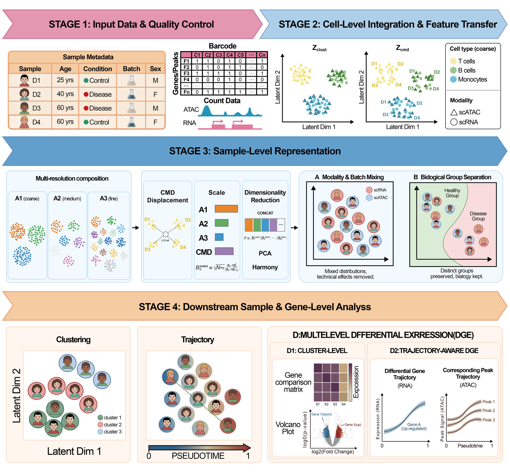

# SampleDisco

**Sample-level representation learning for single-cell multi-omics.**

SampleDisco turns a single-cell cohort (scRNA-seq, scATAC-seq, or unpaired multi-omics) into one embedding with a point per sample, then compares the samples on it: distances, trajectories, clusters and differential tests. One config file runs the whole pipeline.

[Get started](tutorials/quickstart.md){ .md-button .md-button--primary }
[Browse the API](api/index.md){ .md-button }

## How it works

- **Preprocess.** QC, then two cell-level embeddings: `Z_comp` with sample differences removed and `Z_rmd` with them kept. RNA uses PCA + Harmony, ATAC uses TF-IDF/LSI + Harmony, and unpaired modalities are joined by scGLUE (RNA + ATAC) or MaxFuse (RNA + flow cytometry).
- **Cell types.** Leiden clustering on `Z_comp`, merged down to a target number of types, or your own labels.
- **Sample embedding.** Cell-type composition at several resolutions, plus each sample's within-cell-type shift from a reference (RMD) on `Z_rmd`. The blocks are weighted, stacked and reduced by PCA into `adata.uns['X_DR_sample']`.
- **Downstream.** Sample distances, a trajectory (CCA or TSCAN) with trajectory DGE, sample clustering, proportion tests, RAISIN DGE and association with metadata. Phenotype prediction is one extra Python call.

## Install

Create the recommended conda environment, or run `pip install "sampledisco[all]"`; see [Installation](installation.md).

## Start here

1. [Download the demo data](tutorials/demo_data.md): COVID-19 PBMC RNA + ATAC, and a Sound Life RNA + flow cytometry subset.
2. [Quick start](tutorials/quickstart.md): the whole pipeline from one config file.
3. [RNA](tutorials/rna.md): the same steps one by one in Python.
4. [ATAC](tutorials/atac.md)
5. [RNA + ATAC (scGLUE)](tutorials/multiomics.md)
6. [RNA + flow cytometry (MaxFuse)](tutorials/multiomics_maxfuse.md)
7. [Downstream analysis](tutorials/downstream/index.md)

Options and details are in the Advanced pages, starting with the [Configuration guide](tutorials/configuration.md) and [Using your own data](tutorials/own_data.md).

## Data and citation

- The demo data are on Zenodo ([10.5281/zenodo.22549610](https://doi.org/10.5281/zenodo.22549610)) under CC BY-NC 4.0, for noncommercial use. [Demo data](tutorials/demo_data.md#citation) lists what to cite.
- A manuscript describing SampleDisco is in preparation. A citation will be added here once the preprint is posted.
