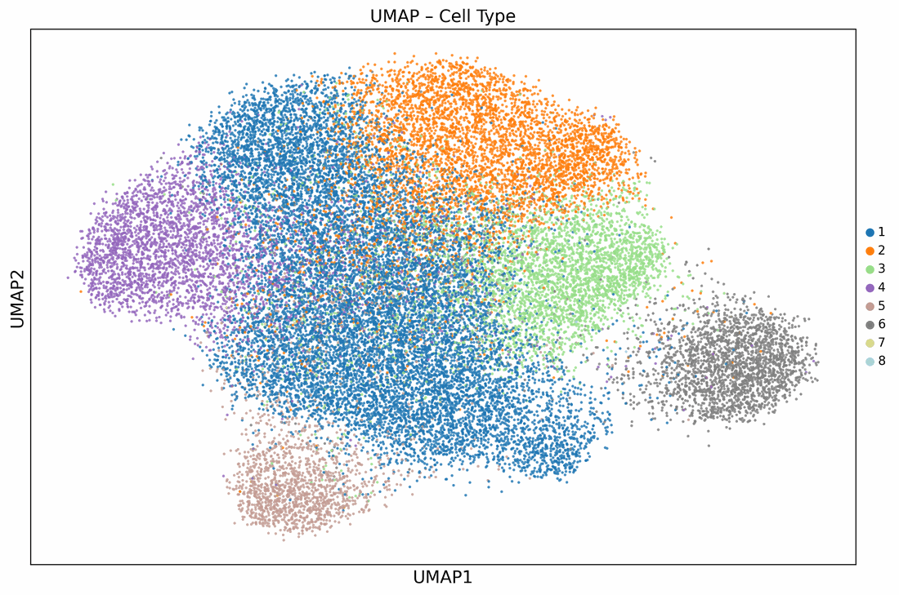

# ATAC pipeline, step by step (Python API)

This page runs the scATAC-seq branch of SampleDisco one function at a time, from the cell × peak count matrix to the sample embedding. It reproduces the ATAC part of the demo config (`sampledisco --init-config`, the same file as [`config_demo.yaml`](../assets/config_demo.yaml)) with the **same functions and parameter values** that `atac_wrapper` uses.

The steps match the [RNA page](rna.md); only preprocessing differs:

1. **`preprocess`** (ATAC version) → TF-IDF, LSI and two Harmony passes: `obsm['Z_comp']` (sample removed) and `obsm['Z_rmd']` (sample differences kept).
2. **`cell_types`** → Leiden clusters on `Z_comp`, merged to 8 cell types, plus a UMAP. This is the same function the RNA branch uses.
3. **`compute_sample_embedding`** → one row per sample in `uns['X_DR_sample']`. It has no ATAC-specific options.

Everything after the embedding is shared with RNA and lives in [Downstream analysis](downstream/index.md).

!!! tip "Prefer one command?"
    The [quick start](quickstart.md) runs this branch, plus the downstream analyses, from the demo config. The table at the end of this page maps every argument below to its config key.

!!! note "Imports and GPU"
    - Import each function from its module, as below. Of the subpackages, only `sampledisco.sample_embedding` and `sampledisco.sample_prediction` re-export anything.
    - Cell typing uses `cell_types` from `sampledisco.preparation.cell_type_cpu`, the function `atac_wrapper` calls. The older `cell_types_atac` (`sampledisco.preparation.ATAC_cell_type`) is not part of the pipeline: it builds its graph differently and saves to a different file.
    - This page runs on CPU. The GPU versions are `preprocess_gpu` (`sampledisco.preparation.atac_preprocess_gpu`), `cell_types_gpu` (`sampledisco.preparation.cell_type_gpu`) and `compute_sample_embedding(..., use_gpu=True)`. **Having RAPIDS installed does not turn them on**: call them yourself and pass `use_gpu=True`, or set `use_gpu: true` in the config (Linux only). Pass every argument by keyword, because `preprocess_gpu` orders its arguments differently. Also pass `sample_level_batch_key=None` explicitly: `preprocess_gpu` defaults it to `"batch"`, a column the ATAC demo does not have. See [GPU acceleration](gpu.md).

## Inputs

Run everything on this page from one empty folder. Download the demo ATAC file (260 MB) into `./data/`:

```bash
mkdir -p data
curl -fL -o data/test_ATAC.h5ad "https://zenodo.org/records/24451067/files/test_ATAC.h5ad?download=1"
```

`test_ATAC.h5ad` holds raw counts for 29,021 cells × 230,356 peaks from 8 samples (SRA runs; see [Demo data](demo_data.md)). Its `.obs` carries:

- `sample`: the sample ID (8 samples, 1,006 to 7,351 cells each);
- `sev.level`: the phenotype, `1` (healthy) or `4` (severe COVID-19), 4 samples each;
- per-cell QC columns from Cell Ranger and Signac.

It has **no batch column**, so, like the demo config, this page uses no batch covariate. No metadata CSV is needed.

All output goes to `sampledisco_demo_output/atac/`, the folder the config-driven run uses. Running the quick start in the same folder overwrites it.

## 1. Preprocessing

```python
from sampledisco.preparation.atac_preprocess_cpu import preprocess

OUT = "sampledisco_demo_output/atac"

adata = preprocess(
    h5ad_path="data/test_ATAC.h5ad",
    sample_meta_path=None,            # sample and sev.level are already in .obs
    output_dir=OUT,
    sample_column="sample",
    cell_level_batch_key=None,        # the ATAC demo has no batch column
    sample_level_batch_key=None,
    min_cells=10,
    min_features=200,
    max_features=50000,
    min_cells_per_sample=50,
    exclude_features=None,
    doublet_detection=False,
    num_cell_hvfs=10000,
    cell_embedding_num_PCs=30,
    num_harmony_iterations=20,
    tfidf_scale_factor=10000.0,
    log_transform=True,
    drop_first_lsi=True,
    verbose=True,
)
print(adata.shape)
print({k: adata.obsm[k].shape for k in sorted(adata.obsm.keys())})
```

What happens, in order:

1. **QC.** Peaks open in fewer than `min_cells` cells are removed, then cells with fewer than `min_features` or more than `max_features` open peaks. With `doublet_detection=True`, Scrublet would then remove doublets per sample; the demo config switches it off. Samples with fewer than `min_cells_per_sample` cells are dropped (none on the demo). Finally, peaks open in fewer than 0.1 % of the cells are dropped.
2. **TF-IDF.** The raw counts are kept in `.layers['counts']`. `.X` becomes TF-IDF (muon, scale factor `tfidf_scale_factor`), then `log1p` because `log_transform=True`.
3. **HVFs.** 10,000 highly variable peaks (`num_cell_hvfs`) are selected (`seurat_v3`, with `sample` as the batch key) and flagged in `.var['highly_variable']`; `.X` keeps all peaks.
4. **LSI.** A truncated SVD of the TF-IDF matrix, restricted to the HVFs, gives `cell_embedding_num_PCs` = 30 components, each scaled to unit variance. In scATAC the first LSI component mostly tracks sequencing depth, so `drop_first_lsi=True` drops it: **`X_lsi` has 29 dimensions, not 30**, and so do all the embeddings below. The loadings are in `.varm['LSI']`.
5. **Harmony pass 1 → `Z_comp`.** Harmony runs on `X_lsi` with the `cell_level_batch_key` columns **plus** `sample`. Here that is `sample` alone, so the per-sample variation is removed. Cell typing and the composition blocks use this view. The same matrix is also written under its pre-0.3 name `Z_clust`.
6. **Harmony pass 2 → `Z_rmd`.** A second, sample-naive set of 10,000 HVFs gives a second LSI with the same depth component dropped (`obsm['X_lsi_rmd']`). Pass 2 runs Harmony on it with the `cell_level_batch_key` columns **other than** `sample`. **The ATAC demo has none, so pass 2 is skipped** and `Z_rmd` is the uncorrected `X_lsi_rmd`, which keeps the sample differences the RMD block measures. If your data has a technical batch column, pass it as `cell_level_batch_key=["batch"]` and pass 2 will remove it.

The demo prints (abridged; the Harmony iteration log and a few `FutureWarning`s are left out):

```text
Raw shape: 29021 cells × 230356 features
After initial filtering: 29021 cells × 230300 features
After sample filtering: 29021 cells × 230300 features
Samples remaining: 8
Final shape: 29021 cells × 228367 features
Running TF-IDF normalization...
Applying log1p transformation...
After HVF1 (sample-aware) selection: 10000 flagged / 228367 total features
Running LSI (HVF1) with 30 components (drop_first=True)...
=== [CPU] Harmony pass 1: WITH sample (sample-removed) ===
  batch keys: sample
Running HVF2 (sample-naive) selection...
Running LSI (HVF2/rmd) with 30 components...
=== [CPU] Harmony pass 2: no extra batch covariate → using raw X_lsi_rmd ===
  Z_comp    shape: (29021, 29)
  X_lsi_rmd shape: (29021, 29)
  Z_rmd     shape: (29021, 29)
Wrote sampledisco_demo_output/atac/preprocess/adata_preprocessed.h5ad
(29021, 228367)
{'X_lsi': (29021, 29), 'X_lsi_rmd': (29021, 29), 'Z_clust': (29021, 29), 'Z_comp': (29021, 29), 'Z_rmd': (29021, 29)}
```

Scanpy also warns twice that `flavor='seurat_v3'` "expects raw count data, but non-integers were found": the HVF ranking runs on the TF-IDF matrix, not on counts. The run continues normally.

**Writes →**

- `sampledisco_demo_output/atac/preprocess/adata_preprocessed.h5ad` (860 MB): the cell-level AnnData, 29,021 cells × 228,367 peaks, with `X_lsi`, `Z_comp`, `Z_clust`, `X_lsi_rmd` and `Z_rmd`.

## 2. Cell-type clustering

```python
from sampledisco.preparation.cell_type_cpu import cell_types

adata = cell_types(
    anndata_cell=adata,
    cell_type_column="cell_type",
    existing_cell_types=False,
    n_target_clusters=8,
    umap=True,
    save=True,
    output_dir=OUT,
    defined_output_path=f"{OUT}/preprocess/adata_preprocessed.h5ad",  # the default, written out
    leiden_cluster_resolution=0.8,
    cell_embedding_column=None,       # None = Z_comp
    cell_embedding_num_PCs=30,        # passed by the wrapper; not used for ATAC (see below)
    verbose=True,
)
print(adata.obs["cell_type"].value_counts().sort_index())
```

`cell_types` notices ATAC input because `obsm['X_lsi']` exists. It then builds the 15-neighbor graph with the **cosine** metric on all 29 dimensions of `Z_comp`, and `cell_embedding_num_PCs` is not used. The rest is as for RNA:

- **Hitting the target.** Leiden runs at resolution 0.8. If it finds fewer than `n_target_clusters` clusters, the resolution goes up by 0.5 and Leiden runs again; once it finds more, the cluster centroids are merged by average-linkage hierarchical clustering down to 8. In this run Leiden found exactly 8 clusters at resolution 0.8, so nothing was merged and there is no `obs['cell_type_original']`. Other runs found 7 or 9 (see [Runtime and reproducibility](#runtime-and-reproducibility)).
- **Where the labels go.** Labels are always written to `obs['cell_type']`, numbered from `"1"`. When clusters are merged, the unmerged Leiden labels stay in `obs['cell_type_original']` and the mapping in `uns['cluster_mapping']`.
- **UMAP.** `umap=True` computes `obsm['X_umap']` and saves the plot below.

The demo prints (abridged):

```text
[cell_types] Target=8, resolution=0.80
[cell_types] Found 8 clusters
  [cell_types] Current number of cell types: 8
[cell_types] Saved cell type CSV to sampledisco_demo_output/atac/preprocess/cell_type.csv
[cell_types] Saved sampledisco_demo_output/atac/preprocess/adata_preprocessed.h5ad
cell_type
1    2410
2    6871
3    1847
4    3792
5    3621
6    1670
7    2753
8    6057
Name: count, dtype: int64
```

**Writes →**

- `sampledisco_demo_output/atac/preprocess/cell_type.csv`: one row per cell, columns `cell_id` and `cell_type`;
- `sampledisco_demo_output/atac/preprocess/umap_cell_type.png` (3.2 MB, 300 dpi): the UMAP below;
- `sampledisco_demo_output/atac/preprocess/adata_preprocessed.h5ad`: overwritten, now with `obs['cell_type']`, the neighbor graph and `X_umap`. The file grows to 1.9 GB here.


<div class="figure-caption">Step 2: UMAP of the 29,021 cells from this run, colored by the 8 Leiden cell types. The ATAC cells form a continuum rather than well-separated islands, so the cluster borders move from run to run.</div>

## 3. Sample embedding

```python
from sampledisco.sample_embedding import compute_sample_embedding

adata = compute_sample_embedding(
    adata,
    OUT,
    use_gpu=False,
    sample_col="sample",
    celltype_col="cell_type",
    comp_emb_key=None,                # None = Z_comp
    rmd_emb_key=None,                 # None = Z_rmd
    batch_col=None,                   # no batch column in the ATAC demo
    medium_K=120,
    fine_K=300,
    rmd_dim_per_cluster=8,
    use_clr=False,
    use_rmd=True,
    block_weights=None,
    rmd_weight="equal",
    pca_components=10,
    batch_method="harmony",
    save=True,
    save_cell_adata=True,
    seed=42,
    verbose=True,
)
emb = adata.uns["X_DR_sample"]
print(emb.shape)
print(emb.round(3))
```

The blocks are the same as for RNA (see [RNA, step 3](rna.md#3-sample-embedding) and [Sample embedding in depth](sample_embedding.md)):

| Block | Built from | Demo shape |
| --- | --- | --- |
| A1: coarse composition | fraction of each sample's cells in each of the 8 cell types | 8 × 8 |
| A2: medium composition | soft assignment of the `Z_comp` cells to `medium_K` = 120 k-means centers | 8 × 120 |
| A3: fine composition | the same with `fine_K` centers, capped at cells / 100 = 290 here | 8 × 290 |
| RMD: displacement | per cell type, the sample's mean `Z_rmd` position minus the mean of all **other** samples, reduced by PCA to at most 7 dimensions (8 samples allow 7) | 8 × 56 |

With `batch_col=None` there is a single reference group for the leave-one-out RMD and **no sample-level batch correction**. The log reports "1 groups (group only)", and `batch_method` has no effect. PCA keeps `pca_components` = 10 PCs, capped at samples − 1 = **7**.

The demo prints (abridged):

```text
[sample_embedding] comp_emb=Z_comp, rmd_emb=Z_rmd
[sample_embedding] 8 units; 29021 cells; comp_emb dim=29
[A1] coarse cell-type composition: shape=(8, 8)
[A2/A3] MiniBatchKMeans K=120 and K=290...
[A2] shape=(8, 120)
[A3] shape=(8, 290)
  [RMD] shape=(8, 56)
[sample_embedding] weights=[6.021, 1.555, 1.0, 6.3] (n_blocks=4)
  [batch correction] 1 groups (group only)
[sample_embedding] done in 2.62s; shape=(8, 7)
(8, 7)
                  PC1     PC2    PC3    PC4    PC5    PC6    PC7
sample
SRR14466464     4.107   0.342  3.083  1.222  0.178  1.735 -1.951
SRR14466466     6.987  -1.469  1.589 -0.845  2.036  1.203  1.795
SRR14466470     3.899   0.260  0.868 -2.827 -3.816 -0.393  0.187
SRR14466479    -0.764   2.674 -7.781 -0.003  0.011  1.151 -0.148
SRR14466481    -9.184 -10.173  0.103 -0.395  0.089  0.133 -0.076
SRR14466482    -9.992   8.085  2.705 -1.185  0.881 -0.151  0.208
SRR14466483     0.080   0.863  0.493  4.843 -1.362 -0.941  0.820
re_SRR14466471  4.868  -0.581 -1.059 -0.811  1.984 -2.737 -0.834
```

The weights follow the same formula as for RNA with K_fine = 290: √(290/8) = 6.02, √(290/120) = 1.55, 1, and α = 6.30.

**Writes →**

- `adata.uns['X_DR_sample']`: a `pandas.DataFrame`, samples × PCs (8 × 7 here), plus the settings in `adata.uns['sample_embedding_params']`;
- `sampledisco_demo_output/atac/sample_embedding/sample_embedding.csv`: the same table;
- `sampledisco_demo_output/atac/sample_embedding/sample_embedding_blocks.npz`: the four blocks before weighting (`A1`, `A2`, `A3`, `RMD`) with `unit_ids` and `A1_cell_types`;
- `sampledisco_demo_output/atac/preprocess/adata_preprocessed.h5ad`: updated in place with the two `uns` entries.

## 4. Check the result

```python
import numpy as np
import pandas as pd
from sampledisco.sample_embedding.sample_embedding import build_sample_adata

emb_csv = pd.read_csv(f"{OUT}/sample_embedding/sample_embedding.csv", index_col=0)
blocks = np.load(f"{OUT}/sample_embedding/sample_embedding_blocks.npz")
print(emb_csv.shape, {k: blocks[k].shape for k in ["A1", "A2", "A3", "RMD"]})

sample_adata = build_sample_adata(adata, sample_col="sample")
print(sample_adata.obs[["sev.level"]])
```

```text
(8, 7) {'A1': (8, 8), 'A2': (8, 120), 'A3': (8, 290), 'RMD': (8, 56)}
                sev.level
sample
SRR14466464             4
SRR14466466             4
SRR14466470             4
SRR14466479             1
SRR14466481             1
SRR14466482             1
SRR14466483             1
re_SRR14466471          4
```

## Runtime and reproducibility

**Runtime.** The outputs on this page come from a plain `pip install` environment, where Harmony runs through `harmonypy`. There, on 8 cores of a recent Intel node, the whole page took 2 min 38 s and peaked at 5.9 GB of RAM: preprocessing 99 s (5.7 GB), cell typing with the UMAP 52 s, the sample embedding 3 s. On an older Intel node (Xeon E5 v3) the same page took 6 min 6 s with the same memory. The config-driven ATAC run (demo config with `run_rna_pipeline: false`), which also runs the downstream analyses, took 6 min 46 s and 7 min 4 s on the older nodes and peaked at 5.8 GB. The output folder takes about 2 GB, almost all of it the h5ad.

In the all-in-one CPU conda environment, Harmony runs through `harmony-pytorch`, which uses every physical core of the machine regardless of your job's allocation (see the [RNA page](rna.md#runtime-and-reproducibility)). With 8 cores allocated on shared nodes, the page took 6 min 49 s and 9 min 55 s, with preprocessing at 5.8 and 8.8 minutes. Peak RAM was 5.2–5.5 GB.

**Does this page reproduce the config run?** Yes, as closely as the config run reproduces itself. In the pip environment, we ran this page twice and the config-driven run twice, each in a fresh folder on 8 cores, and compared every pair. All four gave 8 cell types and an 8 × 7 `X_DR_sample` with the same block shapes. Three runs found 8 Leiden clusters at resolution 0.8 and one found 9; an earlier run of the demo config (with sampledisco 0.5.0, whose ATAC code is the same) found 7, retried at resolution 1.3, found 22 and merged them to 8.

| Runs compared | Cell-type agreement (ARI) | Procrustes disparity | Sample-distance correlation |
| --- | --- | --- | --- |
| This page vs the config runs, same CPU type | 0.50–0.65 | 0.001 | 0.998–0.999 |
| Config run 1 vs config run 2, same CPU type | 0.52 | 0.001 | 0.999 |
| This page, run 1 vs run 2 (two CPU types) | 0.43 | 0.007 | 0.990 |
| Worst value over all six pairs | 0.42 | 0.007 | 0.990 |

The columns are defined as on the [RNA page](rna.md#runtime-and-reproducibility).

Two things stand out:

- **The ATAC cell-type borders are not stable.** The demo ATAC cells form a continuum (see the UMAP above), so Leiden has no clear borders to find. `harmonypy` is not bit-reproducible with several threads, and its tiny run-to-run differences (up to 0.003 here) are enough to move the borders. Two runs on the same CPU type agreed only at ARI 0.50–0.65. Given an identical `Z_comp`, `cell_types` itself is deterministic: we got ARI 1.0. Given two Harmony runs on the same `X_lsi`, it gave ARI 0.26.
- **The sample embedding is stable anyway.** Across all four runs the 8 × 7 embeddings agree at Procrustes disparity ≤ 0.007, and the sample-to-sample distances correlate at ≥ 0.99. The embedding is far more stable than the labels it is partly built from.

On a different CPU type, the LSI components can also come out with flipped signs; SVD allows that. In our runs, `X_lsi` on an AVX-512 node matched the other nodes to 0.003 once the signs were aligned. Sign flips do not change the neighbor graph or the embedding.

In the all-in-one environment (`harmony-pytorch`), two runs on two node types found 8 and 10 Leiden clusters. They agreed at ARI 0.37, Procrustes disparity 0.029 and sample-distance correlation 0.978. Against the pip runs above they gave ARI 0.38–0.47 and Procrustes disparity 0.005–0.022.

!!! tip "Exactly reproducible runs"
    - **Plain pip install (`harmonypy`).** We ran this page twice with `OMP_NUM_THREADS=1` (plus `MKL_NUM_THREADS`, `OPENBLAS_NUM_THREADS`, `NUMEXPR_NUM_THREADS` and `NUMBA_NUM_THREADS` set to 1) exported before starting Python, on two different nodes with the same CPU (AMD EPYC 7702). The two runs were bit-identical: same LSI, same cell types, same `X_DR_sample`. Each took 3 min 48 s.
    - **All-in-one environment (`harmony-pytorch`).** For RNA, two runs on the same node were bit-identical with the default settings; see the [RNA page](rna.md#runtime-and-reproducibility).

    With either package, a different machine can still give different numbers.

## Equivalent config keys

The config-driven run (`sampledisco --config`) calls the same three functions through `atac_wrapper` (`sampledisco/wrapper/atac_wrapper.py`). This table shows where each argument on this page comes from. The values are those of the demo config.

| Call | Argument on this page | Config key | Demo value |
| --- | --- | --- | --- |
| *(all)* | run the step at all | `atac_preprocessing`, `atac_cell_type_cluster`, `atac_derive_sample_embedding` | `true` |
| *(all)* | `output_dir` / `OUT` | `atac_output_dir` (empty = `{output_dir}/atac`) | empty, so `./sampledisco_demo_output/atac` |
| `preprocess` | `h5ad_path` | `atac_count_data_path` | `./data/test_ATAC.h5ad` |
| `preprocess` | `sample_meta_path` | `atac_sample_meta_path` | empty |
| `preprocess` | `cell_meta_path` (not set here) | `atac_cell_meta_path` | empty |
| `preprocess` | `sample_column` | `atac_sample_col` | `sample` |
| `preprocess` | `cell_level_batch_key` | `atac_cell_level_batch_key` | empty |
| `preprocess` | `sample_level_batch_key` | `atac_sample_level_batch_col` | empty |
| `preprocess` | `min_cells`, `min_features`, `max_features` | `atac_min_cells`, `atac_min_features`, `atac_max_features` | 10, 200, 50000 |
| `preprocess` | `min_cells_per_sample` | `atac_min_cells_per_sample` | 50 |
| `preprocess` | `exclude_features` | `atac_exclude_features` | empty |
| `preprocess` | `doublet_detection` | `atac_doublet_detection` | `false` |
| `preprocess` | `num_cell_hvfs` | `atac_num_cell_hvfs` | 10000 |
| `preprocess`, `cell_types` | `cell_embedding_num_PCs` | `atac_cell_embedding_num_pcs` | 30 |
| `preprocess` | `num_harmony_iterations` | `atac_num_harmony_iterations` | 20 |
| `preprocess` | `tfidf_scale_factor`, `log_transform`, `drop_first_lsi` | `atac_tfidf_scale_factor`, `atac_log_transform`, `atac_drop_first_lsi` | 10000.0, `true`, `true` |
| `cell_types` | `cell_type_column` | `atac_celltype_col` | `cell_type` |
| `cell_types` | `existing_cell_types` | `atac_existing_cell_types` | `false` |
| `cell_types` | `n_target_clusters` | `atac_n_target_cell_clusters` | 8 |
| `cell_types` | `umap` | `atac_umap` | `true` |
| `cell_types` | `leiden_cluster_resolution` | `atac_leiden_cluster_resolution` | 0.8 |
| `cell_types` | `cell_embedding_column` | `atac_cell_embedding_column` | empty (= `Z_comp`) |
| `cell_types` | `save=True`, output path | fixed in the wrapper (default path) | – |
| `compute_sample_embedding` | `use_gpu` | `use_gpu` (Linux only) | `false` |
| `compute_sample_embedding` | `sample_col`, `celltype_col` | `atac_sample_col`, `atac_celltype_col` | `sample`, `cell_type` |
| `compute_sample_embedding` | `comp_emb_key`, `rmd_emb_key` | resolved from `atac_cell_embedding_column` | empty (= `Z_comp`, `Z_rmd`) |
| `compute_sample_embedding` | `batch_col` | `atac_sample_level_batch_col` | empty |
| `compute_sample_embedding` | `medium_K`, `fine_K` | `atac_sample_embedding_medium_K`, `atac_sample_embedding_fine_K` | 120, 300 |
| `compute_sample_embedding` | `rmd_dim_per_cluster` | `atac_sample_embedding_rmd_dim` | 8 |
| `compute_sample_embedding` | `use_clr`, `use_rmd` | `atac_sample_embedding_use_clr`, `atac_sample_embedding_use_rmd` | `false`, `true` |
| `compute_sample_embedding` | `block_weights` | `atac_sample_embedding_block_weights` | empty |
| `compute_sample_embedding` | `rmd_weight` | `atac_sample_embedding_rmd_weight` | `"equal"` |
| `compute_sample_embedding` | `pca_components` | `atac_sample_embedding_pca_components` | 10 |
| `compute_sample_embedding` | `batch_method` | `atac_sample_embedding_batch_method` | `harmony` |
| `compute_sample_embedding` | `save_cell_adata` | `atac_save_cell_adata_after_embedding` | `true` |
| `compute_sample_embedding` | `seed` | `random_state` | 42 |
| *(all)* | `verbose` | `verbose` | `true` |

With `atac_autotune_enable: true`, the wrapper calls `run_autotune` instead of `compute_sample_embedding` to choose `rmd_weight` (see [Autotune](downstream/autotune.md)).

---

## Next: downstream analysis

Continue with [Downstream analysis](downstream/index.md). The calls are the same as for RNA; point them at `sampledisco_demo_output/atac/preprocess/adata_preprocessed.h5ad` or at the in-memory `adata` from this page. On the 8-sample demo, CCA scores, p-values and prediction accuracy are degenerate or noisy. The [Sound Life RNA tutorial](soundlife_rna.md) (32 samples) shows them on a cohort large enough to mean something.
