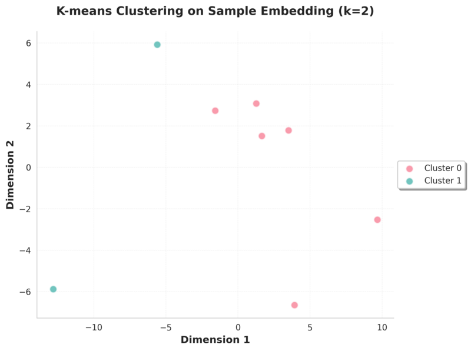

# Sample clustering

`cluster` runs k-means on the sample embedding and returns `{sample: cluster}`. It reads `uns['X_DR_sample']` (or `obsm['X_DR_sample']` if the `uns` key is missing) and uses all of its PCs. The clusters feed the [proportion test](proportion_test.md) and [RAISIN](raisin_dge.md) through their `sample_to_clade` argument.

Run the [setup block](index.md#before-you-start) first.

## Call

```python
import pandas as pd
from sampledisco.sample_clustering.cluster import cluster

sample_clusters, _ = cluster(
    pseudobulk_adata=pseudo_adata,
    output_dir=OUT,
    number_of_clusters=2,       # 3 (the demo config) leaves single-sample clusters here
    random_state=0,
)
print(pd.Series(sample_clusters).sort_values())
print(pd.crosstab(pseudo_adata.obs["cluster_sample_kmeans"], pseudo_adata.obs["sev.level"]))
```

```text
[INFO] K-means output directory: sampledisco_demo_output/rna/sample_cluster
[INFO] Running K-means on 'X_DR_sample', shape=(8, 7)
[INFO] Saved sample clustering CSV: sampledisco_demo_output/rna/sample_cluster/kmeans_clusters_sample.csv
[INFO] Saved plot: sampledisco_demo_output/rna/sample_cluster/kmeans_sample_embedding.png
[INFO] K-means clustering completed.
CoV-3-Wilk      0
CoV-36-Aruna    0
HD-20-Aruna     0
HD-1-Wilk       0
HD-21-Aruna     0
HD-4-Wilk       0
CoV-4-Wilk      1
CoV-34-Aruna    1
dtype: int64
sev.level              1  4
cluster_sample_kmeans
0                      4  2
1                      0  2
```

K-means splits off two severe samples, `CoV-4-Wilk` and `CoV-34-Aruna`, the two with the lowest PC1; cluster 0 holds the four healthy and the other two severe samples. The clusters follow the main axes of variation in the embedding, which need not be the phenotype.

!!! tip "Pick k so that no cluster is a single sample"
    The proportion test and RAISIN compare clusters pairwise and need at least 2 samples per cluster; both skip a pair with a single-sample cluster (RAISIN since 0.6.0; see [RAISIN](raisin_dge.md)). With 8 samples, keep k small and check the cluster sizes before you go on. On our embedding, k = 3 (the demo config's value) gave clusters of 6, 1 and 1 samples, and the proportion test then skipped all three pairs; k = 4 gave 4, 2, 1 and 1. k = 2 gave 6 and 2 for every seed we tried.

`cluster` returns a pair of identical dicts (a leftover of an older version with two embeddings; `use_expression` and `use_proportion` are ignored). It also writes the labels into `pseudo_adata.obs['cluster_sample_kmeans']`.

**Writes** → `sampledisco_demo_output/rna/sample_cluster/`:

- `kmeans_clusters_sample.csv`: columns `sample`, `cluster_sample_kmeans`;
- `kmeans_sample_embedding.png`: the samples on the first two PCs, colored by cluster.


<div class="figure-caption"><code>sample_cluster/kmeans_sample_embedding.png</code>: the samples on PC1 and PC2, colored by k-means cluster (k = 2).</div>

## In the config

`rna_sample_cluster: true` with `rna_cluster_number` (3 in the demo, 4 by default) writes `rna/sample_cluster/`, and passes the clusters to the proportion test and RAISIN unless `rna_cluster_differential_gene_group_col` is set.

The call took about 2 s; the session peaked at 1.4 GB, almost all of it the loaded cell-level `adata`.

See the [API page](../../api/downstream/cluster.md) for every parameter.
