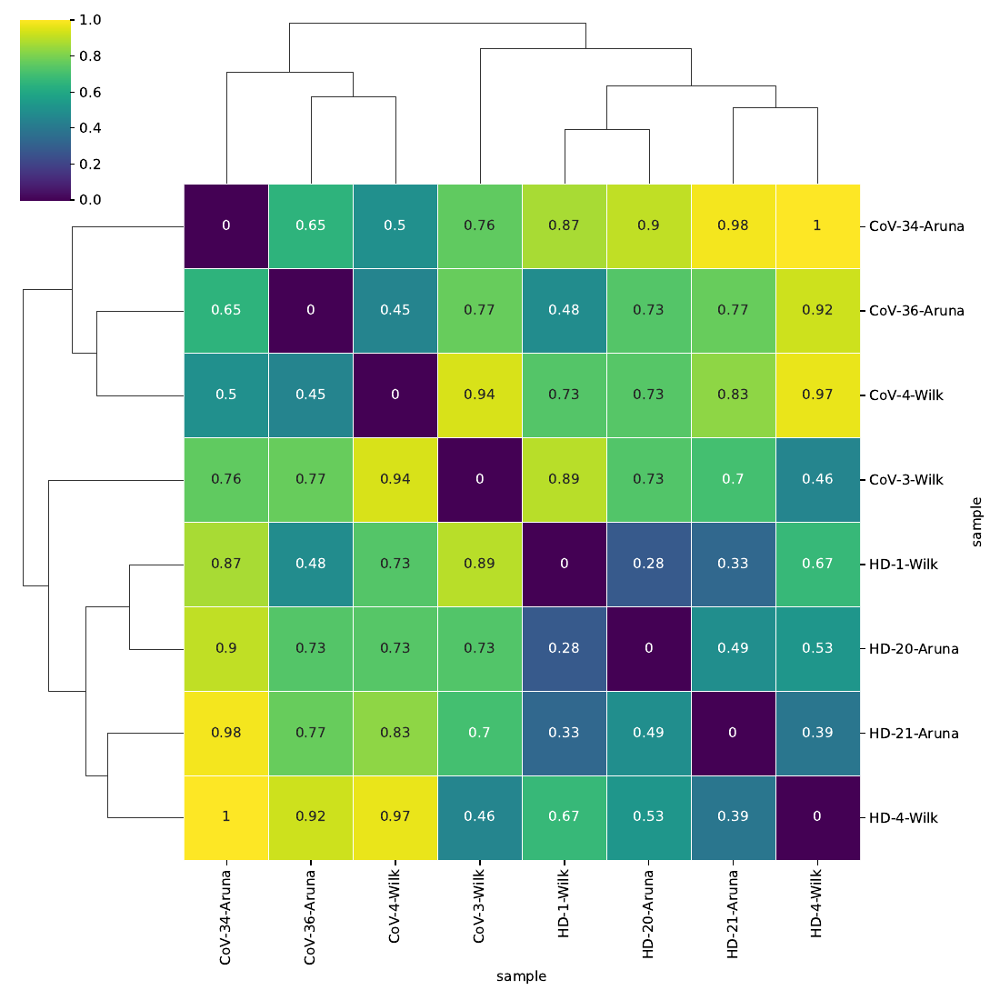
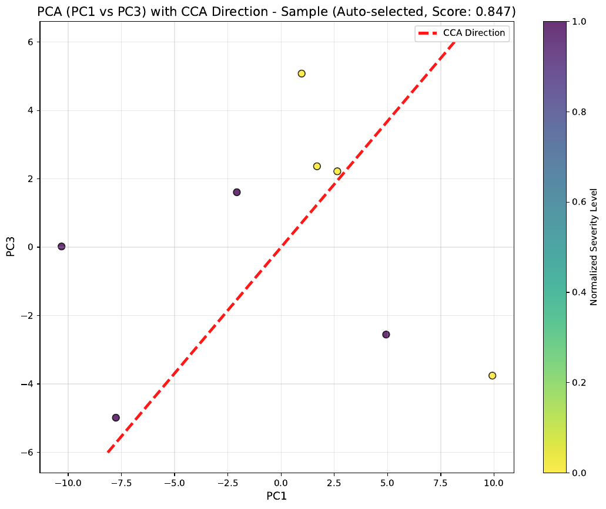

# Downstream analysis

Every downstream function reads the sample embedding `uns['X_DR_sample']` (samples × PCs) that the [RNA tutorial](../rna.md) or the [Quick start](../quickstart.md) stores in the cell-level AnnData. This page runs each analysis once on the 8-sample COVID demo (4 healthy, `sev.level = 1`; 4 severe, `sev.level = 4`). The calls are the same for ATAC and multi-omics; only the input file changes. Each section ends with a collapsed **Options and caveats** block for its settings and config keys.

!!! warning "8 samples is enough to run everything, not to conclude anything"
    With 8 samples, p-values sit at their floor, CCA fits almost any labels and no gene passes FDR. Use the demo to learn the calls and the files. The limits are listed under [Small cohorts](#small-cohorts).

## Setup

Run from the folder that holds `sampledisco_demo_output/`, in one Python session for the whole page:

```python
import anndata as ad
from sampledisco.sample_embedding.sample_embedding import build_sample_adata

OUT = "sampledisco_demo_output/rna"
adata = ad.read_h5ad(f"{OUT}/preprocess/adata_preprocessed.h5ad")  # cells x genes, with uns['X_DR_sample']
pseudo_adata = build_sample_adata(adata, sample_col="sample")      # one row per sample
print(adata.shape, pseudo_adata.shape)
print(pseudo_adata.obs["sev.level"].to_dict())
```

```text
[build_sample_adata] dropped 10 obs column(s) that vary within a sample (per-cell values): ['celltype', 'old', 'large', 'n_genes', 'n_genes_by_counts', 'total_counts', 'total_counts_mt', 'pct_counts_mt', 'cell_type', 'cell_type_original']
(29988, 12301) (8, 7)
{'CoV-3-Wilk': 4, 'CoV-34-Aruna': 4, 'CoV-36-Aruna': 4, 'CoV-4-Wilk': 4, 'HD-1-Wilk': 1, 'HD-20-Aruna': 1, 'HD-21-Aruna': 1, 'HD-4-Wilk': 1}
```

`adata` (cells) feeds the steps that need expression or cell types: EMD, trajectory DGE, the proportion test, RAISIN and the dendrogram. `pseudo_adata` (one row per sample, sample-level `obs` columns only) feeds everything else. The embedding has 7 PCs: SampleDisco caps the PC count at n_samples − 1. The whole page runs in about 4 to 6 minutes (the trajectory DGE takes about 1.5) and needs about 5 GB of RAM on 8 CPUs.

## What runs where

The config run (`sampledisco --config config.yaml`) runs these stages after the sample embedding, all through [`downstream_analysis`](../../api/pipeline/downstream_analysis.md). Flags carry the `rna_` prefix (`atac_` and `multiomics_` for the other branches), and folders are relative to `sampledisco_demo_output/rna/`.

| Analysis | Config flag | Python function | Output folder |
| --- | --- | --- | --- |
| [Sample distance](#sample-distance) | `rna_sample_distance_calculation` | `sample_distance` | `Sample_distance/<method>/` |
| [Dimension association](#dimension-association) | `rna_dimension_association_analysis` | `run_dimension_association_analysis` | `sample_association/` |
| [Trajectory: CCA](#trajectory) | `rna_trajectory_analysis`, `rna_trajectory_supervised: true`; `rna_cca_pvalue` | `CCA_Call`; `cca_pvalue_test` | `CCA/`; `CCA_test/` |
| [Trajectory: TSCAN](#trajectory) | `rna_trajectory_analysis`, `rna_trajectory_supervised: false` | `TSCAN` | `TSCAN/` |
| [Trajectory DGE](#trajectory-dge) | `rna_trajectory_dge` | `run_trajectory_gam_differential_gene_analysis` | `trajectoryDEG/` |
| [Sample clustering](#clustering) | `rna_sample_cluster` | `cluster` | `sample_cluster/` |
| [Proportion test](#clustering) | `rna_proportion_test` | `proportion_test` | `sample_cluster/proportion_test/` |
| [RAISIN DGE](#clustering) | `rna_cluster_dge` | `raisinfit`, `run_pairwise_tests` | `raisin_results/` |
| [Prediction, label transfer](#prediction) | none (Python only) | `predict_phenotype`, `transfer_labels` | none: they return tables |
| [Visualization](#visualization) | `rna_visualize_data` | `visualization` | `visualization/` |
| [Autotune α](#autotune) | `rna_autotune_enable` | `run_autotune` | `sample_embedding/` |

**To rerun only these stages**, set `rna_preprocessing`, `rna_cell_type_cluster` and `rna_derive_sample_embedding` to `false`: the run then reads `rna/preprocess/adata_preprocessed.h5ad` (or `rna_adata_cell_path`) and the `uns['X_DR_sample']` stored in it. `downstream_analysis` takes the same settings as the config keys minus the `rna_` prefix. `rna_trajectory_col` and `rna_grouping_columns` default to the demo's `sev.level`; set them to columns of your own data.

## Sample distance {#sample-distance}

`sample_distance` writes a sample × sample distance matrix, a clustered heatmap and a group-separation score (mean distance between groups / within groups; above 1, the groups separate). Cosine works on the embedding; EMD works on cell-type proportions, so it also needs the cells.

```python
from sampledisco.sample_distance.sample_distance import sample_distance

sample_distance(adata=pseudo_adata, output_dir=f"{OUT}/Sample_distance", method="cosine",
                data_type="RNA", grouping_columns=["sev.level"])
sample_distance(adata=pseudo_adata, output_dir=f"{OUT}/Sample_distance", method="EMD",
                cell_adata=adata,               # cells: cell-type proportions and centroids
                pseudobulk_adata=pseudo_adata,  # samples: group labels for the score
                sample_column="sample", cell_type_column="cell_type",
                grouping_columns=["sev.level"])
```

**Output** (under `Sample_distance/`): `cosine/distance_matrix_sample_DR.csv`, `cosine/sample_distance_sample_DR_heatmap.pdf` and the score in `cosine/distance_check_results_sample_DR_cosine.txt`; `EMD_distance/distance_matrix_EMD.csv`, `cell_type_proportions.csv`, `cell_type_centroids.csv` and a heatmap.

On the embedding, healthy samples sit closer to each other than to severe ones (cosine score about 1.4 to 1.5, depending on the machine). On cell-type proportions alone the groups barely separate (EMD score about 1.0).


<div class="figure-caption"><code>Sample_distance/cosine/sample_distance_sample_DR_heatmap.pdf</code>: cosine distances (scaled to a maximum of 1) with hierarchical clustering.</div>

??? note "Options and caveats: all 15 methods"
    One `method` per call. Every matrix is divided by its largest entry, so values run from 0 to 1 and compare only within one method. An unknown name prints a warning and is skipped.

    | Methods | Input | Folder under `Sample_distance/` |
    | --- | --- | --- |
    | `euclidean`, `sqeuclidean`, `minkowski`, `cityblock`, `chebyshev`, `cosine`, `correlation`, `canberra`, `braycurtis`; the binary `hamming`, `jaccard`, `matching` (of little use on PCs) | `pseudo_adata` (`scipy` `pdist` on `X_DR_sample`) | `<method>/` |
    | `EMD`: earth mover's distance between cell-type proportions; the ground distance is between cell-type centroids in the first `n_pcs` (20) dimensions of `embedding_key` (`Z_comp`) | `cell_adata` (+ `pseudobulk_adata` for the score) | `EMD_distance/` |
    | `chi_square`, `jensen_shannon`: distances between the proportion vectors | `cell_adata` (+ `pseudobulk_adata`) | `<method>/proportion_DR_distance/` |

    The embedding methods also write `distance_statistics_summary_<method>.csv`. In the config, `rna_sample_distance_methods` lists the methods (the demo uses `["cosine", "correlation"]`); the config run passes the cells, so the proportion methods work there too. With `rna_summary_sample_csv_path` set, each score is also added to that CSV.

## Dimension association {#dimension-association}

`run_dimension_association_analysis` reports how much of each PC's variance every sample-level variable explains (R², with a permutation p-value and an FDR).

```python
from sampledisco.sample_association.association import run_dimension_association_analysis

assoc = run_dimension_association_analysis(
    pseudo_adata=pseudo_adata, output_dir=f"{OUT}/sample_association",
    continuous_cols=[], categorical_cols=["sev.level", "batch"],  # unset: every obs column is tested
    n_permutations=999, sample_col="sample", random_state=42,
)
table = assoc["results"]["X_DR_sample"]
print(table.sort_values("perm_p")[["variable", "component", "r2", "perm_p", "fdr"]].head(3))
```

```text
...
     variable component        r2  perm_p    fdr
13      batch       PC7  0.549981   0.022  0.3080
0   sev.level       PC1  0.380275   0.154  0.7056
3   sev.level       PC4  0.266232   0.231  0.7056
```

**Output** (under `sample_association/`): `variance_explained_sample.csv` (one row per variable × PC), `figures/sample_variance_heatmap.pdf` and `figures/sample_top_associations.pdf`. On the demo, severity explains over a third of the variance of PC1, but with 8 samples nothing survives the FDR.

??? note "Options and caveats"
    - **Model.** Each (variable, PC) pair gets a least-squares fit: the squared Pearson correlation for a continuous variable, the ANOVA η² for a categorical one (one-hot). Each R² gets a permutation p-value (`n_permutations`) and a Benjamini–Hochberg FDR.
    - **Config.** `rna_association_continuous_cols` and `rna_association_categorical_cols` (both empty in the demo, which means auto), `rna_association_n_permutations` (99 in the demo).

## Trajectory: CCA, then TSCAN {#trajectory}

CCA (supervised) finds the direction in the first `K` PCs that correlates best with a numeric phenotype and gives every sample a pseudotime along it. `cca_pvalue_test` compares the score with label permutations; pass the same `K` as `n_pcs`.

```python
from sampledisco.sample_trajectory.CCA import CCA_Call
from sampledisco.sample_trajectory.CCA_test import cca_pvalue_test

K = 3                                     # PCs used by CCA; keep well below n_samples - 1
score, _, ptime, _ = CCA_Call(adata=pseudo_adata, output_dir=OUT,
                              trajectory_col="sev.level", n_components=K)
p = cca_pvalue_test(pseudo_adata=pseudo_adata, column="X_DR_sample", input_correlation=score,
                    output_directory=OUT, num_simulations=1000, trajectory_col="sev.level",
                    n_pcs=K)              # must equal n_components
print(f"CCA score on PC1-PC{K}: {score:.3f}, permutation p = {p:.3f}")
```

The output has the form:

```text
[CCA] Flipped pseudotime so it increases with 'sev.level' (Spearman rho before flip: ...)
P-value for observed correlation ...: ... [(1 + k) / (1000 + 1)]
CCA score on PC1-PC3: ..., permutation p = ...
```

The pseudotime `ptime` (`{sample: value}` in [0, 1]) is oriented to increase with `sev.level`. Expect a high CCA score and a small but not tiny p-value: with a 4 + 4 design an exact test cannot go below 1/35 ≈ 0.029, so the demo cannot show a strong effect. The exact numbers depend on the machine (see [run-to-run variation](../own_data.md#run-to-run-variation)).

TSCAN (unsupervised) orders the samples without a phenotype: it clusters them (a Gaussian mixture; `n_clusters=None` picks the number by BIC), joins the clusters with a minimum spanning tree and follows its longest path. Use CCA when you have a phenotype to follow (severity, age, time point), and TSCAN when you have none or want to see whether one emerges.

```python
from sampledisco.sample_trajectory.TSCAN import TSCAN

tscan = TSCAN(AnnData_sample=pseudo_adata, column="X_DR_sample", n_clusters=3, output_dir=OUT,
              grouping_columns=["sev.level"],  # colors a plot and orients the path
              origin=None, pseudotime_mode="rank")
print("cluster path:", tscan["main_path"], "origin:", tscan["origin"])  # e.g. [0, 2, 1], origin 0
```

**Output**: `CCA/pca_3d_cca_sample.pdf` (the samples on the PC pair best aligned with `sev.level`), `CCA/pseudotime_sample.csv`, `CCA_test/cca_pvalue_result_X_DR_sample.txt`, and `TSCAN/clusters_by_cluster_X_DR_sample.png`, `clusters_by_grouping_X_DR_sample.png` and `X_DR_sample_pseudotime.csv`. TSCAN's main path runs through all 3 clusters (0-based labels, which can change between machines), starting at the end with the lower mean `sev.level`; its pseudotime is in `tscan["pseudotime"]["main_path"]`.


<div class="figure-caption"><code>CCA/pca_3d_cca_sample.pdf</code>: the 8 samples on PC1 and PC3, colored by severity, with the CCA direction.</div>

??? note "Options and caveats"
    - **CCA: `trajectory_col` must be numeric.** It goes through `pd.to_numeric`; samples whose value cannot be converted are dropped from the score and the null.
    - **CCA score, plot and pseudotime.** The score uses all of the first `n_components` PCs. The plot and the pseudotime use only the PC pair with the highest canonical correlation (`auto_select_best_2pc=True`); the pseudotime is scaled to [0, 1] and reversed when needed (the `Flipped pseudotime` line).
    - **CCA p-value.** `cca_pvalue_test` refits the CCA on the first `n_pcs` PCs for `num_simulations` = N permutations and is (1 + k) / (N + 1), where k permuted scores reach the observed one. At the default `n_pcs=2` with a larger `n_components`, the null uses fewer PCs than the score and the p-value sits at its minimum, 1/(N + 1), whatever the data.
    - **`CCA_Call` returns** `(score, score, pseudotime, pseudotime)`; on failure `(nan, nan, {}, {})` instead of raising, so check the score.
    - **CCA config.** `rna_trajectory_supervised: true`, `rna_trajectory_col` (default `"sev.level"`), `rna_n_cca_pcs`; `rna_cca_pvalue: true` adds the test with `n_pcs = rna_n_cca_pcs`.
    - **TSCAN `origin`** picks which end of the main path is time 0: the 0-based index of one of the two endpoint clusters, or the call raises. With `origin=None`, TSCAN starts at the endpoint whose samples have the lower mean of the first numeric column in `grouping_columns`; without one, at the endpoint with the lower index.
    - **TSCAN `pseudotime_mode`**: `"rank"` gives the i-th of n ordered samples i/(n − 1); `"distance"` uses the cumulative distance along the path in the embedding, scaled to [0, 1].
    - **TSCAN side branches.** Samples in clusters off the main path get `NaN` in `obs['tscan_pseudotime_main']` and a branch pseudotime in `tscan["pseudotime"]["branching_paths"]`.
    - **TSCAN config.** `rna_trajectory_supervised: false`, with `rna_tscan_n_clusters`, `rna_tscan_origin` and `rna_tscan_pseudotime_mode`; `rna_trajectory_visualization_label` colors the plots.

## Trajectory DGE {#trajectory-dge}

`run_trajectory_gam_differential_gene_analysis` fits a GAM along a pseudotime to each cell type's pseudobulk expression and reports the genes that change.

```python
from sampledisco.sample_trajectory.trajectory_diff_gene import run_trajectory_gam_differential_gene_analysis

dge = run_trajectory_gam_differential_gene_analysis(
    adata,                          # cell level; the pseudobulk is built inside
    pseudotime_source=ptime,        # from CCA_Call; or tscan["pseudotime"]["main_path"]
    sample_col="sample", celltype_col="cell_type", batch_col="batch",
    num_splines=5, spline_order=2,  # the default spline_order=3 fits no gene on 8 samples
    fdr_threshold=0.05, effect_size_threshold=1.0, top_n_genes=100,
    anchor_col="sev.level",         # UP = rises with severity
    output_dir=f"{OUT}/trajectoryDEG", verbose=False,
)
print(f"{len(dge)} features fitted, {(dge['fdr'] < 0.05).sum()} with FDR < 0.05")  # about 41,000, 0
```

**Output** (under `trajectoryDEG/`, `<ts>` a timestamp): `gam_all_genes_<ts>.tsv` (one row per feature, named `<cell type> - <gene>`), `gam_pseudoDEGs_<ts>.tsv`, `gam_summary_<ts>.txt` and plots in `visualizations/`. The call warns that nothing is significant with 8 samples, as expected.

??? note "Options and caveats"
    - **Pseudotime.** `pseudotime_source` takes a `{sample: pseudotime}` dict, a DataFrame, or the path of a CSV/TSV such as `CCA/pseudotime_sample.csv`.
    - **Direction.** `UP` and `DOWN` follow the pseudotime. `anchor_col` names a numeric column and reverses the pseudotime when it runs against it; keep it for TSCAN, whose direction depends on `origin`. The config run sets it for TSCAN only.
    - **Model.** Per cell type, a sample with fewer than 10 cells of that type is left out (`min_cells_per_group`), and a gene is tested when its between-sample variance is at least twice the variance expected from sampling the cells (`min_variance_ratio`). Each feature gets a GAM on all its samples, zeros included, with `batch_col` as an unpenalized fixed effect (the pseudobulk itself is not batch-corrected). The p-value is a Wald test that the spline coefficients are equal, as in tradeSeq, with a BH FDR over all features; the `top_n_genes` largest effects among the features with FDR < `fdr_threshold` are the pseudoDEGs. `n_jobs=-1` fits on every core.
    - **Files.** Each run adds new timestamped tables (`gam_all_genes_`, `gam_significant_`, `gam_pseudoDEGs_`, `gam_summary_`) instead of replacing them. The heatmap and cluster-pattern plots appear only with significant features; `visualization_gene_list` adds one plot per listed gene.
    - **Config.** `rna_trajectory_dge` runs only inside the trajectory stage, with `rna_num_splines`, `rna_spline_order`, `rna_fdr_threshold`, `rna_effect_size_threshold`, `rna_top_n_genes`, `rna_trajectory_diff_gene_covariate` and `rna_visualization_gene_list`.

## Clustering, proportion test and RAISIN {#clustering}

`cluster` runs k-means on the embedding. The proportion test (CLR-transformed cell-type proportions, moderated t-test) and RAISIN (differential expression between groups of samples) then compare the clusters.

```python
import pandas as pd
from sampledisco.sample_clustering.cluster import cluster
from sampledisco.sample_clustering.proportion_test import proportion_test
from sampledisco.sample_clustering.RAISIN import raisinfit
from sampledisco.sample_clustering.RAISIN_TEST import run_pairwise_tests

sample_clusters, _ = cluster(pseudobulk_adata=pseudo_adata, output_dir=OUT,
                             number_of_clusters=2, random_state=0)  # keep every cluster >= 2 samples
print(pd.Series(sample_clusters).value_counts().to_dict())

props = proportion_test(adata=adata, sample_col="sample", sample_to_clade=sample_clusters,
                        celltype_col="cell_type",   # the default is "celltype"
                        output_dir=f"{OUT}/sample_cluster/proportion_test")

fit = raisinfit(adata=adata, sample_col="sample", sample_to_clade=sample_clusters,
                testtype="unpaired", n_jobs=8, verbose=False)
n_sig, tables = run_pairwise_tests(fit=fit, output_dir=f"{OUT}/raisin_results", verbose=False)
print(tables["0_vs_1"].sort_values("pvalue").head(3))
```

```text
...
{0: 6, 1: 2}
...
        Foldchange      stat    pvalue       FDR
RPS14     1.205664  4.077699  0.000045  0.559493
PNISR     0.608640  3.790880  0.000150  0.763767
S100A8   -1.885200 -3.736945  0.000186  0.763767
```

**Output**: `sample_cluster/kmeans_clusters_sample.csv` and `kmeans_sample_embedding.png`; `sample_cluster/proportion_test/proportion_test_0_vs_1.csv` (`logFC`, `p_value`, `FDR` per cell type) and proportion heatmaps; `raisin_results/0_vs_1/raisin_results.csv` (per gene), volcano plots and `summary_plots/`.

K-means splits off two severe samples, and with 8 samples neither test finds anything at FDR < 0.05. RAISIN is the heaviest step: 1 to 3 minutes and up to about 5 GB of RAM on 8 CPUs.

### Phenotype groups instead of clusters {#group-col}

Both tests take their groups from `sample_to_clade` (a `{sample: group}` dict such as the k-means clusters) or from `group_col` (a column of `adata.obs`). **When both are given, `group_col` wins.** The config run passes both: the clusters and `rna_cluster_differential_gene_group_col`. The demo config sets that key to `sev.level`, so its `proportion_test/` and `raisin_results/` compare healthy with severe samples, not clusters. This is that comparison from Python:

```python
by_severity = proportion_test(
    adata=adata, sample_col="sample", group_col="sev.level",  # overrides sample_to_clade
    celltype_col="cell_type", output_dir=f"{OUT}/sample_cluster/proportion_test_sev.level",
)
print(by_severity["1_vs_4"].head(3).round(4).to_string(index=False))

fit_sev = raisinfit(adata=adata, sample_col="sample", group_col="sev.level",
                    testtype="unpaired", n_jobs=8, verbose=False)
n_sig_sev, tables_sev = run_pairwise_tests(fit=fit_sev, output_dir=f"{OUT}/raisin_results_sev.level",
                                           verbose=False)
print(tables_sev["1_vs_4"].sort_values("pvalue").head(3))
```

```text
celltype   logFC  p_value    FDR
       4  1.3111   0.0188 0.1503
       2 -1.1766   0.1152 0.3377
       6  0.7551   0.1634 0.3377
...
      Foldchange      stat    pvalue       FDR
IGKC   -1.403446 -4.183352  0.000029  0.353337
HOPX    0.451075  3.459771  0.000541  1.000000
ENO1   -0.393033 -3.350979  0.000805  1.000000
```

A positive `logFC` or `Foldchange` means higher in the first group (healthy). One cell type reaches a nominal p < 0.05 (which one depends on the cell-type labels of your run), and the immunoglobulin gene IGKC is higher in severe samples, but with 4 samples per group nothing passes FDR < 0.05.

??? note "Options and caveats"
    - **`celltype_col`** of `proportion_test` defaults to `"celltype"`, not `"cell_type"`. The demo h5ad also has a `celltype` column (the original authors' labels), so leaving it unset silently tests different cell types.
    - **Groups need 2 samples.** A group with one sample is listed in `fit["failgroup"]`; `run_pairwise_tests` skips every pair that involves it (with a warning, a `FAILED` file in the pair's folder and a line in `raisin_summary.txt`), and the proportion test skips it too (listed in `proportion_test_significant_summary.txt`). Check the cluster sizes first: on the demo, k = 3 (the demo config's `rna_cluster_number`) gave 6, 1 and 1 samples.
    - **Proportion test output.** One `proportion_test_<g1>_vs_<g2>.csv` per pair (`logFC` is the difference in mean CLR), `proportion_test_significant_summary.txt`, heatmaps (raw, CLR, z-score), a significance matrix, and box plots only for pairs with a cell type at FDR < 0.01.
    - **RAISIN memory.** `raisinfit` makes a dense copy of the cells × genes matrix; with `batch_col`, ComBat corrects the expression first and needs more. The config run uses the first sample-level batch column and `n_jobs=-1` (every core the process may use, capped at `SLURM_CPUS_PER_TASK` in a SLURM job); the demo config leaves `rna_cluster_dge` off.
    - **RAISIN designs.** `testtype` also accepts `"paired"` (with `individual_col`), `"continuous"` and `"custom"` (with `custom_design`); `run_pairwise_tests(control_group=...)` tests every group against one control. `summary_plots/` holds the summary tables and, when some gene is significant, a pseudobulk heatmap and a dot plot.

## Prediction and label transfer {#prediction}

`predict_phenotype` predicts a sample label from the embedding with cross-validation; `transfer_labels` labels new samples from their nearest labelled neighbours. Both return tables, write no files and are not part of the config run.

```python
from sampledisco.sample_prediction import predict_phenotype, transfer_labels

pred, metrics = predict_phenotype(pseudo_adata, label_col="sev.level",
                                  n_splits=4,       # at most the size of the smallest class
                                  random_state=0)
print({k: metrics[k] for k in ("n_samples", "n_pcs", "auc", "balanced_accuracy")})

query = pseudo_adata.obs_names.isin(["CoV-3-Wilk", "HD-4-Wilk"])  # pretend these are unlabelled
table, tmetrics = transfer_labels(pseudo_adata, label_col="sev.level", query=query, n_neighbors=3)
print(table[table["query"]])
```

```text
{'n_samples': 8, 'n_pcs': 7, 'auc': 0.625, 'balanced_accuracy': 0.5}
            label  query  predicted  confidence
sample
CoV-3-Wilk      4   True          1         1.0
HD-4-Wilk       1   True          1         1.0
```

`pred` holds the out-of-fold prediction of every sample, and `table` the transferred labels with their confidence. With 4 samples per class, these scores are noise.

??? note "Options and caveats"
    - **Model.** By default (`model="mlp"`) `predict_phenotype` standardizes the first `n_pcs` PCs and fits a multilayer perceptron (one hidden layer of 100 ReLU units, Adam, L2 weight penalty 10; nothing is tuned) in each of the `n_splits` folds, so every sample is predicted once, by a model that did not see it. `task="regression"` predicts a continuous label. For cohorts of tens of samples, `model="knn"` takes the majority label of the `n_neighbors` nearest training samples instead and fits no parameters; on the 8-sample demo the MLP's penalty keeps every probability near 0.5.
    - **`group_col`.** When a donor has several samples (repeat visits, or the RNA and ATAC units of one sample), pass the donor column: all samples of a group then stay in one fold. Without it, a model can recognise the donor rather than the phenotype, and the scores are inflated.
    - **`score_by="group"`** averages the out-of-fold probabilities (or predictions) and the labels within each `group_col` group before scoring, so each donor counts once. `pred` stays per sample either way.
    - **Metrics.** `auc` (binary; the second class in sorted order is positive), `accuracy` and `balanced_accuracy`, or `r2` for regression, plus the `model` used. With few samples the fold split alone moves an AUC by 0.1 or more; try several `random_state` values before comparing two embeddings.
    - **`transfer_labels`** takes the majority label of the `n_neighbors` nearest labelled samples (Euclidean distance on the first `n_pcs` PCs; `weighted=True` weights votes by 1/distance). Every labelled sample is also labelled leave-one-out (`loo_accuracy`), leaving out the rest of its `group_col` group too. For multi-omics, pass `group_col="sample"`, since the RNA and ATAC units of one sample are each other's nearest neighbours.

## Visualization {#visualization}

`visualization` draws a cell-type dendrogram and the samples on PC1 and PC2, colored by each grouping column.

```python
from sampledisco.visualization.visualization_other import visualization

visualization(AnnData_cell=adata, pseudobulk_anndata=pseudo_adata,
              output_dir=OUT,            # the figures go to OUT/visualization/
              grouping_columns=["sev.level"], plot_dendrogram_flag=True,
              plot_cell_type_proportions_pca_flag=True, plot_cell_type_expression_umap_flag=True)
```

**Output** (under `visualization/`): `cell_type_dendrogram.png`, `expression_embedding_sev.level.png` and `proportion_embedding_sev.level.png`.

??? note "Options and caveats"
    - The two scatters show the same PC1–PC2 points in two colormaps; the flag names are historical, and no PCA or UMAP is computed.
    - The dendrogram clusters the cell-type means in `obsm['Z_comp']` (Ward linkage) and needs a cell-type column in the cell-level data.
    - Every grouping column must exist in `pseudo_adata.obs`, or the call raises. In the config, `rna_grouping_columns` (default `["sev.level"]`) colors the scatters; on your own data set it to a column that exists, or the visualization stage stops the run.

## Autotune {#autotune}

Optional. `run_autotune` chooses α, the weight of the RMD block in the embedding (default `"equal"`), by scoring how well each candidate separates `grouping_col` and mixes `batch_col`.

```python
from sampledisco.parameter_selection.autotune import run_autotune

tuned = run_autotune(
    adata.copy(),                        # the copy keeps adata's embedding unchanged
    output_dir="sampledisco_demo_output/rna_autotune",
    sample_col="sample", celltype_col="cell_type",
    batch_col="batch", grouping_col="sev.level", seed=42,
)
print(tuned["best_params"], round(tuned["best_score"], 3))  # e.g. {'rmd_weight': 46.7...} 0.436
```

**Output**: `rna_autotune/sample_embedding/sample_embedding.csv` and `autotune_record.txt`. The score is flat at the top: every α from about 35 to the upper bound of 100 scores within 1% of the best, which `autotune_record.txt` reports, so the chosen α moves between machines. On 8 samples, read it as a mild preference for a heavier RMD block, not an exact value. To use a tuned embedding, pass `tuned["adata"]` to `build_sample_adata`.

??? note "Options and caveats"
    The embedding stacks three cell-type composition blocks, whose weights are fixed by the block sizes, and one RMD block weighted by α (`rmd_weight`); `"equal"` gives it the energy of the three composition blocks together. `run_autotune` searches α only (`scope="alpha_only"`), rebuilding the embedding from blocks computed once.

    - **`scoring`.** `"auto"` (default, the same as `"multi_metric_proxy"`) maximizes the mean of the available proxies, each min-max scaled: grouping tracking (canonical correlation or R²) and SPS for `grouping_col`, iLISI and the negative batch silhouette for `batch_col`. `"ilisi_label"` keeps grouping tracking and batch iLISI; `"sev_minus_batch"` is grouping tracking − 0.5 × batch silhouette; `"cca"`, `"sps"`, `"cv_knn_severity"`, `"pseudotime_spearman"`, `"ilisi_batch"` and `"neg_asw_batch"` use one proxy each.
    - **`search`** over `alpha_bounds` (log10 scale, default `(0.1, 100.0)`): `"bayesian"` (default) evaluates 5 log-spaced points including both bounds, then 10 by expected improvement; `"golden_section"` 14 interior points, assuming one peak; `"grid"` 15 log-spaced points including both bounds.
    - **α on a bound.** `autotune_record.txt` then adds a `NOTE` line, and a range when several α score within 1% of the best. Widen `alpha_bounds` and search again; if the answer moves to the new bound while the score stays flat, there is no optimum: keep the default or any α on the plateau.
    - **Circularity.** α is chosen to separate `grouping_col`; judge the tuned embedding on a label that took no part in the search.
    - **Outputs.** `run_autotune` replaces `uns['X_DR_sample']` of the AnnData it gets, writes `sample_embedding/` (`sample_embedding_tune-on-<modality>/` with `tune_on_modality`) and re-saves `<output_dir>/preprocess/adata_preprocessed.h5ad` when that file exists.
    - **Config.** Autotune replaces the plain embedding when `rna_derive_sample_embedding` and `rna_autotune_enable` are both `true`. It needs something to score, `rna_autotune_grouping_col` or `rna_sample_level_batch_col`: with neither, no search runs and α stays `"equal"`; with only the batch column (the demo config's default state), α is chosen for batch mixing alone. `rna_autotune_search`, `rna_autotune_scoring`, `rna_autotune_scope` and `rna_autotune_alpha_bounds` set the arguments above; the ATAC and multi-omics keys start with `atac_` and `multiomics_`, and multi-omics adds `multiomics_autotune_tune_on_modality`. With autotune on, `*_sample_embedding_rmd_weight`, `*_sample_embedding_block_weights`, `*_sample_embedding_use_clr` and `*_sample_embedding_use_rmd` are ignored, and the embedding is built on the CPU even with `use_gpu: true`.

## Small cohorts {#small-cohorts}

Every call above runs on 8 samples, but several hit hard limits there ([Using your own data](../own_data.md#small-cohorts) lists the limits of the whole pipeline):

- **PCs ≤ n − 1.** The embedding keeps at most n_samples − 1 PCs (7 here, whatever `pca_components` asks for), and every function caps its PC count at that.
- **CCA needs K well below n.** With K PCs, CCA regresses the phenotype on K predictors; at K ≥ n − 1 it fits any labelling, so the score is 1.0 and so is every permuted score. On the demo the score is about 0.7 at K = 2 and already close to 1 at K = 4. Use K = 3 on 8 samples; the demo config's `rna_n_cca_pcs: 5` is valid but leaves fewer spare degrees of freedom.
- **Permutation p-values have a floor.** A 4 + 4 design has only 35 distinct splits of the labels, so an exact p-value cannot go below 1/35 ≈ 0.029; a Monte-Carlo estimate below that only reflects how often the random permutations drew the real split. The same floor applies to the association p-values, and an FDR over many tests cannot get far below it.
- **The GAM spline needs samples.** Trajectory DGE shrinks the spline to the sample size, then skips every feature that has a value in fewer than order + splines + 2 samples. On 8 samples the default `spline_order=3` (order 3, 4 splines) needs 9, so every feature is skipped and the table is empty; `spline_order=2` (the demo config) needs 7 and fits the roughly 41,000 features that pass the variance filter. With 10 or more samples the default fits too.
- **Every compared group needs 2 samples.** RAISIN and the proportion test skip groups of one; k-means with k = 3 left two clusters of one sample here.
- **Prediction folds.** `n_splits` must not exceed the smallest class (4 here); the default of 5 raises `ValueError`.
