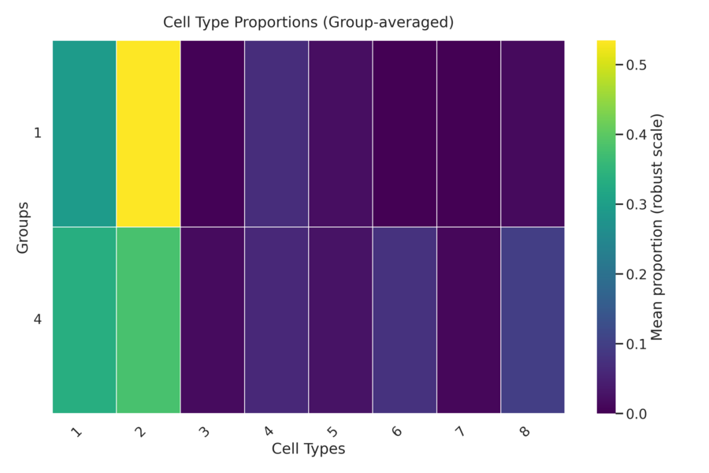

# Proportion test

`proportion_test` asks whether cell-type proportions differ between groups of samples. Per sample it counts cells per cell type, turns the counts into proportions and applies the centered log-ratio (CLR) transform, which compares each cell type with the sample's geometric mean and so avoids the spurious shifts that proportions summing to 1 create. For every pair of groups it then fits a limma-style moderated t-test per cell type, and applies one Benjamini–Hochberg FDR across all (pair × cell type) tests.

The groups come from one of two arguments:

- **`sample_to_clade`**: a `{sample: group}` dict, such as the clusters from [`cluster`](cluster.md);
- **`group_col`**: a column of `adata.obs`, such as `sev.level`. Each sample takes the most frequent value among its cells.

**When both are given, `group_col` wins** and `sample_to_clade` is ignored with a warning. The config run passes both: the k-means clusters and `rna_cluster_differential_gene_group_col`. The demo config sets that key to `sev.level`, so its `rna/sample_cluster/proportion_test/` compares healthy with severe samples, not the clusters.

It follows the clustering page: run the [setup block](index.md#before-you-start), then the [`cluster` call](cluster.md#call), which defines `sample_clusters`.

## Between clusters

```python
from sampledisco.sample_clustering.proportion_test import proportion_test

by_cluster = proportion_test(
    adata=adata,                         # cell level
    sample_col="sample",
    sample_to_clade=sample_clusters,     # from cluster()
    celltype_col="cell_type",            # the default is "celltype"
    output_dir=f"{OUT}/sample_cluster/proportion_test",
)
for name, table in by_cluster.items():
    print(name)
    print(table.round(4).to_string(index=False))
```

```text
0_vs_1
celltype   logFC  p_value    FDR
       2  1.7063   0.0356 0.2847
       4  0.9036   0.2420 0.6537
       8 -1.5175   0.2451 0.6537
       3  0.4771   0.4766 0.6900
       7 -1.0282   0.3544 0.6900
       6 -0.9297   0.5175 0.6900
       1  0.3791   0.6042 0.6905
       5  0.0094   0.9911 0.9911
```

!!! warning "Set `celltype_col`"
    The default is `"celltype"`, not `"cell_type"`. The demo `.h5ad` happens to have a `celltype` column too (the original authors' labels), so without the argument the test silently runs on different cell types from the rest of the pipeline.

The two clusters (6 and 2 samples) differ most in cell type 2 (`logFC` = 1.71 in CLR units, higher in cluster 0), but no cell type reaches FDR < 0.05. The cell types are the Leiden clusters `1` to `8` from the RNA tutorial; the dendrogram on the [visualization page](visualization.md) shows how they relate.

## Between phenotype groups (`group_col`)

This is what the demo config runs:

```python
by_severity = proportion_test(
    adata=adata,
    sample_col="sample",
    group_col="sev.level",               # overrides sample_to_clade
    celltype_col="cell_type",
    output_dir=f"{OUT}/sample_cluster/proportion_test_sev.level",
)
print(by_severity["1_vs_4"].round(4).to_string(index=False))
```

```text
celltype   logFC  p_value    FDR
       2  1.6711   0.0083 0.0661
       4  1.1365   0.0552 0.2208
       6 -2.0099   0.0892 0.2380
       1  0.8267   0.1368 0.2737
       7 -1.0530   0.2655 0.3765
       5  0.7231   0.2824 0.3765
       8 -1.1067   0.3365 0.3846
       3 -0.1879   0.7220 0.7220
```

Healthy samples (`1`) have relatively more of cell type 2 than severe ones (`4`), p = 0.008, FDR = 0.066 over the 8 tests; severe samples have more of cell type 6. With 4 samples per group nothing passes FDR < 0.05.

## Outputs

`proportion_test` returns `{"<g1>_vs_<g2>": DataFrame}` with columns `celltype`, `logFC` (difference in mean CLR, first group minus second), `p_value` and `FDR`, sorted by FDR. Pairs where a group has fewer than 2 samples are skipped with a warning, left out of the FDR and listed in `proportion_test_significant_summary.txt`. (In 0.5.0 the warning could be hidden: once trajectory DGE had run in the same Python session, all warnings were switched off.)

**Writes** → `output_dir`:

- `proportion_test_<g1>_vs_<g2>.csv`: one table per tested pair;
- `proportion_test_significant_summary.txt`: cell types with FDR < 0.01 per pair, and the skipped pairs;
- `proportion_heatmap_group_by_celltype.png`: mean proportion per group × cell type; `..._clr.png` and `..._zscore.png` show the CLR and z-scored versions;
- `proportion_significance_matrix.png`: cell type × pair grid of significance;
- `proportion_boxplot_<g1>_vs_<g2>.png`: only for pairs with at least one cell type at FDR < 0.01, showing up to 6 of them. Neither demo call reaches that, so neither writes a boxplot.


<div class="figure-caption"><code>sample_cluster/proportion_test_sev.level/proportion_heatmap_group_by_celltype.png</code>: mean proportion of each cell type in healthy (1) and severe (4) samples.</div>

## In the config

`rna_proportion_test: true` writes `rna/sample_cluster/proportion_test/`. It compares the k-means clusters, or the groups of `rna_cluster_differential_gene_group_col` when that key is set.

Each call took a few seconds; the session peaked at 1.5 GB, almost all of it the loaded cell-level `adata`.

See the [API page](../../api/downstream/proportion_test.md) for every parameter.
