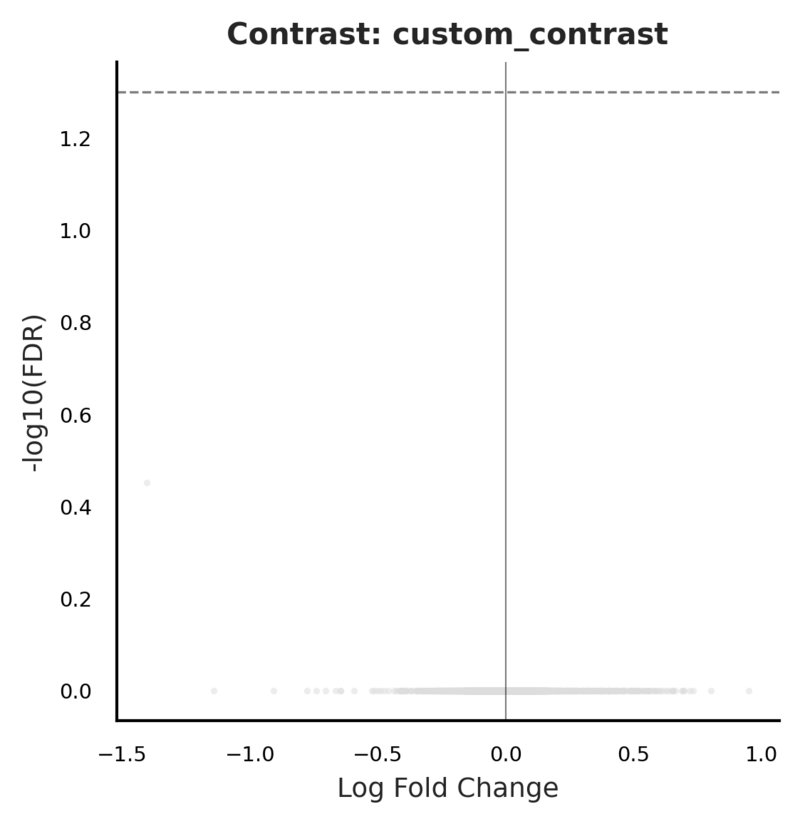

# RAISIN differential expression

RAISIN tests differential expression between groups of samples while modelling both sources of noise in single-cell data: variation between samples of a group and variation between cells of a sample. It runs in two steps:

- `raisinfit` estimates, per gene, the sample means and the variance components (a hierarchical model with empirical-Bayes shrinkage). It reads the cell-level `adata.X`, which after preprocessing holds the normalized, log-transformed expression.
- `run_pairwise_tests` tests every pair of groups and writes a table, volcano plots and summary figures.

The groups come from `sample_to_clade` (for example the k-means clusters) or from `group_col`, an `obs` column. **When `group_col` is given and exists in `adata.obs`, it wins and `sample_to_clade` is ignored**, exactly as in the [proportion test](proportion_test.md). The config run passes both, so with the demo's `rna_cluster_differential_gene_group_col: sev.level`, RAISIN compares healthy with severe samples rather than the clusters.

It follows the clustering page: run the [setup block](index.md#before-you-start), then the [`cluster` call](cluster.md#call), which defines `sample_clusters`.

!!! warning "Memory"
    `raisinfit` makes a dense copy of the cells × genes matrix and fits the variance components on `n_jobs` threads. On the demo (30k cells × 12k genes) with `n_jobs=8`, the session peaked at 4.5 GB; plan for about 8 GB to be safe. With `batch_col`, ComBat corrects the expression first and needs more memory again. The demo config would pass `batch` and every core (`n_jobs=-1`), and leaves RAISIN off (`rna_cluster_dge: false`) to stay light.

## Call

```python
from sampledisco.sample_clustering.RAISIN import raisinfit
from sampledisco.sample_clustering.RAISIN_TEST import run_pairwise_tests

fit = raisinfit(
    adata=adata,                         # cell level
    sample_col="sample",
    sample_to_clade=sample_clusters,     # from cluster(); a group_col would override it
    testtype="unpaired",
    batch_col=None,                      # "batch" adds ComBat (more memory)
    intercept=True,
    n_jobs=8,
    verbose=True,
)
n_sig, tables = run_pairwise_tests(
    fit=fit,
    output_dir=f"{OUT}/raisin_results",
    fdrmethod="fdr_bh",
    n_permutations=100,
    fdr_threshold=0.05,
    top_n_genes=50,
    make_summary_plots=True,
)
print("groups without a variance estimate:", fit["failgroup"])
print(n_sig)
for name, table in tables.items():
    print(name)
    print(table.sort_values("pvalue").head())
```

```text
===== Starting RAISIN fitting =====
Using 8 CPU cores
...
Using sample_to_clade mapping for 8 samples
Expression matrix: 12301 genes x 29988 cells
Design matrix X: 8 samples x 3 features
Random effects Z: 8 samples x 8 effects
Unique variance groups: ['0' '1']
...
Starting pairwise comparisons. Found 1 pairs.
Testing: 0_vs_1
Wrote RAISIN summary: sampledisco_demo_output/rna/raisin_results/summary_plots/raisin_summary.txt

Generating Visualizations...
Warning: No significant markers found to plot. Skipping pseudobulk heatmap.
Warning: No genes to plot in DotPlot.
Saved cluster x gene z-score heatmap: sampledisco_demo_output/rna/raisin_results/summary_plots/cluster_gene_zscore.png
groups without a variance estimate: []
{'0_vs_1': np.int64(0)}
0_vs_1
        Foldchange      stat    pvalue       FDR
RPS14     1.205664  4.077699  0.000045  0.559493
PNISR     0.608640  3.790880  0.000150  0.763767
S100A8   -1.885200 -3.736945  0.000186  0.763767
EVL       0.660954  3.610696  0.000305  0.939107
RPS6      0.893498  3.360316  0.000779  0.999993
```

No gene differs between the two clusters (6 and 2 samples) at FDR < 0.05; the strongest, *RPS14*, has FDR 0.56. With no significant gene, the pseudobulk heatmap and the dot plot are skipped.

!!! warning "Groups with a single sample cannot be tested"
    RAISIN estimates the between-sample variance of each group from that group's samples. A group with one sample has none to estimate it from: `raisinfit` warns `Unable to estimate variance for group ..., setting to 0` and lists the group in `fit["failgroup"]`. Since 0.6.0, `run_pairwise_tests` skips every comparison that involves such a group, with a warning: the pair's folder gets a `FAILED` file, and `raisin_summary.txt` lists it as skipped. With k = 3 on the demo (clusters of 6, 1 and 1 samples), `fit["failgroup"]` is `['2', '1']`, all three pairs are skipped (`Skipping 0_vs_1: variance not estimable for group(s) ['1'] ...`), and `run_pairwise_tests` returns no table. Version 0.5.0 still tested those pairs with a variance of 0, which ignores sample-to-sample variation altogether: on the same clusters it reported 6,806 "significant" genes between the two single-sample clusters. Check the cluster sizes and `fit["failgroup"]` before reading any result.

`raisinfit` returns a dict with the per-sample means (`mean`), variance components (`sigma2`, `omega2`), the designs (`X`, `Z`), `group`, `failgroup`, `eb_fallback`, `sample_names` and `batch_corrected`. `run_pairwise_tests` returns `(n_significant_per_pair, {pair: table})`. Each table is indexed by gene, with `Foldchange` (the mean difference, first group minus second, on the log-normalized scale), `stat`, `pvalue` and `FDR`. The p-values come from a t (or normal) distribution fitted to the statistics of `n_permutations` permutations of the design.

## Between phenotype groups (`group_col`)

This is what the demo config would run with `rna_cluster_dge: true`, since it sets `rna_cluster_differential_gene_group_col: sev.level`:

```python
fit_sev = raisinfit(
    adata=adata,
    sample_col="sample",
    group_col="sev.level",               # overrides sample_to_clade
    testtype="unpaired",
    n_jobs=8,
    verbose=False,
)
n_sig_sev, tables_sev = run_pairwise_tests(
    fit=fit_sev,
    output_dir=f"{OUT}/raisin_results_sev.level",
    verbose=False,
)
print(n_sig_sev)
for name, table in tables_sev.items():
    print(name)
    print(table.sort_values("pvalue").head(8))
```

```text

Generating Visualizations...
Warning: No significant markers found to plot. Skipping pseudobulk heatmap.
Warning: No genes to plot in DotPlot.
Saved cluster x gene z-score heatmap: sampledisco_demo_output/rna/raisin_results_sev.level/summary_plots/cluster_gene_zscore.png
{'1_vs_4': np.int64(0)}
1_vs_4
        Foldchange      stat    pvalue       FDR
IGKC     -1.403446 -4.183352  0.000029  0.353337
HOPX      0.451075  3.459771  0.000541  1.000000
ENO1     -0.393033 -3.350979  0.000805  1.000000
MATK      0.334016  3.203837  0.001356  1.000000
IGLC2    -0.644494 -3.188804  0.001429  1.000000
IFITM3   -0.664654 -3.048526  0.002300  1.000000
IGHA1    -0.419796 -2.694061  0.007059  1.000000
IGHG1    -0.777877 -2.532209  0.011335  1.000000
```

Healthy (`1`) against severe (`4`): the top genes are plausible, with the immunoglobulin genes *IGKC*, *IGLC2*, *IGHG1* and *IGHA1* and the interferon-induced *IFITM3* higher in severe COVID-19 (negative `Foldchange`), but with 4 samples per group none reaches FDR < 0.05.

## Outputs and other designs

Other designs: `testtype` also accepts `"paired"` (with `individual_col`), `"continuous"` and `"custom"` (with `custom_design`); `run_pairwise_tests(control_group=...)` tests every group against one control instead of all pairs.

**Writes** → `sampledisco_demo_output/rna/raisin_results/`:

- `<g1>_vs_<g2>/raisin_results.csv`, `volcano.png`, `volcano_labeled.png` (the 5 most significant genes labelled, if any reach the FDR threshold), one folder per pair; a pair that could not be tested gets a `FAILED` file with the reason instead;
- `summary_plots/raisin_summary.csv` and `raisin_summary.txt`: significant genes per pair (up and down), with the top `top_n_genes` listed;
- `summary_plots/cluster_gene_zscore.png` (z-scored mean expression of the top genes per group) and `all_results_combined.csv`: only with `make_summary_plots=True`;
- `summary_plots/pseudobulk_heatmap.png` and `summary_dotplot.png`: only with `make_summary_plots=True` and at least one significant gene, so not on the demo.

The `group_col` call above writes the same layout under `raisin_results_sev.level/`, with one pair, `1_vs_4/`.

## Result


<div class="figure-caption"><code>raisin_results_sev.level/1_vs_4/volcano_labeled.png</code>: fold change against −log10(FDR) for 12,301 genes. The dashed line is FDR = 0.05, which no gene crosses on the demo; the lone point on the left is <i>IGKC</i>.</div>

## In the config

`rna_cluster_dge: true` runs RAISIN on the clusters, or on `rna_cluster_differential_gene_group_col` when it is set, with `batch_col` set to the first `rna_sample_level_batch_col`, `n_jobs=-1` and `fdr_threshold=0.05`. `n_jobs=-1` means every core the process may use; since 0.6.0 it is also capped at `SLURM_CPUS_PER_TASK` inside a SLURM job. It writes `rna/raisin_results/`. The demo config leaves it off.

Each `raisinfit` + `run_pairwise_tests` pair took between 36 s and 3.5 minutes on 8 CPUs, depending on the node; the session peaked at 4.5 GB.

See the API pages for [`raisinfit`](../../api/downstream/raisinfit.md) and [`run_pairwise_tests`](../../api/downstream/run_pairwise_tests.md).
