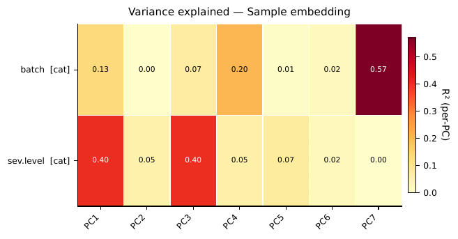

# Dimension association

`run_dimension_association_analysis` asks which sample-level variables explain each PC of the sample embedding. For every (variable, PC) pair it fits a least-squares model and reports R²:

- a continuous variable enters as one column, so R² is the squared Pearson correlation;
- a categorical variable enters one-hot, so R² is the one-way ANOVA η².

Each R² gets a permutation p-value (the variable's values are shuffled across samples) and a Benjamini–Hochberg FDR. The result is one comparable number per cell of a variables × PCs table: a quick way to find the PCs that carry your phenotype and the ones that carry a batch or another confounder.

Run the [setup block](index.md#before-you-start) first.

## Call

```python
from sampledisco.sample_association.association import run_dimension_association_analysis

assoc = run_dimension_association_analysis(
    pseudo_adata=pseudo_adata,
    output_dir=f"{OUT}/sample_association",
    continuous_cols=[],                        # the demo has no continuous sample variable
    categorical_cols=["sev.level", "batch"],
    n_permutations=999,
    sample_col="sample",
    random_state=42,
)
print(sorted(assoc))
table = assoc["results"]["X_DR_sample"]
print(table.sort_values("perm_p")[["variable", "component", "r2", "perm_p", "fdr"]].head(6))
```

```text
[Association] Continuous variables (0): []
[Association] Categorical variables (2): ['sev.level', 'batch']
[Association] X_DR_sample: 14 rows → sampledisco_demo_output/rna/sample_association/variance_explained_sample.csv
['categorical_cols', 'continuous_cols', 'dropped_non_sample_level', 'results']
     variable component        r2  perm_p       fdr
13      batch       PC7  0.569886   0.022  0.308000
2   sev.level       PC3  0.398277   0.119  0.574000
0   sev.level       PC1  0.399612   0.123  0.574000
10      batch       PC4  0.202405   0.320  0.810727
7       batch       PC1  0.132088   0.393  0.810727
3   sev.level       PC4  0.054628   0.516  0.810727
```

!!! warning "Name the sample-level columns"
    If you leave `continuous_cols` and `categorical_cols` unset, every column of `pseudo_adata.obs` is classified and tested. In `pseudo_adata` built by `build_sample_adata`, cell-level columns such as `n_genes`, `total_counts`, `pct_counts_mt` or `celltype` hold the value of each sample's first cell (see [Before you start](index.md#before-you-start)). They are tested as if they were sample traits, and the function does not catch it: its filter drops columns that vary *within* a sample, and in a one-row-per-sample object nothing does. In our run without the lists, 12 columns were tested, and the strongest association of the whole table was `pct_counts_mt` on PC7 (R² = 0.67, p = 0.009): the mitochondrial fraction of one arbitrary cell per sample.

The function returns a dict:

- `results`: `{embedding key: DataFrame}`; here one table under `"X_DR_sample"`;
- `continuous_cols`, `categorical_cols`: the variables that were tested;
- `dropped_non_sample_level`: columns dropped because they vary within a sample (empty for a `pseudo_adata`).

**Writes** → `sampledisco_demo_output/rna/sample_association/`:

- `variance_explained_sample.csv`: one row per (variable, PC), with `variable`, `component`, `kind`, `n_levels`, `r2`, `perm_p`, `fdr`, `pearson_r`, `spearman_r`, `n`;
- `figures/sample_variance_heatmap.pdf`: variables × PCs heatmap of R², with stars for FDR;
- `figures/sample_top_associations.pdf`: scatter or box plots of the strongest pairs.

## Result

Severity explains about 40% of the variance of PC1 and of PC3, and batch (Aruna vs Wilk) 57% of PC7, the last and smallest PC. None of these survives the FDR across the 14 tests. The embedding was built with `batch_col="batch"`, which removes batch differences at the sample level; the batch signal left on PC7 carries very little variance.


<div class="figure-caption">R² of severity and batch on each of the 7 PCs of the demo embedding. Stars would mark FDR-significant cells; there are none with 8 samples.</div>

With 8 samples, the smallest permutation p-value a 4-vs-4 split can reach is about 1/35: there are only 35 distinct ways to split 8 samples into two groups of 4 (up to swapping the labels). A permutation p-value near that floor, like the 0.02 to 0.03 seen here, only says that the observed split is the best of the 35, and an FDR across 14 tests cannot get far below it. For a larger example, the [Sound Life RNA tutorial](../soundlife_rna.md) runs the same analysis on 32 donors.

## In the config

`rna_dimension_association_analysis: true`, with `rna_association_continuous_cols`, `rna_association_categorical_cols` and `rna_association_n_permutations` (the demo uses 99 and leaves both lists empty, which means "auto-classify all columns"; set them as above). The output folder is `rna/sample_association/`.

The call took about 7 s (999 permutations); the session peaked at 1.4 GB, most of it the loaded cell-level `adata`.

See the [API page](../../api/downstream/sample_association.md) for every parameter.
