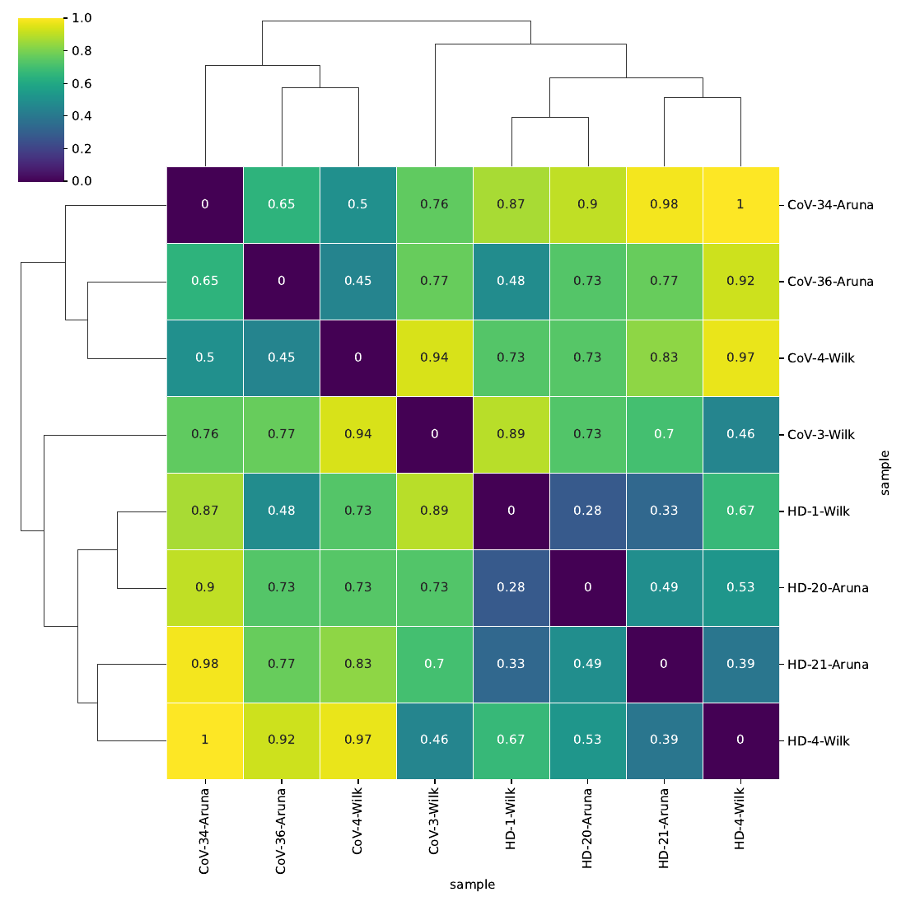

# Sample distance

`sample_distance` computes a sample × sample distance matrix with one method per call, and writes the matrix, a heatmap and a group-separation score. There are two kinds of method:

- **12 vector metrics on the sample embedding.** These take the rows of `uns['X_DR_sample']` and call `scipy.spatial.distance.pdist`: `euclidean`, `sqeuclidean`, `minkowski`, `cityblock`, `chebyshev`, `cosine`, `correlation`, `hamming`, `jaccard`, `canberra`, `braycurtis`, `matching`. `hamming`, `jaccard` and `matching` are meant for binary vectors and are of little use on continuous PCs.
- **3 methods on cell-type proportions,** computed from the cell-level AnnData rather than from the embedding:
    - `EMD`: earth mover's distance between the samples' cell-type proportions, with the ground distance between cell types taken from their centroids in the first 20 dimensions of `obsm['Z_comp']` (`n_pcs`, `embedding_key`);
    - `chi_square`: chi-square distance between the proportion vectors;
    - `jensen_shannon`: Jensen–Shannon distance between the proportion vectors.

Every matrix is divided by its largest entry, so distances run from 0 to 1 and are comparable only within one method. An unknown method name prints a warning and is skipped; it does not raise.

Run the [setup block](index.md#before-you-start) first; it defines `OUT`, `adata` (cells) and `pseudo_adata` (samples).

## Distances on the embedding

```python
from sampledisco.sample_distance.sample_distance import sample_distance

for method in ["cosine", "correlation", "euclidean"]:
    sample_distance(
        adata=pseudo_adata,                    # one row per sample
        output_dir=f"{OUT}/Sample_distance",
        method=method,
        data_type="RNA",
        grouping_columns=["sev.level"],
    )
```

Pass the sample-level `pseudo_adata`, as the config run does. `grouping_columns` names the column used for the group-separation score: the mean distance between samples of different groups divided by the mean distance within groups, so a score above 1 means the groups separate.

**Writes** → `sampledisco_demo_output/rna/Sample_distance/<method>/`, one folder per metric:

- `distance_matrix_sample_DR.csv`: the sample × sample matrix;
- `sample_DR_coordinates.csv`: the embedding rows it was computed from;
- `sample_distance_sample_DR_heatmap.pdf`: clustered heatmap;
- `distance_check_results_sample_DR_<method>.txt`: the group-separation score;
- `distance_statistics_summary_<method>.csv`: mean, sd, min, max and median of the distances.

```python
import pandas as pd

d = pd.read_csv(f"{OUT}/Sample_distance/cosine/distance_matrix_sample_DR.csv", index_col=0)
print(d.round(2).to_string())
for method in ["cosine", "correlation", "euclidean"]:
    with open(f"{OUT}/Sample_distance/{method}/distance_check_results_sample_DR_{method}.txt") as fh:
        score = [line for line in fh if line.startswith("Score")][0].strip()
    print(method, score)
```

```text
              CoV-3-Wilk  CoV-34-Aruna  CoV-36-Aruna  CoV-4-Wilk  HD-1-Wilk  HD-20-Aruna  HD-21-Aruna  HD-4-Wilk
sample
CoV-3-Wilk          0.00          0.76          0.77        0.94       0.89         0.73         0.70       0.46
CoV-34-Aruna        0.76          0.00          0.65        0.50       0.87         0.90         0.98       1.00
CoV-36-Aruna        0.77          0.65          0.00        0.45       0.48         0.73         0.77       0.92
CoV-4-Wilk          0.94          0.50          0.45        0.00       0.73         0.73         0.83       0.97
HD-1-Wilk           0.89          0.87          0.48        0.73       0.00         0.28         0.33       0.67
HD-20-Aruna         0.73          0.90          0.73        0.73       0.28         0.00         0.49       0.53
HD-21-Aruna         0.70          0.98          0.77        0.83       0.33         0.49         0.00       0.39
HD-4-Wilk           0.46          1.00          0.92        0.97       0.67         0.53         0.39       0.00
cosine Score (between/in-group): 1.411783
correlation Score (between/in-group): 1.001831
euclidean Score (between/in-group): 1.157766
```

Under the cosine metric, healthy samples are closer to each other (mean 0.56 within groups) than to severe ones (0.79 between groups), a separation score of 1.41. The healthy samples form a tight block in the heatmap, while three of the severe samples cluster together and `CoV-3-Wilk` sits nearer the healthy donors. The score depends on the metric: 1.16 for euclidean and 1.00, no separation, for correlation. With 8 samples, read these as descriptions, not tests.


<div class="figure-caption"><code>Sample_distance/cosine/sample_distance_sample_DR_heatmap.pdf</code>: cosine distances between the 8 samples, scaled to a maximum of 1, with hierarchical clustering of rows and columns.</div>

## Distances on cell-type proportions

These methods count cell types per sample in the cell-level `adata` (`cell_adata`), and take the group labels for the separation score from the sample-level object (`pseudobulk_adata`).

```python
for method in ["EMD", "chi_square", "jensen_shannon"]:
    sample_distance(
        adata=pseudo_adata,
        output_dir=f"{OUT}/Sample_distance",
        method=method,
        cell_adata=adata,                      # cells: proportions (and EMD's centroids)
        pseudobulk_adata=pseudo_adata,         # samples: group labels for the score
        sample_column="sample",
        cell_type_column="cell_type",
        grouping_columns=["sev.level"],
    )
emd = pd.read_csv(f"{OUT}/Sample_distance/EMD_distance/distance_matrix_EMD.csv", index_col=0)
print(emd.round(2).to_string())
```

```text
Computing EMD distance...
Computing EMD distances...
  Sample column: sample
  Cell type column: cell_type
  Embedding: Z_comp (first 20 dims)
  Distance matrix saved to: sampledisco_demo_output/rna/Sample_distance/EMD_distance/distance_matrix_EMD.csv
Distance check results saved to sampledisco_demo_output/rna/Sample_distance/EMD_distance/distance_check_results_EMD_EMD.txt
Score for EMD (EMD): 1.021799
  Distance check score: 1.021799
Sample distance heatmap saved to sampledisco_demo_output/rna/Sample_distance/EMD_distance/distance_matrix_EMD_heatmap.pdf
Computing chi_square distance...
Computing Chi-square distance...
Distance check results saved to sampledisco_demo_output/rna/Sample_distance/chi_square/proportion_DR_distance/distance_check_results_proportion_DR_chi_square.txt
Score for proportion_DR (chi_square): 1.144491
...
Computing jensen_shannon distance...
Computing Jensen-Shannon distance...
Distance check results saved to sampledisco_demo_output/rna/Sample_distance/jensen_shannon/proportion_DR_distance/distance_check_results_proportion_DR_jensen_shannon.txt
Score for proportion_DR (jensen_shannon): 1.089696
...
              CoV-3-Wilk  CoV-4-Wilk  HD-1-Wilk  HD-4-Wilk  CoV-36-Aruna  HD-20-Aruna  HD-21-Aruna  CoV-34-Aruna
CoV-3-Wilk          0.00        0.60       0.39       0.25          0.42         0.30         0.30          0.83
CoV-4-Wilk          0.60        0.00       0.34       0.82          0.27         0.42         0.40          0.69
HD-1-Wilk           0.39        0.34       0.00       0.52          0.13         0.15         0.17          0.61
HD-4-Wilk           0.25        0.82       0.52       0.00          0.65         0.46         0.46          1.00
CoV-36-Aruna        0.42        0.27       0.13       0.65          0.00         0.23         0.23          0.60
HD-20-Aruna         0.30        0.42       0.15       0.46          0.23         0.00         0.10          0.54
HD-21-Aruna         0.30        0.40       0.17       0.46          0.23         0.10         0.00          0.61
CoV-34-Aruna        0.83        0.69       0.61       1.00          0.60         0.54         0.61          0.00
```

On cell-type proportions alone the groups barely separate: the scores are 1.02 for EMD, 1.14 for chi-square and 1.09 for Jensen–Shannon, against 1.41 for cosine on the embedding. In the EMD matrix, `CoV-34-Aruna` is far from everyone and the other samples mix. The samples are in the order of `adata.obs`, not sorted. EMD weighs how far apart the differing cell types are in `Z_comp`; chi-square and Jensen–Shannon compare the proportion vectors only and need no embedding.

!!! note "Version 0.5.0"
    In 0.5.0, `chi_square` and `jensen_shannon` stop with `NameError: name 'plot_cell_type_abundances' is not defined` after writing the matrix, and they never compute the group-separation score. Both are fixed in 0.6.0.

**Writes** → under `sampledisco_demo_output/rna/Sample_distance/`:

| Method | Folder | Files |
| --- | --- | --- |
| `EMD` | `EMD_distance/` | `distance_matrix_EMD.csv`, `cell_type_proportions.csv`, `cell_type_centroids.csv`, `distance_matrix_EMD_heatmap.pdf`, `distance_check_results_EMD_EMD.txt` |
| `chi_square` | `chi_square/` | `distance_statistics_summary_chi_square.csv`, and in `chi_square/proportion_DR_distance/`: `distance_matrix_proportion_DR.csv`, `proportion_DR_coordinates.csv` (the proportions), `cell_type_abundances.pdf`, `sample_distance_proportion_DR_heatmap.pdf`, `distance_check_results_proportion_DR_chi_square.txt` |
| `jensen_shannon` | `jensen_shannon/` | the same layout as `chi_square/`, with `_jensen_shannon` in place of `_chi_square` |

## In the config

`rna_sample_distance_methods` lists the methods (the demo uses `["cosine", "correlation"]`), `rna_grouping_columns` the grouping column, and the outputs land in `rna/Sample_distance/<method>/` as above. With `rna_summary_sample_csv_path` set, each group-separation score is also added to that CSV.

Each call took about 3 s or less on 8 CPUs; the session peaked at 1.6 GB, most of it the loaded cell-level `adata`.

See the [API page](../../api/downstream/sample_distance.md) for every parameter.
