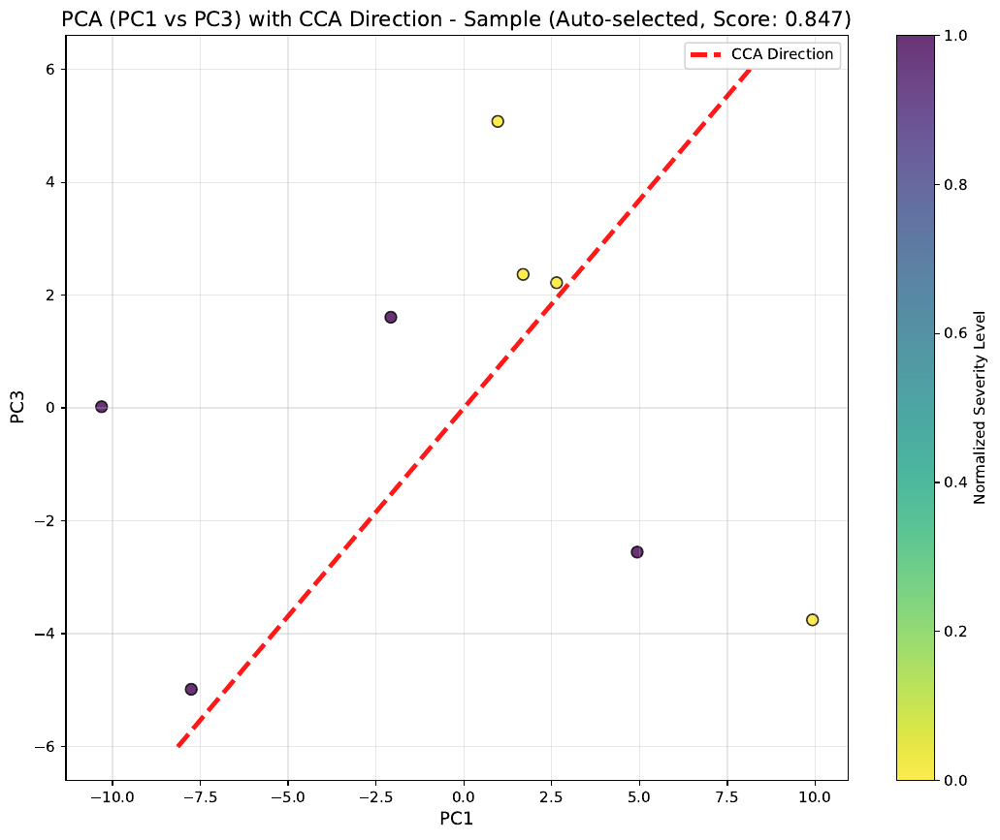
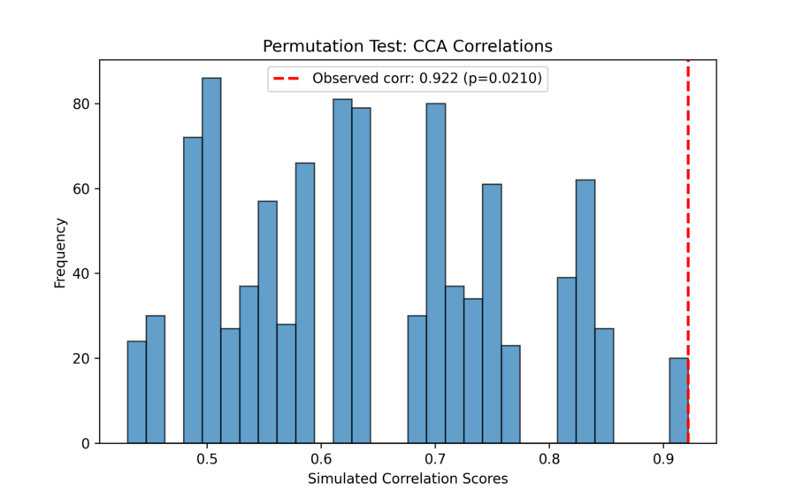

# Trajectory: CCA (supervised)

Canonical correlation analysis (CCA) finds the direction in the sample embedding that correlates best with a numeric phenotype, such as severity or age. `CCA_Call` reports that correlation and gives every sample a pseudotime along the direction; `cca_pvalue_test` asks whether the correlation is larger than it would be for shuffled labels. For choosing between CCA and TSCAN, see [Choosing a trajectory method](index.md#choosing-a-trajectory-method).

Run the [setup block](index.md#before-you-start) first.

## What the code computes

- **The score** is the canonical correlation between the first `n_components` PCs of `X_DR_sample` and `trajectory_col`. It uses all of those PCs together.
- **The plot and the pseudotime** use only two PCs: the pair, among the first `n_components`, with the highest canonical correlation (`auto_select_best_2pc=True`). Each sample's pseudotime is its projection on that pair's CCA direction, scaled to [0, 1]. The sign of a CCA direction is arbitrary, so since 0.6.0 the pseudotime is reversed (1 − pseudotime, with a log line) whenever its Spearman correlation with `trajectory_col` is negative: it always increases with the phenotype. In 0.5.0 its direction was arbitrary. The pair search and the flip do not change the score.
- **The p-value** refits the same CCA on the first `n_pcs` PCs for `num_simulations` (N) random permutations of the labels. Since 0.6.0 it is (1 + k) / (N + 1), where k permuted scores are at least as large as the observed one, so it is never 0 (0.5.0 reported k / N). It is only comparable to the score when `n_pcs` equals `n_components`. Left at its default (`n_pcs=2`), the null is built on fewer PCs than the score, and the p-value comes out too small.
- **`trajectory_col` must be numeric.** It is converted with `pd.to_numeric`; samples whose value cannot be converted are dropped, from the score and from the null alike.
- **Both functions cap the PC count** at the number of PCs in the embedding, which is at most n_samples − 1.

!!! warning "Choose `n_components` well below the number of samples"
    With k PCs and n samples, CCA is a regression of the phenotype on k predictors. When k reaches n − 1, it fits **any** labelling perfectly: the score is 1.0, every permuted score is about 1.0 as well, and the p-value is noise. (Version 0.5.0 can even stop with `ValueError: Too many bins for data range` while drawing that degenerate null; 0.6.0 draws it and warns.) On the 8-sample demo the embedding has 7 PCs, so `n_components=7` (or 10, which is capped to 7) is meaningless. We use **k = 3**. The demo config uses `rna_n_cca_pcs: 5`, which is valid (5 < 7) but leaves fewer spare degrees of freedom.

## Call

```python
import pandas as pd
from sampledisco.sample_trajectory.CCA import CCA_Call
from sampledisco.sample_trajectory.CCA_test import cca_pvalue_test

K = 3                                     # PCs used by CCA; keep well below n_samples - 1
score, _, ptime, _ = CCA_Call(
    adata=pseudo_adata,
    output_dir=OUT,
    trajectory_col="sev.level",           # numeric: 1 = healthy, 4 = severe
    n_components=K,
    verbose=True,
)
p = cca_pvalue_test(
    pseudo_adata=pseudo_adata,
    column="X_DR_sample",
    input_correlation=score,
    output_directory=OUT,
    num_simulations=1000,
    trajectory_col="sev.level",
    n_pcs=K,                              # must equal n_components
)
print(f"CCA score on PC1-PC{K}: {score:.3f}, permutation p = {p:.3f}")
print(pd.Series(ptime, name="pseudotime").sort_values().round(3))
```

```text
[CCA] Flipped pseudotime so it increases with 'sev.level' (Spearman rho before flip: -0.873)

CCA Analysis Summary:
  Sample: score=0.9220 (PC1 + PC3)
P-value for observed correlation 0.9219580824908382: 0.02097902097902098 [(1 + 20) / (1000 + 1)]
[CCA p-test] Runtime: 1.11 seconds
CCA score on PC1-PC3: 0.922, permutation p = 0.021
HD-4-Wilk       0.000
HD-21-Aruna     0.341
HD-1-Wilk       0.460
HD-20-Aruna     0.470
CoV-3-Wilk      0.661
CoV-36-Aruna    0.755
CoV-4-Wilk      0.921
CoV-34-Aruna    1.000
Name: pseudotime, dtype: float64
```

`CCA_Call` returns a 4-tuple `(score, score, pseudotime, pseudotime)`; the two copies are left over from an older version with two embeddings. The pseudotime is a `{sample: value}` dict, the input of [trajectory DGE](trajectory_dge.md). If the call fails, `CCA_Call` returns `(nan, nan, {}, {})` instead of raising, so check the score.

The first three PCs correlate with severity at 0.92, and the pseudotime separates the groups completely: the four healthy samples get 0 to 0.47, the four severe ones 0.66 to 1. The plot shows PC1 against PC3, the pair best aligned with severity. The CCA axis came out pointing from severe to healthy, so `CCA_Call` reversed the pseudotime (the `Flipped` line) and it now increases with `sev.level`. With 0.5.0 you get the unflipped values (severe near 0); pass `anchor_col` to [trajectory DGE](trajectory_dge.md), as that page does, so that `UP` and `DOWN` refer to the phenotype in either version.

How much the p-value of 0.021 means. It is (1 + 20) / (1000 + 1): 20 of the 1,000 permuted scores reached the observed one.

- **It is at the floor.** With 4 + 4 samples there are 70 ways to choose which 4 samples carry the severe label, and swapping the two labels leaves the CCA score unchanged, so a permutation can produce only 35 distinct scores. We scored all 70: the real labels give the highest score, so the exact permutation p-value is 1/35 ≈ 0.029, the smallest this design can produce. The 1,000 random permutations estimate it as 0.021; a value below 1/35 only reflects how many of them happened to draw the real split.
- **It depends on k.** We repeated the call for other k on the same embedding:

    | k (`n_components` = `n_pcs`) | 2 | 3 | 4 | 5 | 6 | 7 |
    | --- | --- | --- | --- | --- | --- | --- |
    | score | 0.67 | 0.92 | 0.95 | 0.99 | 1.00 | 1.00 |
    | p, `n_pcs` matched | 0.20 | 0.021 | 0.050 | 0.10 | 0.021 | 0.52 |
    | p, `n_pcs` left at 2 | 0.20 | 0.001 | 0.001 | 0.001 | 0.001 | 0.001 |

    The last row shows why `n_pcs` must match: the null built on 2 PCs never reaches a score fitted on more, so p sits at its minimum, 1/1001 (0.5.0 printed 0). At k = 7 the matched p-value is noise: it was 0.58 in an earlier run of the same call.
- **It depends on the run.** Preprocessing and cell typing are not bit-reproducible between runs, so the embedding, and with it this p-value, changes a little from run to run; on other runs of the same pipeline the matched p-value for k = 3 was as high as about 0.4.

Treat the demo as a check that the calls work. The [Sound Life RNA tutorial](../soundlife_rna.md) runs CCA on age with 32 donors.

**Writes** →

- `sampledisco_demo_output/rna/CCA/pca_3d_cca_sample.pdf`: samples on the chosen PC pair, colored by `sev.level`, with the CCA direction. The `3d` in the name is `n_components`.
- `sampledisco_demo_output/rna/CCA/pca_3d_cca_sample_contributions.pdf`: the weight of each of the two PCs in that direction.
- `sampledisco_demo_output/rna/CCA/pseudotime_sample.csv`: columns `sample`, `pseudotime` (after the flip).
- `sampledisco_demo_output/rna/CCA_test/cca_pvalue_distribution_X_DR_sample.png`: the permutation null with the observed score.
- `sampledisco_demo_output/rna/CCA_test/cca_pvalue_result_X_DR_sample.txt`: observed score, p-value, its definition (`P-value definition: (1 + k) / (N + 1) with k = 20 of N = 1000 permuted |r| >= observed`) and the number of samples used.

## Result



<div class="figure-caption">Top: the 8 samples on PC1 and PC3, the pair best aligned with severity, colored by scaled severity (yellow healthy, purple severe), with the CCA direction. Bottom: scores of 1,000 label permutations with the observed 0.922 (red, p = 0.021); 20 permutations reached it.</div>

## In the config

`rna_trajectory_analysis: true` with `rna_trajectory_supervised: true` runs CCA on `rna_trajectory_col` with `rna_n_cca_pcs` PCs and writes `rna/CCA/` (`pca_5d_cca_sample*.pdf` with the demo's 5 PCs). `rna_cca_pvalue: true` adds the test with `n_pcs` set to `rna_n_cca_pcs`; the demo leaves it off. The config run also stores the CCA pseudotime in its in-memory `pseudo_adata.obs['pseudotime_sample']` and passes it to the trajectory DGE.

Both calls together took 2 to 3 s; the session peaked at 1.4 GB, almost all of it the loaded cell-level `adata`. A larger example, where age is the trajectory, is in the [Sound Life RNA tutorial](../soundlife_rna.md).

See the API pages for [`CCA_Call`](../../api/downstream/trajectory_cca_call.md) and [`cca_pvalue_test`](../../api/downstream/trajectory_cca_pvalue_test.md).
