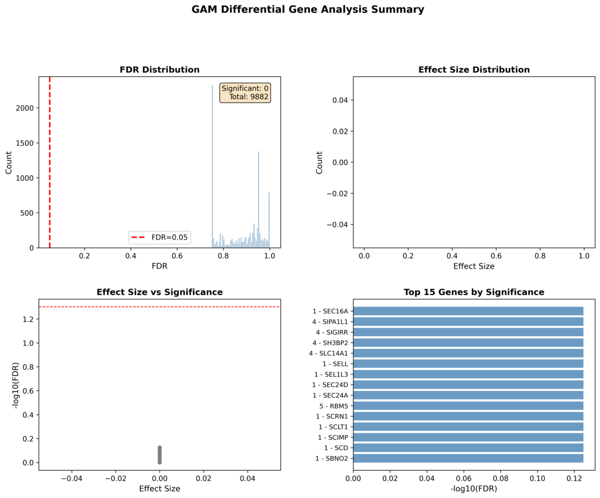

# Trajectory DGE

Given a pseudotime, `run_trajectory_gam_differential_gene_analysis` finds the genes whose expression changes along it. It works per cell type:

1. **Pseudobulk.** Average the normalized expression of each cell type in each sample. Each feature is one gene in one cell type; per cell type, the 2,000 most variable genes are kept (`n_features_per_celltype`). With `batch_col`, the batch effect is regressed out of each cell type's pseudobulk first (limma).
2. **GAM per feature.** Fit expression ~ spline(pseudotime) on the samples where the feature is non-zero, and test the spline term; Benjamini–Hochberg FDR across features.
3. **Effect size and direction** for the features with FDR < `fdr_threshold`; the `top_n_genes` largest effects are the pseudoDEGs, labelled `UP` or `DOWN`.

It follows the CCA page: run the [setup block](index.md#before-you-start), then the [CCA call](trajectory_cca.md#call), which defines `ptime`.

## Why `spline_order=2` on 8 samples

The function adapts the spline to the sample size, then skips any feature that is non-zero in fewer than spline order + number of splines + 2 samples, the minimum its fit needs. With 8 samples:

| Requested `spline_order` | Order and splines used | Samples needed | Result on 8 samples |
| --- | --- | --- | --- |
| 3 (the function's default) | order 3, 4 splines | 9 | every feature is skipped |
| 2 (the demo config) | order 2, 3 splines | 7 | features non-zero in at least 7 samples are fitted |

So on the demo, use `spline_order=2`, as `rna_spline_order: 2` does in the config. With order 3 the call runs, prints `Successfully fitted 0/15688 genes` and `No genes were successfully analyzed`, and returns an empty table; 0.6.0 adds a warning that names the cause. With 10 or more samples the default fits too (at 12 samples, the features non-zero in at least 10).

## Call

```python
from sampledisco.sample_trajectory.trajectory_diff_gene import (
    run_trajectory_gam_differential_gene_analysis,
)

run_trajectory_gam_differential_gene_analysis(
    adata,                          # cell level; the pseudobulk is built inside
    pseudotime_source=ptime,        # {sample: pseudotime} from CCA_Call
    sample_col="sample",
    celltype_col="cell_type",
    batch_col="batch",              # as the config run does
    num_splines=5,
    spline_order=2,                 # see the table above
    fdr_threshold=0.05,
    effect_size_threshold=1.0,
    top_n_genes=100,
    anchor_col="sev.level",         # UP = rises with severity
    output_dir=f"{OUT}/trajectoryDEG",
)
```

`pseudotime_source` takes a `{sample: pseudotime}` dict (from `CCA_Call`, or `tscan["pseudotime"]["main_path"]` from [TSCAN](trajectory_tscan.md)), a DataFrame, or the path of a pseudotime CSV/TSV such as `CCA/pseudotime_sample.csv`. `UP` and `DOWN` refer to the direction of the pseudotime: `UP` means rising along the trajectory variable. Since 0.6.0 the CCA pseudotime already increases with `trajectory_col` (see the [CCA page](trajectory_cca.md#call)). `anchor_col` makes sure of it for any pseudotime: it names a numeric column, and when the pseudotime runs against it, the pseudotime is reversed. Keep it for TSCAN pseudotime, whose direction depends on the chosen origin, and for 0.5.0, whose CCA pseudotime can run either way (on the demo it ran from severe to healthy). The config run sets `anchor_col` for TSCAN only.

The call prints its progress. On the demo it reports `Successfully fitted 9882/15688 genes` (the other 5,806 features are non-zero in fewer than 7 samples) and a warning that 0 features are significant with only 8 samples. It returns the full results table, one row per fitted feature with `gene`, `pval`, `dev_exp` (deviance explained), `fdr`, `significant`, `effect_size`, `regulation` and `pseudoDEG`; the same table is saved as `gam_all_genes_<ts>.tsv`. Reading the files, as below, also works in a later session.

## Read the results

The tables carry a timestamp in their names, so pick the newest:

```python
import glob
import pandas as pd

def newest(pattern):
    return sorted(glob.glob(f"{OUT}/trajectoryDEG/{pattern}"))[-1]

res = pd.read_csv(newest("gam_all_genes_*.tsv"), sep="\t")
print(f"{len(res)} features fitted, {(res['fdr'] < 0.05).sum()} with FDR < 0.05")
print(res.sort_values("pval")[["gene", "pval", "fdr", "dev_exp"]].head(8).to_string(index=False))
print(open(newest("gam_summary_*.txt")).read())
```

```text
9882 features fitted, 0 with FDR < 0.05
      gene     pval      fdr  dev_exp
 1 - PEA15 0.000708 0.749914 0.926678
  2 - ECE1 0.000798 0.749914 0.924737
 1 - CEBPA 0.001147 0.749914 0.915050
   2 - HK1 0.001369 0.749914 0.909648
 2 - OBSCN 0.001505 0.749914 0.905568
2 - UBAP2L 0.001758 0.749914 0.897684
 5 - FCGRT 0.001886 0.749914 0.898084
  2 - NEK9 0.001936 0.749914 0.896434
===== GAM ANALYSIS SUMMARY =====

Analysis date: 2026-11-23 01:31:38
FDR threshold: 0.05
Selection: Top 100 genes by effect size

Total genes analyzed: 9882
Significant genes (FDR<0.05): 0
Selected pseudoDEGs: 0
  - Upregulated: 0
  - Downregulated: 0
```

Features are named `<cell type> - <gene>`: `1 - PEA15` is *PEA15* in Leiden cell type 1. The smallest p-value is 0.0007, but after the FDR over 9,882 features nothing is close to significant, and the deviance explained of about 0.9 for the top features shows how easily a 3-basis spline fits 7 or 8 points. This is the expected result with 8 samples; the step needs more samples along the trajectory to find anything.

**Writes** → `sampledisco_demo_output/rna/trajectoryDEG/` (`<ts>` is a `YYYYMMDD_HHMMSS` timestamp, so reruns add files instead of replacing them):

| File | Content |
| --- | --- |
| `gam_all_genes_<ts>.tsv` | every fitted feature: `gene`, `pval`, `dev_exp`, `fdr`, `significant`, `effect_size`, `regulation`, `pseudoDEG` |
| `gam_significant_<ts>.tsv` | the features with FDR < `fdr_threshold` (header only on the demo) |
| `gam_pseudoDEGs_<ts>.tsv` | the selected pseudoDEGs (header only on the demo) |
| `gam_summary_<ts>.txt` | thresholds and counts, as printed above |
| `differential_gene_result.txt` | counts of significant, UP and DOWN features |
| `visualizations/01_results_summary.png` | FDR and effect-size distributions, top features |
| `visualizations/04_volcano_plot.png` | effect size against −log10(FDR) |
| `visualizations/05_gene_curves.png` | fitted curves of the top 20 features (on the demo, 20 of the many features tied at the lowest FDR, none significant) |
| `visualizations/06_sample_density.png` | samples along the pseudotime |
| `visualizations/08_sample_level_curves.png` | per-sample values and fit for the top feature |

Two more plots appear only when there is something to show: `02_tde_heatmap.png` and `07_cluster_patterns.png` need significant features to cluster, and `03_xde_heatmap.png` needs `group_col`. With `visualization_gene_list`, one plot per listed gene is added.

## Result


<div class="figure-caption"><code>trajectoryDEG/visualizations/01_results_summary.png</code>: all 9,882 FDR values lie above 0.7, so the effect-size panels are empty. On a cohort with signal, these panels show the significant features.</div>

## In the config

`rna_trajectory_dge: true` runs this step right after the trajectory, on the CCA or TSCAN pseudotime, with `rna_num_splines`, `rna_spline_order`, `rna_fdr_threshold`, `rna_effect_size_threshold`, `rna_top_n_genes`, `rna_trajectory_diff_gene_covariate` (extra `obs` columns added to the model) and `rna_visualization_gene_list` (genes to plot one by one), and writes `rna/trajectoryDEG/`. It cannot run without `rna_trajectory_analysis: true`.

The call took 15 to 30 s on 8 CPUs; the session peaked at 3.4 GB, including the worker processes that fit the GAMs in parallel (`n_jobs=-1`, every core).

See the [API page](../../api/downstream/trajectory_gam_dge.md) for every parameter.
