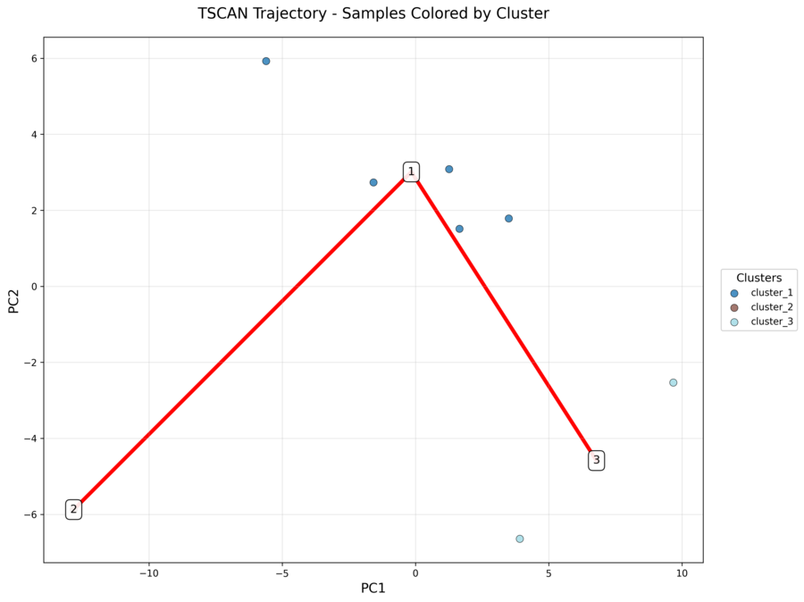
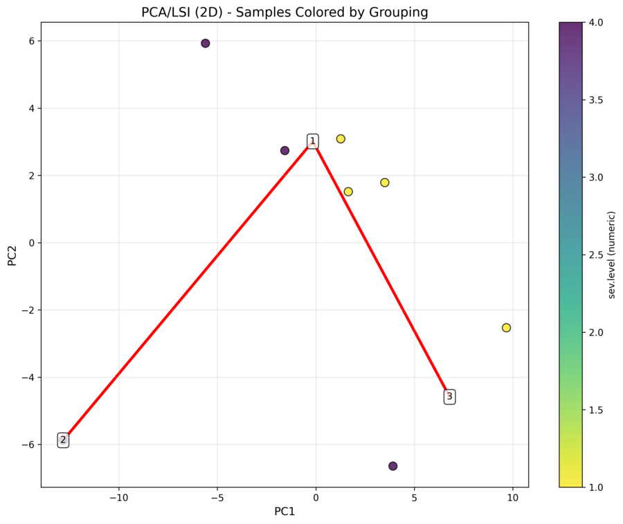

# Trajectory: TSCAN (unsupervised)

TSCAN orders samples without a phenotype. It follows Ji & Ji (*Nucleic Acids Res.* 2016):

1. cluster the samples in the embedding with a Gaussian mixture (`n_clusters=None` chooses the number by BIC);
2. connect the cluster centers with a minimum spanning tree;
3. take the longest path through the tree as the main trajectory, and the other tree branches as side paths;
4. project each sample on the tree edges and order the samples along the path.

For choosing between TSCAN and CCA, see [Choosing a trajectory method](index.md#choosing-a-trajectory-method). Run the [setup block](index.md#before-you-start) first.

## Call

```python
import pandas as pd
from sampledisco.sample_trajectory.TSCAN import TSCAN

tscan = TSCAN(
    AnnData_sample=pseudo_adata,
    column="X_DR_sample",
    n_clusters=3,                    # demo config value; None = choose by BIC
    output_dir=OUT,
    grouping_columns=["sev.level"],  # colors a plot; a numeric column also orients the path
    origin=None,                     # or the 0-based index of an endpoint cluster
    pseudotime_mode="rank",          # or "distance"
    verbose=True,
)
ptime_tscan = tscan["pseudotime"]["main_path"]
print("cluster path:", tscan["main_path"], "origin:", tscan["origin"])
print(pseudo_adata.obs[["sev.level", "tscan_cluster", "tscan_pseudotime_main"]]
      .sort_values("tscan_pseudotime_main"))
```

```text
cluster path: [2, 0, 1] origin: 2
              sev.level tscan_cluster  tscan_pseudotime_main
sample
HD-4-Wilk             1     cluster_3               0.000000
CoV-3-Wilk            4     cluster_3               0.142857
HD-21-Aruna           1     cluster_1               0.285714
HD-20-Aruna           1     cluster_1               0.428571
HD-1-Wilk             1     cluster_1               0.571429
CoV-36-Aruna          4     cluster_1               0.714286
CoV-4-Wilk            4     cluster_1               0.857143
CoV-34-Aruna          4     cluster_2               1.000000
```

The Gaussian mixture put 5 samples in `cluster_1`, 1 in `cluster_2` and 2 in `cluster_3`, and the tree runs `cluster_3 → cluster_1 → cluster_2`. TSCAN starts at `cluster_3` (0-based index 2) because its mean `sev.level` (2.5) is lower than that of the other end (4). Without any phenotype, the order is partly aligned with severity: the three healthy samples in `cluster_1` come before the two severe ones, and the outlying severe sample `CoV-34-Aruna` ends the path alone in `cluster_2`. It is far from a clean split, though: `CoV-3-Wilk` sits next to a healthy donor at the start. Compare with the [CCA pseudotime](trajectory_cca.md#call), which is fitted to the labels. Cluster sizes and order can change with small run-to-run differences of the embedding.

- **`origin`** picks which end of the main path is time 0. It must be the 0-based index of one of the two endpoint clusters, or the call raises. With `origin=None`, TSCAN takes the endpoint whose samples have the lower mean of the first numeric column in `grouping_columns` (here `sev.level`, so the healthy end); without a numeric column it takes the endpoint with the lower index.
- **`pseudotime_mode`**: `"rank"` gives the i-th of n ordered samples the value i/(n − 1); `"distance"` uses the cumulative distance along the ordering in the embedding, scaled to [0, 1]. Any other value raises a `ValueError`.
- **Side branches.** Samples in clusters off the main path get no main pseudotime (`NaN` in `tscan_pseudotime_main`); they have a pseudotime on their branch in `tscan["pseudotime"]["branching_paths"]`. With 3 clusters the tree is a single path, so every sample is on it.

`TSCAN` returns a dict with `main_path`, `origin`, `branching_paths`, `sample_cluster`, `ordered_samples`, `pseudotime` (`{"main_path": {sample: value}, "branching_paths": {...}}`) and the projection details. It also adds `tscan_cluster` and `tscan_pseudotime_main` to `pseudo_adata.obs`. Pass `tscan["pseudotime"]["main_path"]` to [trajectory DGE](trajectory_dge.md) in place of the CCA pseudotime.

**Writes** → `sampledisco_demo_output/rna/TSCAN/`:

- `clusters_by_cluster_X_DR_sample.png`: samples on PC1 and PC2, colored by TSCAN cluster, with the tree and the main path;
- `clusters_by_grouping_X_DR_sample.png`: the same, colored by each `grouping_columns` entry;
- `X_DR_sample_pseudotime.csv`: `sample_id`, `trajectory_type` (`main_path` or `branch`), `branch_id`, `pseudotime`, `cluster`.

## Result



<div class="figure-caption"><code>TSCAN/clusters_by_cluster_X_DR_sample.png</code> and <code>clusters_by_grouping_X_DR_sample.png</code>: the samples on PC1 and PC2 with the cluster centers (numbered boxes) and the main path (red), colored by TSCAN cluster (top) and by <code>sev.level</code> (bottom, purple severe, yellow healthy).</div>

## In the config

`rna_trajectory_analysis: true` with `rna_trajectory_supervised: false` runs TSCAN with `rna_tscan_n_clusters`, `rna_tscan_origin` and `rna_tscan_pseudotime_mode`, colored by `rna_trajectory_visualization_label`, and writes `rna/TSCAN/`. The demo config is supervised (CCA), so it does not run TSCAN.

The call took about 5 s; the session peaked at 1.5 GB, almost all of it the loaded cell-level `adata`.

See the [API page](../../api/downstream/trajectory_tscan.md) for every parameter.
