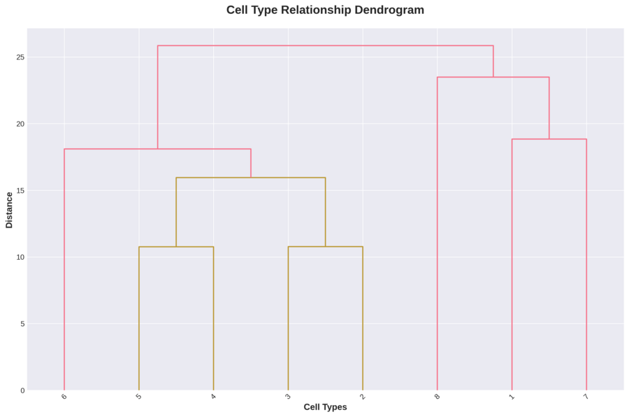
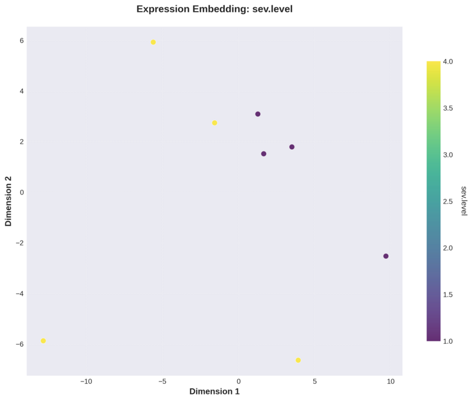

# Visualization

`visualization` draws up to three figures, each switched on by a flag:

- **Cell-type dendrogram** (`plot_dendrogram_flag`): the mean of each cell type in the cell embedding `obsm['Z_comp']`, clustered with Ward linkage on Euclidean distances. Cell types that sit close together in the embedding join low in the tree. It reads the first of `cell_type`, `celltype`, `cluster`, `leiden`, `seurat_clusters` found in `adata.obs`.
- **Two scatters of the sample embedding** (`plot_cell_type_proportions_pca_flag`, `plot_cell_type_expression_umap_flag`): each plots PC1 against PC2 of `X_DR_sample`, one point per sample, colored by each column in `grouping_columns`. The two plots show **the same points**; only the title and the colormap differ. The names ("proportion PCA", "expression UMAP") date from older versions that had two sample embeddings, and no PCA or UMAP is computed.

Run the [setup block](index.md#before-you-start) first.

## Call

```python
from sampledisco.visualization.visualization_other import visualization

visualization(
    AnnData_cell=adata,                  # cell level: the dendrogram
    pseudobulk_anndata=pseudo_adata,     # sample level: the scatters
    output_dir=OUT,                      # the figures go to OUT/visualization/
    grouping_columns=["sev.level"],
    plot_dendrogram_flag=True,
    plot_cell_type_proportions_pca_flag=True,
    plot_cell_type_expression_umap_flag=True,
)
```

**Writes** → `sampledisco_demo_output/rna/visualization/`:

- `cell_type_dendrogram.png`;
- `proportion_embedding_sev.level.png`: PC1 vs PC2, `RdYlBu` colormap;
- `expression_embedding_sev.level.png`: the same scatter, `viridis` colormap.

!!! note "Where the files go"
    With `grouping_columns` set, `visualization` adds a `visualization/` folder under `output_dir` itself; pass the branch folder (`OUT`), as above. Passing `f"{OUT}/visualization"` gives `visualization/visualization/`. Without `grouping_columns` the dendrogram goes straight into `output_dir`, and the two scatter flags fail, since they loop over the grouping columns. Every grouping column must exist in `pseudo_adata.obs`, or the call raises `ValueError`.

## Result


<div class="figure-caption"><code>visualization/cell_type_dendrogram.png</code>: the 8 Leiden cell types of the demo, clustered by their mean position in <code>Z_comp</code>. Types 1, 7 and 8 form one branch, types 2 to 6 the other.</div>


<div class="figure-caption"><code>visualization/expression_embedding_sev.level.png</code>: PC1 against PC2 of <code>X_DR_sample</code>, colored by <code>sev.level</code> (purple healthy, yellow severe). <code>proportion_embedding_sev.level.png</code> shows the same 8 points in the <code>RdYlBu</code> colormap.</div>

## In the config

`rna_visualize_data: true` with `rna_plot_dendrogram_flag`, `rna_plot_cell_type_proportions_pca_flag` and `rna_plot_cell_type_expression_umap_flag` (all three on in the demo), colored by `rna_grouping_columns`, writes `rna/visualization/`. `rna_age_bin_size` and `rna_age_column` only add the age column to the required columns; the plots do not bin ages. The dendrogram flag needs a cell-type column in the cell-level data, or the run stops with an error.

The call took about 2 to 6 s; the session peaked at 1.5 GB, almost all of it the loaded cell-level `adata`.

See the [API page](../../api/downstream/visualization.md) for every parameter.
