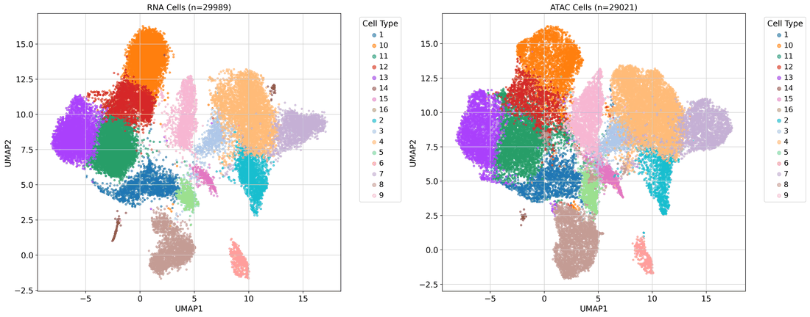
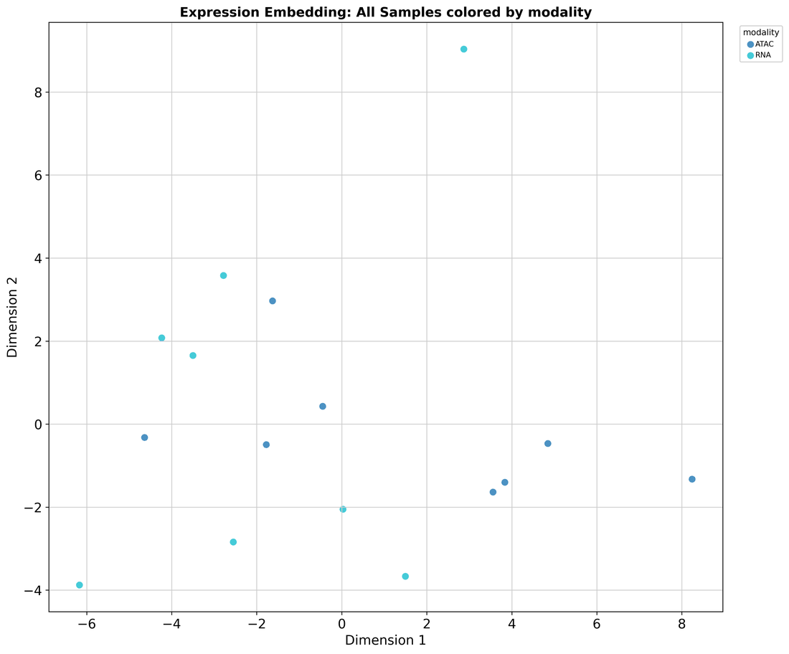
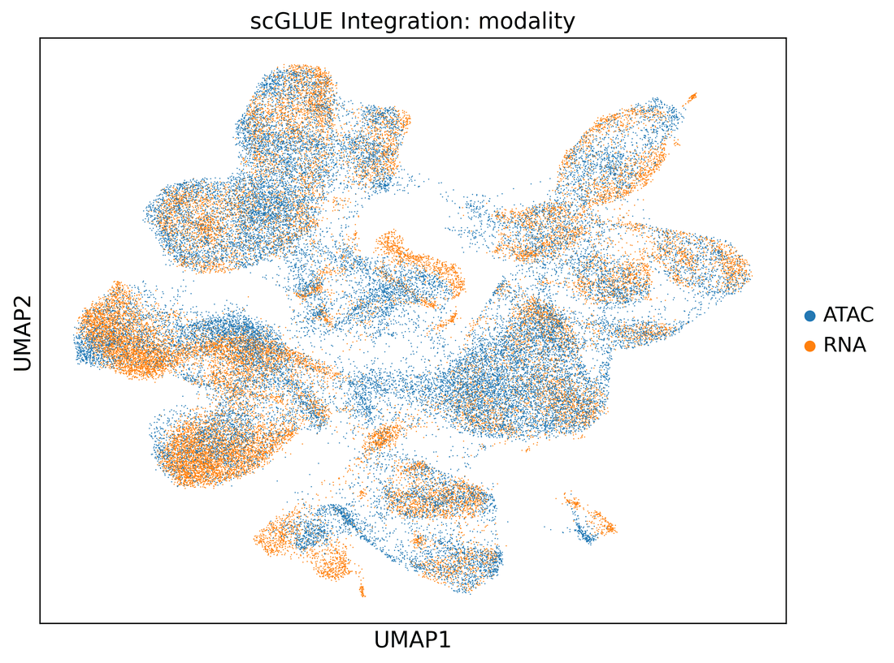
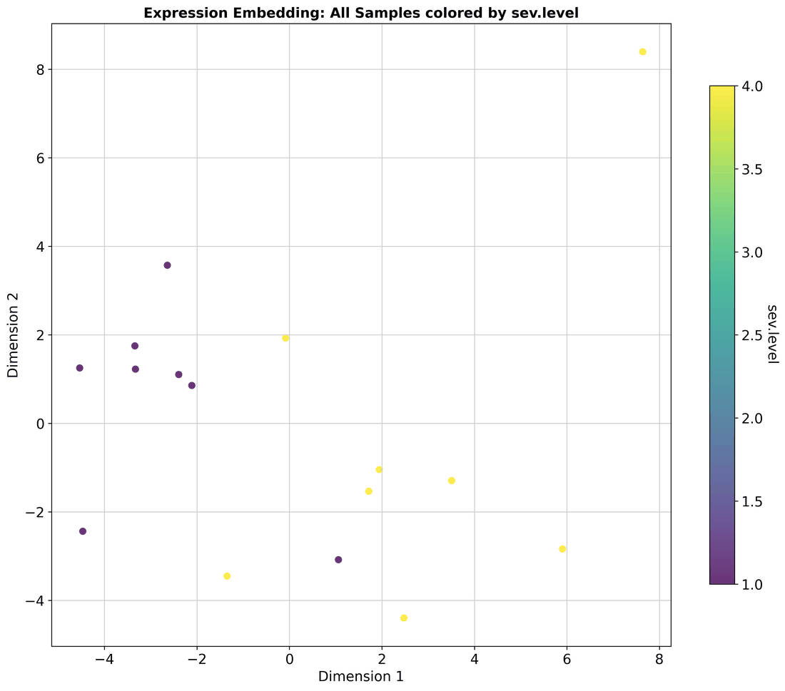

# Multi-omics pipeline: RNA + ATAC with scGLUE (Python API)

The multi-omics branch builds one sample embedding from scRNA-seq and scATAC-seq measured on **different cells**, here even on different donors. [scGLUE](https://www.nature.com/articles/s41587-022-01284-4) puts the RNA and ATAC cells into one joint cell embedding. From then on, the steps are the same as for a single modality.

SampleDisco uses two views of that joint embedding:

- **`Z_rmd`** keeps the differences between samples. It is scGLUE's own output, `obsm['X_glue']`, and feeds the RMD displacement block.
- **`Z_comp`** has the sample effect removed. By default it comes from one Harmony pass on `X_glue` with `sample` as the batch key. It feeds the cell typing and the composition blocks.

This page calls each function directly:

1. **Load** the pre-integrated demo object and put its embeddings under the current key names.
2. **`cell_types_multiomics`** → Leiden clusters on the RNA cells, then labels transferred to the ATAC cells.
3. **`compute_sample_embedding`** → one row per `<sample>_RNA` / `<sample>_ATAC` unit in `uns['X_DR_sample']`.
4. **`visualize_multimodal_embedding`** → the sample embedding colored by phenotype and modality.
5. **Optional: train scGLUE from scratch** on the raw RNA and ATAC counts, then repeat steps 2–4.

!!! tip "Prefer one command?"
    [Multi-omics from a config](multiomics_config.md) runs the same steps with `sampledisco --config`, plus the downstream analyses. With the same settings it gives the same sample embedding as this page.

Everything after the sample embedding (distances, trajectories, clustering, association) is shared with RNA and ATAC; see [Downstream analysis](downstream/index.md).

## Inputs

Run everything on this page from one empty folder. Steps 1–4 need only the pre-integrated object:

```bash
mkdir -p data
curl -fL -o data/test_multiomics_integrated.h5ad "https://zenodo.org/records/24451067/files/test_multiomics_integrated.h5ad?download=1"
```

Steps 1–4 need **no scGLUE and no `bedtools`**: a plain `pip install sampledisco` runs them. Only step 5 trains scGLUE (see its own requirements).

`test_multiomics_integrated.h5ad` (54 MB) was written by an older SampleDisco release. It holds:

| Part | Content |
| --- | --- |
| cells | 59,010: 29,989 RNA cells from 8 donors and 29,021 ATAC cells from 8 *other* donors (unpaired) |
| `obs['sample']` | 16 IDs that already carry the modality, e.g. `CoV-3-Wilk_RNA`, `SRR14466464_ATAC` |
| `obs['modality']` | `RNA` or `ATAC` |
| `obs['sev.level']` | `1` (healthy) or `4` (severe COVID-19); 4 donors of each per modality |
| `obsm['X_glue']` | the 50-d scGLUE embedding (sample differences kept) |
| `obsm['Z_cmd']` | an identical copy of `X_glue`, under the old name of `Z_rmd` |
| `obsm['Z_clust']` | the sample-removed view, under the old name of `Z_comp` |
| `obsm['X_umap']` | a UMAP from the older run (step 2 recomputes it) |
| `obs['cell_type']`, `uns['X_DR_sample']` | cell types and a sample embedding **from the older run**; this page recomputes both |
| `.X` | an empty placeholder (59,010 × 13,820, no stored values): the file has **no expression data** |

All output goes to `sampledisco_demo_output/multiomics_api/`. The [config run](multiomics_config.md) writes to `sampledisco_demo_output/multiomics/`, so you can run both in the same folder and compare them.

!!! note "GPU"
    This page runs on CPU. The GPU versions are `cell_types_multiomics_gpu` (`sampledisco.preparation.multi_omics_cell_type_gpu`, same arguments, needs RAPIDS), `harmonize_xglue(..., use_gpu=True)` and `compute_sample_embedding(..., use_gpu=True)`. Nothing switches to the GPU on its own except scGLUE training in step 5, which uses a visible CUDA GPU automatically.

## 1. Load the integrated object

```python
import anndata as ad
from sampledisco.utils.embedding_keys import migrate_obsm_keys

OUT = "sampledisco_demo_output/multiomics_api"

adata = ad.read_h5ad("data/test_multiomics_integrated.h5ad")
migrate_obsm_keys(adata)   # Z_clust -> Z_comp, Z_cmd -> Z_rmd (in memory; the file is not changed)

# The file ships the cell types and sample embedding of an older run. Steps 2 and 3 recompute them.
adata.obs = adata.obs.drop(columns=["cell_type"], errors="ignore")
for key in ("X_DR_sample", "sample_embedding_params", "cell_type_colors"):
    adata.uns.pop(key, None)
print(adata)
```

```text
[sampledisco] migrated obsm['Z_clust'] → obsm['Z_comp']
[sampledisco] migrated obsm['Z_cmd'] → obsm['Z_rmd']
AnnData object with n_obs × n_vars = 59010 × 13820
    obs: 'sample', 'sev.level', 'balancing_weight', 'modality', 'original_barcode', 'original_sample', 'n_genes_by_counts', 'total_counts', 'pct_counts_in_top_50_genes', 'pct_counts_in_top_100_genes', 'pct_counts_in_top_200_genes', 'pct_counts_in_top_500_genes', 'total_counts_mt', 'pct_counts_mt', 'n_genes'
    var: 'mt', 'MT', 'n_cells_by_counts', 'mean_counts', 'pct_dropout_by_counts', 'total_counts', 'n_cells'
    uns: 'modality_colors', 'neighbors', 'umap'
    obsm: 'X_glue', 'X_umap', 'Z_clust', 'Z_cmd', 'Z_comp', 'Z_rmd'
    obsp: 'connectivities', 'distances'
```

`migrate_obsm_keys` copies each legacy embedding onto its current name and keeps the old one (see [legacy key names](../legacy_keys.md)). Without it, the functions still find `Z_clust` and `Z_cmd` when you leave the key arguments empty, with a `FutureWarning`. But in 0.5.0 an explicit `use_rep="Z_comp"` or `comp_emb_key="Z_comp"` raises `KeyError` on this file. Migrating first works with every version.

## 2. Joint cell typing

`cell_types_multiomics` works on the sample-removed `Z_comp`:

1. Leiden clustering of the **RNA cells only** (`cluster_resolution`). The clusters are numbered `1`, `2`, …
2. Each ATAC cell takes the label with the highest weight in a Jaccard-weighted shared-nearest-neighbor graph between the RNA and ATAC cells, built from `k_neighbors` nearest neighbors per modality. The weight is stored as `obs['label_transfer_confidence']`.
3. Clusters dominated by one modality are dropped. A cluster goes when either modality's fraction of its cells is below 5% of that modality's fraction in the whole object. Here ATAC is 49% of all cells, so a cluster with fewer than 2.5% ATAC cells would be dropped.

The settings below are the ones the pipeline uses (`k_neighbors=3`, `cluster_resolution=0.8`, cosine distance), so the labels match a [config run](multiomics_config.md). The function's own default is `k_neighbors=15`. `use_rep` defaults to `None`, which finds `Z_comp` (or its legacy names) by itself and uses `X_glue` only as a last resort; we pass it explicitly for clarity.

```python
import pandas as pd
from sampledisco.preparation.multi_omics_cell_type_cpu import cell_types_multiomics

adata = cell_types_multiomics(
    adata,
    modality_column="modality",
    rna_modality_value="RNA",
    atac_modality_value="ATAC",
    cell_type_column="cell_type",
    cluster_resolution=0.8,
    use_rep="Z_comp",
    k_neighbors=3,
    transfer_metric="cosine",
    compute_umap=True,
    save=True,
    output_dir=OUT,
    defined_output_path=f"{OUT}/preprocess/adata_sample.h5ad",
)
print(adata.n_obs, "cells kept")
print(pd.crosstab(adata.obs["cell_type"], adata.obs["modality"]))
```

The function prints its progress (cluster sizes, mean transfer confidence 0.924, the modality check), then:

```text
59010 cells kept
modality   ATAC   RNA
cell_type
1          1516  1370
10         3108  5642
11         4035  5204
12         1126  1861
13         2628  3402
14           45   102
15          616   270
16           25    82
2          1184  1574
3          1050   672
4          6218  3978
5           662   458
6           268   392
7          1945  1693
8          2694  1993
9          1901  1296
```

!!! warning "It can return a new object with fewer cells"
    - Assign the result (`adata = cell_types_multiomics(...)`). It is a **copy**, without the cells of any dropped cluster; the object you passed in keeps all cells.
    - An ATAC cell that shares no neighbor with any RNA cell gets the label `'unassigned'` (more likely at small `k_neighbors`). That label has no RNA cells, so the modality check then drops those cells too.
    - In this run every ATAC cell got a label and all 16 clusters passed the check (`All clusters balanced, no filtering needed`), so all 59,010 cells are kept.

**Writes** →

- `sampledisco_demo_output/multiomics_api/preprocess/adata_sample.h5ad`: the typed object (`defined_output_path`).
- `sampledisco_demo_output/multiomics_api/preprocess/cell_type.csv`: cell ID, modality and cell type.
- `sampledisco_demo_output/multiomics_api/preprocess/visualization/`: `umap_cell_type.png`, `umap_modality.png`, `umap_split_by_modality.png`, `label_transfer_confidence.png`, `celltype_modality_heatmap.png` and `celltype_modality_distribution.csv`.

Always pass `defined_output_path`. Without it, `save=True` writes `<output_dir>/preprocess/adata_preprocessed.h5ad` in 0.6.0 but `<output_dir>/preprocess/preprocess/adata_preprocessed.h5ad` in 0.5.0.

On 8 CPU cores this step took 2.5 minutes, including the UMAP and the plots, and peaked at 2.8 GB of RAM.


<div class="figure-caption">Step 2 — <code>umap_split_by_modality.png</code>: the same UMAP of <code>Z_comp</code>, RNA cells (left, Leiden clusters) and ATAC cells (right, transferred labels).</div>

## 3. Sample embedding

`compute_sample_embedding` is the same function as for RNA and ATAC. With `modality_col="modality"`, each sample × modality pair becomes one unit, here `<sample>_RNA` or `<sample>_ATAC`:

- The **composition blocks** (A1 cell types, A2/A3 soft k-means clusters) are built on `Z_comp`.
- The **RMD block** measures each unit's displacement within each cell type on `Z_rmd`, compared with the other units of the same modality.
- The blocks are stacked, reduced to `pca_components` PCs, and Harmony then removes the modality offset at the unit level. That step runs only with at least 8 units and 2 modalities; here there are 16 units.

```python
from sampledisco.sample_embedding import compute_sample_embedding
from sampledisco.sample_embedding.blocks import save_embedding_to_h5ad

adata = compute_sample_embedding(
    adata,
    output_dir=OUT,
    use_gpu=False,
    sample_col="sample",
    celltype_col="cell_type",
    comp_emb_key="Z_comp",      # sample removed
    rmd_emb_key="Z_rmd",        # sample differences kept (= X_glue)
    modality_col="modality",
    batch_col=None,
    medium_K=120,
    fine_K=300,
    rmd_dim_per_cluster=8,
    rmd_weight="equal",
    pca_components=10,
    batch_method="harmony",
    save=True,
)
print(save_embedding_to_h5ad(f"{OUT}/preprocess/adata_sample.h5ad", adata))
print(adata.uns["X_DR_sample"].iloc[:, :4].round(2))
```

The log shows the four blocks (`[A1] … shape=(16, 16)`, `[A2] … (16, 120)`, `[A3] … (16, 300)`, `[RMD] shape=(16, 128)`), their weights and the Harmony pass over the 2 modality groups. Then:

```text
rewrite
                      PC1   PC2   PC3   PC4
sample
CoV-3-Wilk_RNA      -2.55 -2.84  3.73  2.33
CoV-34-Aruna_RNA     2.87  9.04  3.62  1.48
CoV-36-Aruna_RNA    -2.78  3.58 -2.91  2.48
CoV-4-Wilk_RNA       1.50 -3.67  2.00 -2.21
HD-1-Wilk_RNA        0.03 -2.05 -1.17  0.29
HD-20-Aruna_RNA     -3.50  1.65 -1.61 -1.73
HD-21-Aruna_RNA     -4.23  2.08 -3.62 -2.80
HD-4-Wilk_RNA       -6.17 -3.87  1.36  0.71
SRR14466464_ATAC     3.56 -1.64 -0.66  0.61
SRR14466466_ATAC     8.24 -1.32 -2.32  0.21
SRR14466470_ATAC     3.83 -1.40  1.30 -1.14
SRR14466479_ATAC    -1.63  2.97  2.63 -3.68
SRR14466481_ATAC    -1.78 -0.49 -0.71  3.30
SRR14466482_ATAC    -4.64 -0.32  0.61 -0.39
SRR14466483_ATAC    -0.45  0.43 -2.10  0.98
re_SRR14466471_ATAC  4.85 -0.47 -0.87 -0.61
```

The step takes about 10 seconds and 1.7 GB of RAM.

**Writes** →

- In memory: `adata.uns['X_DR_sample']` (a DataFrame, 16 units × 10 PCs) and `adata.uns['sample_embedding_params']`. The function returns the same, modified `adata`.
- `sampledisco_demo_output/multiomics_api/sample_embedding/sample_embedding.csv` and `sample_embedding_blocks.npz` (the A1, A2, A3 and RMD blocks).
- `save_embedding_to_h5ad` stores the two `uns` entries in `preprocess/adata_sample.h5ad`. It returns `in-place` when it could replace just those entries, and `rewrite` when it wrote the whole file again (here: `rewrite`, a 79 MB file, because step 2 saved the empty `label_transfer_confidence` of the RNA cells as −1 instead of NaN). `compute_sample_embedding` does not update that file itself: it only re-saves a `preprocess/adata_preprocessed.h5ad`, which the multi-omics branch does not use.

To reload the result in a new session, read `preprocess/adata_sample.h5ad` and rebuild the unit-level object with `build_sample_adata`, as in step 4.

## 4. Plot the sample embedding

The embedding has one row per unit, while `adata.obs` has one row per cell. `build_sample_adata` builds the matching unit-level object (one row per unit, with the sample metadata), which every downstream module accepts. Pass that object to the plotting function, or the points come out uncolored.

```python
from sampledisco.sample_embedding.sample_embedding import build_sample_adata
from sampledisco.visualization.multi_omics_visualization import visualize_multimodal_embedding

sample_adata = build_sample_adata(adata, sample_col="sample", modality_col="modality")
print(sample_adata.obs[["sev.level", "modality"]])

visualize_multimodal_embedding(
    adata=sample_adata,
    visualization_grouping_column=["sev.level", "modality"],
    output_dir=OUT,            # the function adds /visualization itself
    show_default=True,
)
```

```text
                    sev.level modality
sample
CoV-3-Wilk_RNA              4      RNA
CoV-34-Aruna_RNA            4      RNA
CoV-36-Aruna_RNA            4      RNA
CoV-4-Wilk_RNA              4      RNA
HD-1-Wilk_RNA               1      RNA
HD-20-Aruna_RNA             1      RNA
HD-21-Aruna_RNA             1      RNA
HD-4-Wilk_RNA               1      RNA
SRR14466464_ATAC            4     ATAC
SRR14466466_ATAC            4     ATAC
SRR14466470_ATAC            4     ATAC
SRR14466479_ATAC            1     ATAC
SRR14466481_ATAC            1     ATAC
SRR14466482_ATAC            1     ATAC
SRR14466483_ATAC            1     ATAC
re_SRR14466471_ATAC         4     ATAC
```

**Writes** → `sampledisco_demo_output/multiomics_api/visualization/all_samples_expression_by_{sev.level,modality}.png`, `all_samples_proportion_by_{sev.level,modality}.png` and `all_samples_combined_by_{sev.level,modality}.png`.

- The function dates from a release with two sample embeddings, an "expression" one and a "proportion" one. Both now read the single `X_DR_sample`, so the `expression` and `proportion` files show the same scatter of PC1 against PC2, and the `combined` file shows it twice.
- `sev.level` holds the numbers 1 and 4, so it gets a color bar; cast it to strings first if you want a categorical legend.
- Calling it on the cell-level `adata` instead draws every plot uncolored, with the message `'sev.level' has 59010 cell-level values but the embedding has 16 units — plotting uncolored`.



<div class="figure-caption">Step 4 — PC1 against PC2 of the 16 units. Left: severe COVID-19 (<code>sev.level</code> 4, yellow) against healthy (1, purple). Right: the same points by modality.</div>

PC1 separates the two phenotypes in both modalities: 6 of the 8 severe units have PC1 > 0, and 7 of the 8 healthy units have PC1 < 0, the eighth sitting at 0.03 (mean PC1 +2.4 against −2.8). RNA and ATAC units mix along PC1 after the unit-level Harmony pass; the RNA units spread more along PC2.

!!! note "Only 8 donors per modality"
    With 4 healthy and 4 severe donors per modality, this is a picture, not a result: there is no test here, and p-values or classifiers on 16 units are noisy. For an analysis with enough donors to test, see the [Sound Life 32-donor RNA tutorial](soundlife_rna.md) and the [RNA + flow (MaxFuse)](multiomics_maxfuse.md) page.

## 5. Train scGLUE from scratch (optional)

This section builds `test_multiomics_integrated.h5ad`'s equivalent yourself from the raw counts. It is the slowest part of the pipeline and the only one that needs scGLUE.

### Requirements

- **scGLUE, PyTorch, pyensembl and the `bedtools` binary.** The all-in-one environment from [Installation](../installation.md) has all of them. SampleDisco finds `bedtools` on `PATH` or next to the Python executable, so the env does not need to be activated.
- **A gene annotation.** scGLUE links each peak to nearby genes through the gene coordinates. `ensembl_release=98` and `species="homo_sapiens"` (GRCh38) select the annotation. You don't download anything yourself: on first use, pyensembl fetches the Ensembl 98 GTF and the cDNA, ncRNA and protein FASTA files (about 150 MB) from the Ensembl FTP server and indexes them. That took 2.5–6 minutes in our runs (up to 6.6 GB of RAM) and leaves 1.4 GB in `~/.cache/pyensembl/GRCh38/ensembl98/`. Later runs reuse the cache, which loads in 2 seconds. Set `PYENSEMBL_CACHE_DIR` to keep the cache elsewhere; it then lives in `$PYENSEMBL_CACHE_DIR/pyensembl/GRCh38/ensembl98/`.
- **Feature names.** RNA genes are matched by symbol (or by Ensembl ID, detected automatically); genes without coordinates are dropped (138 of the demo's 14,881). ATAC peaks must be named `chrom-start-end` or `chrom:start-end`, like the demo's `chr1-9760-10718`.
- **A GPU helps but is not required.** scGLUE uses a visible CUDA GPU automatically. On the demo, the whole section took about 40 minutes on a GPU node and on a CPU-only node alike (see [Runtime](#runtime)). RAM peaked at 16 GB, so ask for at least 20 GB.

Check the environment:

```bash
bedtools --version
python -c "import scglue, pyensembl, torch; print('scglue', scglue.__version__, '| pyensembl', pyensembl.__version__, '| CUDA', torch.cuda.is_available())"
```

On our GPU node (the torch import may add a `pynvml` deprecation warning):

```text
bedtools v2.31.1
scglue 0.3.2 | pyensembl 2.28.0 | CUDA True
```

!!! tip "Compute node without internet?"
    On a node that cannot reach `ftp.ensembl.org`, the run stops at `Setting up Ensembl annotation...` with `Network is unreachable` (one of our GPU nodes did). Fetch and index the annotation once on a machine that has internet, with the same home folder (or the same `PYENSEMBL_CACHE_DIR`) as the compute nodes, and with the same environment: pyensembl versions differ in the files they fetch and in the cache layout. It took 4–6 minutes and up to 6.6 GB of RAM in our tests:

    ```bash
    pyensembl install --release 98 --species homo_sapiens
    ```

Download the raw counts:

```bash
curl -fL -o data/test_RNA.h5ad  "https://zenodo.org/records/24451067/files/test_RNA.h5ad?download=1"
curl -fL -o data/test_ATAC.h5ad "https://zenodo.org/records/24451067/files/test_ATAC.h5ad?download=1"
```

Both files carry `sample` and `sev.level` in `.obs`; the RNA file also has `batch`, the ATAC file has no batch column.

### Train and merge

`multiomics_preparation` runs scGLUE's preprocessing (HVGs and PCA for RNA, variable peaks and LSI for ATAC, the gene–peak guidance graph), trains scGLUE, and builds the cell-level union of both modalities. It also QC-filters and normalizes each modality separately for the DGE steps. The values below are the demo config's.

```python
from sampledisco.preparation.multi_omics_glue import multiomics_preparation

OUT = "sampledisco_demo_output/multiomics_glue"

multiomics_preparation(
    rna_file="data/test_RNA.h5ad",
    atac_file="data/test_ATAC.h5ad",
    output_dir=OUT,
    ensembl_release=98,
    species="homo_sapiens",
    n_top_genes=2000,
    n_top_peaks=50000,
    n_pca_comps=50,
    n_lsi_comps=50,
    rna_sample_column="sample",
    atac_sample_column="sample",
    data_batch_size=128,
    max_epochs=50,
    plot_columns=["modality", "sev.level"],
)
```

**Writes** →

- `sampledisco_demo_output/multiomics_glue/integration/glue/`: the scGLUE inputs (`rna-pp.h5ad`, `atac-pp.h5ad`, `guidance.graphml.gz`), the trained model (`glue.dill`) and the per-modality embeddings (`glue-rna-emb.h5ad`, `glue-atac-emb.h5ad`).
- `sampledisco_demo_output/multiomics_glue/preprocess/adata_sample.h5ad`: the union of all cells with `obsm['X_glue']` and no expression data.
- `sampledisco_demo_output/multiomics_glue/preprocess/adata_rna_preprocessed.h5ad` and `adata_atac_preprocessed.h5ad`: QC-filtered, normalized counts for DGE and RAISIN.
- `sampledisco_demo_output/multiomics_glue/visualization/scglue_umap_{modality,sev.level}.png`: UMAPs of `X_glue`.
- Training checkpoints under `integration/glue/training/glue/{pretrain,fine-tune}/`. The whole folder takes about 2 GB.

The log shows each stage. scGLUE trains in two phases with early stopping, each capped at `max_epochs`: in our GPU run both phases stopped around epoch 30 and kept the epoch-27 checkpoint. At the end, scGLUE's integration-consistency check printed `Consistency scores - Min: 0.1284, Mean: 0.2125` and `Status: ✅ RELIABLE` (threshold `consistency_threshold=0.05`; the check only reports, it changes nothing).


<div class="figure-caption">Step 5 — <code>scglue_umap_modality.png</code> from our GPU run: RNA and ATAC cells from 16 different donors share one embedding.</div>

### `Z_comp`: Harmony on `X_glue`

The union has only `X_glue`. `harmonize_xglue` runs one Harmony pass on it with `sample` as the batch key and writes `obsm['Z_comp']`. It also copies `X_glue` to `obsm['Z_rmd']`. This is what the config pipeline does by default (`multiomics_harmonize_xglue_max_iter: 30`).

```python
import anndata as ad
from sampledisco.preparation.multi_omics_batch_correction import harmonize_xglue

adata = ad.read_h5ad(f"{OUT}/preprocess/adata_sample.h5ad")
adata = harmonize_xglue(adata, sample_col="sample", batch_col=None, max_iter=30, random_state=42)
print(adata)
```

```text
[xglue-harmony] Z_comp: 59,010 × 50 dims, batch_keys=['sample'], gpu=False, max_iter=30
...
[xglue-harmony] Z_comp: done in 139.4s (also aliased obsm['X_glue'] → obsm['Z_rmd'])
AnnData object with n_obs × n_vars = 59010 × 0
    obs: 'celltype', 'sample', 'old', 'large', 'batch', 'sev.level', 'balancing_weight', 'modality', 'original_barcode', 'orig.ident', 'nCount_ATAC', ...
    obsm: 'X_glue', 'Z_comp', 'Z_clust', 'Z_rmd'
```

`Z_clust` is a copy of `Z_comp` under its old name, written so that older SampleDisco releases can read the file. The union keeps the `.obs` columns of both input files, so RNA-only columns are empty for ATAC cells and the other way round. The sample names have no modality suffix here (`CoV-3-Wilk`, `SRR14466464`); the sample embedding adds it to the unit names.

!!! note "Alternative: a second scGLUE run"
    `multiomics_preparation(..., run_second_glue_for_sample_removal=True)` trains scGLUE a second time with `sample` as its batch variable and stores that run's embedding as `Z_comp` (and `X_glue` as `Z_rmd`) directly, at the cost of a second training run. `harmonize_xglue` then has nothing to do: the pipeline skips it when `Z_comp` already exists. We did not run this variant here.

### Cell types and sample embedding

`adata` and `OUT` now point at the new object, so **run the code of steps 2, 3 and 4 again, unchanged**. They write the same files as before, under `sampledisco_demo_output/multiomics_glue/`; the step-4 plots join the scGLUE UMAPs in `visualization/`.

In our V100 run:

- **Cell types:** 18 RNA clusters, mean transfer confidence 0.921, none dropped, all 59,010 cells kept.
- **Sample embedding:** the same picture as with the pre-integrated file. 6 of the 8 severe units have PC1 > 0 and 7 of the 8 healthy units PC1 < 0 (mean PC1 +2.7 against −2.7).


<div class="figure-caption">Step 5 — PC1 against PC2 of the 16 units, built from our own scGLUE run.</div>

The exact clusters and coordinates differ from steps 2–4, and between training runs: scGLUE training is not bit-reproducible between runs and hardware. Our four runs found 15 to 18 clusters (see [Runtime](#runtime)).

Finally, copy the new cell types onto the per-modality files, so that DGE and RAISIN can group the cells:

```python
from sampledisco.preparation.multi_omics_merge import propagate_cell_type

propagate_cell_type(
    union_path=f"{OUT}/preprocess/adata_sample.h5ad",
    per_modality_paths=[f"{OUT}/preprocess/adata_rna_preprocessed.h5ad",
                        f"{OUT}/preprocess/adata_atac_preprocessed.h5ad"],
    celltype_col="cell_type",
)
```

```text
[propagate] loading union sampledisco_demo_output/multiomics_glue/preprocess/adata_sample.h5ad
[propagate] joining cell_type → sampledisco_demo_output/multiomics_glue/preprocess/adata_rna_preprocessed.h5ad
[propagate]   29545/29545 cells received a label
[propagate] joining cell_type → sampledisco_demo_output/multiomics_glue/preprocess/adata_atac_preprocessed.h5ad
[propagate]   25193/25193 cells received a label
```

The per-modality files hold the cells that passed their own QC (29,545 RNA and 25,193 ATAC cells here), joined to the union through `obs['original_barcode']`. This step takes about 1.5 minutes and 9 GB of RAM, most of it for the 780 MB ATAC file.

### Runtime

We ran this whole section on several nodes, each time with 8 CPU cores and a fresh annotation cache:

| Stage | GPU: NVIDIA L40S, AMD Zen 3 CPUs | GPU: Tesla V100, Intel Skylake CPUs | CPU only: AMD Zen 3 |
| --- | --- | --- | --- |
| Annotation download and indexing (first run only) | 1 min 43 s | 2 min 48 s | 1 min 56 s |
| scGLUE preprocessing and guidance graph | 1 min 44 s | 2 min 53 s | 2 min 1 s |
| scGLUE training (pre-training + fine-tuning) | 12 min 2 s | 19 min 27 s | 26 min 58 s |
| Embeddings, consistency check, union, per-modality QC, UMAPs | 6 min 17 s | 9 min 15 s | 4 min 15 s |
| `harmonize_xglue` | 41 s | 2 min 20 s | 1 min 25 s |
| Steps 2–4 | 1 min 7 s | 2 min 10 s | 1 min 4 s |
| `propagate_cell_type` | 1 min 2 s | 1 min 35 s | 53 s |
| **Total** | **25 min** | **41 min** | **39 min** |
| Peak RAM | 14.9 GB | 15.9 GB | 15.0 GB |

- On the same AMD CPUs, the L40S GPU trained scGLUE 2.2 times faster than the CPU alone (12 against 27 minutes). The V100 node gained less because its CPUs were slower at everything around the training.
- CPU speed matters as much as the GPU: on an older CPU-only node (Intel Haswell) one training epoch took 126 s instead of about 30 s, which would put the run well over 2 hours.
- With the demo settings (`data_batch_size=128`, no data-loader workers) the GPU was mostly idle (16–26% average use, never above 50%) and used under 1 GB of its memory.
- The conda CPU environment, on the same kind of AMD node as the CPU-only column, took 48 minutes (training 37 minutes: it ran more epochs before stopping) and peaked at 16.1 GB.
- The four runs stopped training at different epochs and found 15 to 18 clusters, but gave the same picture: the `sev.level` split on PC1 (6 or 7 of the 8 severe units above 0, 7 of the 8 healthy units below; mean PC1 between ±2.7 and ±3.1).
- The L40S run used the conda GPU environment, the V100 and CPU-only runs the pip environment (see [Installation](../installation.md)). Ask for at least 20 GB of RAM and 2 GB of disk.

## Equivalent config keys

The values on this page are the demo config's. In [Multi-omics from a config](multiomics_config.md) they are set by these keys:

| On this page | Config key (demo value) |
| --- | --- |
| loading the pre-integrated object | `multiomics_integration: false` + `multiomics_integrated_h5ad_path` |
| `cell_types_multiomics(cluster_resolution=0.8)` | `multiomics_cluster_resolution: 0.8` |
| `transfer_metric="cosine"` | `multiomics_metric: "cosine"` |
| `use_rep="Z_comp"` | `multiomics_use_rep_celltype:` (empty: found automatically) |
| `compute_umap=True` | `multiomics_generate_umap_celltype: true` |
| cell-typing plots (`generate_plots`, default `True`) | `multiomics_run_glue_visualization: true` |
| `k_neighbors=3`, `defined_output_path` | fixed by the pipeline: 3, and `<multiomics_output_dir>/preprocess/adata_sample.h5ad` (0.5.0 wrote into `multiomics_integrated_h5ad_path` instead) |
| `compute_sample_embedding(medium_K=120, fine_K=300)` | `multiomics_sample_embedding_medium_K: 120`, `multiomics_sample_embedding_fine_K: 300` |
| `rmd_dim_per_cluster=8`, `rmd_weight="equal"` | `multiomics_sample_embedding_rmd_dim: 8`, `multiomics_sample_embedding_rmd_weight: "equal"` |
| `pca_components=10`, `batch_method="harmony"` | `multiomics_sample_embedding_pca_components: 10`, `multiomics_sample_embedding_batch_method: "harmony"` |
| `batch_col=None` | `multiomics_batch_col:` |
| `save_embedding_to_h5ad(...)` | `multiomics_save_cell_adata_after_embedding: true` with `save_intermediate: true` |
| `visualize_multimodal_embedding(visualization_grouping_column=[...])` | `multiomics_visualization_grouping_column: ["sev.level"]` |
| `multiomics_preparation(ensembl_release=98, species="homo_sapiens")` | `multiomics_ensembl_release: 98`, `multiomics_species: "homo_sapiens"` |
| `n_top_genes`, `n_top_peaks`, `n_pca_comps`, `n_lsi_comps` | `multiomics_n_top_genes`, `multiomics_n_top_peaks`, `multiomics_n_pca_comps`, `multiomics_n_lsi_comps` |
| `data_batch_size=128`, `max_epochs=50` | `multiomics_glue_data_batch_size: 128`, `multiomics_glue_max_epochs: 50` |
| `plot_columns` | `multiomics_plot_columns:` (empty: `["modality"]`) |
| `harmonize_xglue(max_iter=30, random_state=42)` | `multiomics_harmonize_xglue_max_iter: 30`, `multiomics_random_state: 42` |
| `run_second_glue_for_sample_removal` | `multiomics_run_glue_twice_for_sample_removal: false` |
| `use_gpu=True` in the functions above | `use_gpu: true` **and** `multiomics_use_gpu: true` |

---

Once `uns['X_DR_sample']` exists, every remaining analysis is shared across modalities; continue with the [Downstream analysis tutorials](downstream/index.md). The alpha autotune (`multiomics_autotune_enable` in the config) searches only the RMD block weight α; see [Autotune](downstream/autotune.md).
