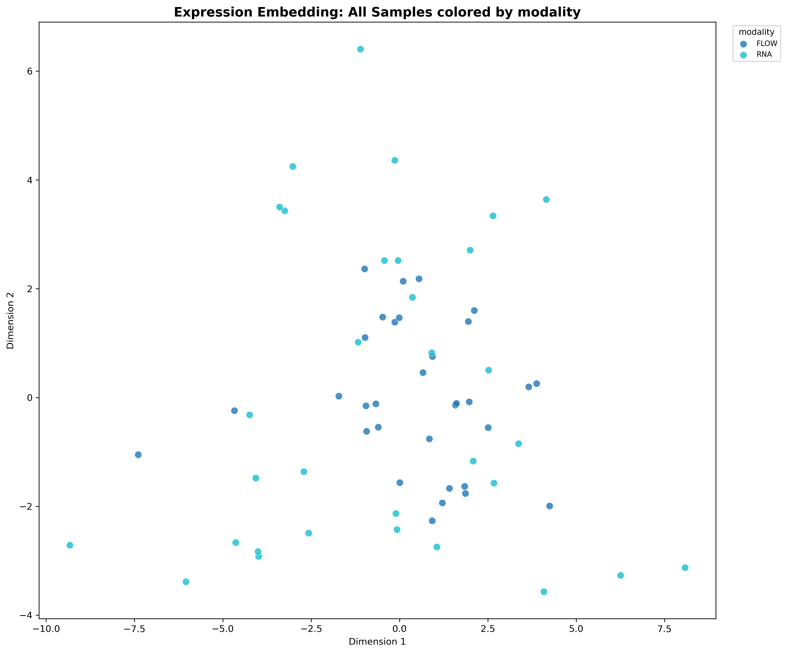

# RNA + flow cytometry with MaxFuse

SampleDisco needs only a joint cell embedding across modalities; it does not care which method produced it. scGLUE (the [multi-omics tutorial](multiomics.md)) links RNA and ATAC through a gene–peak graph. For **RNA + protein** — CITE-seq ADT or flow / spectral cytometry measured on *different* cells — the natural choice is [MaxFuse](https://github.com/shuxiaoc/maxfuse) (Chen et al., *Nat. Biotechnol.* 42, 1096–1106 (2024), [doi:10.1038/s41587-023-01935-0](https://doi.org/10.1038/s41587-023-01935-0)), which matches cells through the handful of proteins that have a coding gene.

This tutorial runs MaxFuse on a subsample of the **Sound Life** cohort (Allen Institute for Immunology; Gong et al., *Nature* 2025): unpaired scRNA-seq and spectral flow cytometry (panel PS1) of PBMCs from young and older adults. It then builds the two cell embeddings SampleDisco uses and derives one sample embedding over both modalities.

In short:

1. **MaxFuse** embeds RNA cells and flow events in one space → `X_maxfuse`.
2. **Harmony on `batch`** → `Z_rmd` (sample differences preserved).
3. **Harmony on `batch` + `sample`** → `Z_comp` (sample removed).
4. **`compute_sample_embedding`** → one embedding of every `<sample>_RNA` / `<sample>_FLOW` unit in `uns['X_DR_sample']`.

!!! info "MaxFuse is part of the standard environment"
    Both environment files ([Installation](../installation.md)) and `pip install "sampledisco[maxfuse]"` (or `[all]`) install MaxFuse 0.0.2 with the **anndata < 0.13** it needs. To add it to an older environment without touching other packages, run `pip install --no-deps maxfuse==0.0.2`. MaxFuse is distributed under its authors' Academic Software License (see its [repository](https://github.com/shuxiaoc/maxfuse)).

## Inputs

Download `soundlife_RNA.h5ad` and `soundlife_FLOW.h5ad` from the [demo dataset](demo_data.md) into a local `data/` folder. They hold **32 samples** — one baseline visit (Flu Year 1 Day 0) per donor, 16 young and 16 older adults, four per sex × CMV group — with **1,000 cells per sample in each modality**.

| File | `.X` | Shape | Per-cell `.obs` |
| --- | --- | --- | --- |
| `soundlife_RNA.h5ad` | raw UMI counts | 32,000 cells × 18,456 genes | `sample`, `subject`, `age_group`, `age_at_draw`, `sex`, `cmv`, `batch`, `cell_type` (AIFI L2), `cell_type_l1` |
| `soundlife_FLOW.h5ad` | `arcsinh(x / 3000)` of the unmixed values (raw values in `layers['unmixed']`) | 32,000 events × 24 markers | same sample columns, `batch`, `lineage` (marker gates) |

The two modalities share **samples**, not cells, so this is the unpaired setting. The whole script is also available as one file: [`soundlife_maxfuse_tutorial.py`](../assets/soundlife_maxfuse_tutorial.py).

Output lands under `sampledisco_soundlife_output/multiomics/`. On 8 CPU cores the full tutorial takes about 17 minutes and peaks at 3.5 GB of RAM; MaxFuse is most of it.

## 1. Load the data

```python
import anndata as ad
import numpy as np
import pandas as pd
import scanpy as sc

rna = ad.read_h5ad("data/soundlife_RNA.h5ad")    # raw counts
flow = ad.read_h5ad("data/soundlife_FLOW.h5ad")  # X = arcsinh(unmixed / 3000)
print(rna, flow, sep="\n")
```

## 2. MaxFuse inputs

MaxFuse takes two views of each modality:

- **Shared features** — the 21 flow markers with a coding gene, expanded to 25 gene–protein pairs (CD3 → *CD3E*, *CD3D*, *CD3G*, …). The linked genes are normalized to the flow scale and log-transformed so the two sides are comparable; pairs that are constant on either side are dropped.
- **Active features** — everything informative within a modality: the RNA highly variable genes and all 24 flow markers.

These are the settings of the MaxFuse authors' CITE-seq tutorial, except that the flow side keeps its `arcsinh` transform (spectrally unmixed values are partly negative, so the ADT row-normalization does not apply).

```python
# Flow marker -> gene(s) encoding it. CD45, CD45RA and CD15 have no usable gene and stay flow-only.
LINKS = {
    "CD3": ["CD3E", "CD3D", "CD3G"], "CD19": ["CD19"], "CD56": ["NCAM1"], "CD14": ["CD14"],
    "HLA-DR": ["HLA-DRA", "HLA-DRB1"], "CD4": ["CD4"], "CD8": ["CD8A", "CD8B"], "CD25": ["IL2RA"],
    "CD127": ["IL7R"], "CCR7": ["CCR7"], "TCRab": ["TRAC"], "IgD": ["IGHD"], "CD27": ["CD27"],
    "CD38": ["CD38"], "CD16": ["FCGR3A"], "CD11b": ["ITGAM"], "CD11c": ["ITGAX"], "CD123": ["IL3RA"],
    "CD304": ["NRP1"], "CD141": ["THBD"], "CD34": ["CD34"],
}
pairs = [(g, p) for p, genes in LINKS.items() for g in genes
         if g in rna.var_names and p in flow.var_names]
rna_link = rna[:, [g for g, _ in pairs]].X.toarray()
flow_link = flow[:, [p for _, p in pairs]].X
keep = (rna_link.std(0) > 1e-5) & (flow_link.std(0) > 1e-5)   # drop constant pairs
pairs = [pr for pr, k in zip(pairs, keep) if k]
print(f"{len(pairs)} linked gene-protein pairs")

def zscore(x):
    return ((x - x.mean(0)) / x.std(0)).astype(np.float32)

# shared features: linked genes normalized to the flow scale, log1p, z-scored
shared = ad.AnnData(rna[:, [g for g, _ in pairs]].X.astype(np.float32))
target = (np.median(np.asarray(shared.X.sum(1))) + np.median(flow_link[:, keep].sum(1))) / 2
sc.pp.normalize_total(shared, target_sum=target)
sc.pp.log1p(shared)
rna_shared = zscore(shared.X.toarray())
flow_z = zscore(flow.X)
flow_shared = flow_z[:, [flow.var_names.get_loc(p) for _, p in pairs]]

# active features: RNA highly variable genes, all flow markers
act = rna.copy()
sc.pp.normalize_total(act)
sc.pp.log1p(act)
sc.pp.highly_variable_genes(act)
rna_active = zscore(act[:, act.var["highly_variable"]].X.toarray())
flow_active = flow_z
print(f"shared {rna_shared.shape[1]} features, active RNA {rna_active.shape[1]} HVGs / flow {flow_active.shape[1]} markers")
```

## 3. Run MaxFuse

MaxFuse matches metacells across modalities on the shared features, refines the matches iteratively with CCA on the active features, discards the weakest 30% of matched pairs, and embeds every cell of both modalities with the CCA fitted on the surviving pairs.

```python
import maxfuse as mf

n_shared = rna_shared.shape[1] - 1
fusor = mf.model.Fusor(shared_arr1=rna_shared, shared_arr2=flow_shared,
                       active_arr1=rna_active, active_arr2=flow_active)
fusor.split_into_batches(max_outward_size=5000, matching_ratio=3, metacell_size=2, seed=42)
fusor.construct_graphs(n_neighbors1=15, n_neighbors2=15, svd_components1=30, svd_components2=None,
                       resolution1=2, resolution2=2, resolution_tol=0.1, leiden_seed=42)
fusor.find_initial_pivots(wt1=0.7, wt2=0.7, svd_components1=min(25, n_shared),
                          svd_components2=min(20, n_shared))
fusor.refine_pivots(wt1=0.7, wt2=0.7, svd_components1=30, svd_components2=None, cca_components=20,
                    n_iters=3, randomized_svd=False, svd_runs=1)
fusor.filter_bad_matches(target="pivot", filter_prop=0.3)
rna_cca, flow_cca = fusor.get_embedding(active_arr1=fusor.active_arr1, active_arr2=fusor.active_arr2)
print("joint embedding:", rna_cca.shape, flow_cca.shape)
```

`rna_cca` and `flow_cca` (20 dimensions each) are the joint embedding, `X_maxfuse`.

## 4. Flow cell types and the RNA + flow union

SampleDisco's composition blocks need one cell-type vocabulary across modalities. The RNA cells carry the AIFI L2 labels; each flow event takes the majority label of its 15 nearest RNA cells in the joint space. The lineage agreement with the flow marker gates is a quick check of the integration — it should be high (this run: 0.93).

The union then gets the two embeddings SampleDisco uses, built from `X_maxfuse` with two Harmony passes:

- `Z_rmd` = Harmony on `batch` — technical batch removed, **sample differences preserved** (feeds the RMD displacement block);
- `Z_comp` = Harmony on `batch` + `sample` — **sample removed** (feeds the composition blocks).

```python
from scipy import sparse
from sklearn.neighbors import NearestNeighbors
from sampledisco.utils.harmony_compat import harmonize_embedding
from sampledisco.preparation.multi_omics_batch_correction import harmonize_xglue

# each flow event takes the majority RNA cell type among its 15 nearest RNA cells in the joint space
_, nbr = NearestNeighbors(n_neighbors=15).fit(rna_cca).kneighbors(flow_cca)
codes, names = pd.factorize(rna.obs["cell_type"].astype(str))
flow_ct = names[[np.bincount(row, minlength=len(names)).argmax() for row in codes[nbr]]]

# sanity check: transferred lineage vs the flow marker gates
to_lineage = {"T cell": "T", "B cell": "B", "NK cell": "NK", "Monocyte": "Mono", "DC": "DC"}
l1 = rna.obs.groupby("cell_type", observed=True)["cell_type_l1"].first().astype(str)
flow_lin = pd.Series(flow_ct).map(l1).map(to_lineage).fillna("other").to_numpy()
print(f"lineage agreement with flow gates: {(flow_lin == flow.obs['lineage'].to_numpy()).mean():.3f}")

meta = ["sample", "batch", "subject", "visit", "age_group", "age_at_draw", "sex", "cmv"]
obs = pd.concat([
    rna.obs[meta].astype({c: str for c in meta if c != "age_at_draw"})
       .assign(modality="RNA", cell_type=rna.obs["cell_type"].astype(str).to_numpy()),
    flow.obs[meta].astype({c: str for c in meta if c != "age_at_draw"})
        .assign(modality="FLOW", cell_type=np.asarray(flow_ct)),
])
for c in obs.columns.drop("age_at_draw"):
    obs[c] = obs[c].astype("category")
union = ad.AnnData(X=sparse.csr_matrix((len(obs), 0), dtype=np.float32), obs=obs)
union.obsm["X_maxfuse"] = np.vstack([rna_cca, flow_cca]).astype(np.float32)

# Z_rmd: technical batch removed, sample differences kept (displacement view)
union.obsm["Z_rmd"] = harmonize_embedding(union.obsm["X_maxfuse"], union.obs, batch_key=["batch"],
                                          max_iter_harmony=50, use_gpu=False, seed=42)
# Z_comp: batch and sample removed (composition / clustering view)
harmonize_xglue(union, sample_col="sample", batch_col="batch", in_key="Z_rmd", out_key="Z_comp",
                use_gpu=False, max_iter=50, random_state=42)
print(union)
```

!!! note "Batch labels in Sound Life"
    `batch` is the Allen processing-batch ID. For most samples the RNA and flow batch IDs are the same label, so the `batch` correction mainly removes processing-run effects rather than the RNA-vs-flow offset; modality is handled explicitly at the sample level (next step), where units are `<sample>_RNA` / `<sample>_FLOW` and Harmony uses `modality × batch`. This mirrors the full Sound Life run.

## 5. Sample embedding

Identical to the other pipelines: composition blocks on `Z_comp`, the RMD displacement block on `Z_rmd`, units `<sample>_RNA` and `<sample>_FLOW`.

```python
from sampledisco.sample_embedding import compute_sample_embedding

union = compute_sample_embedding(
    union,
    output_dir="sampledisco_soundlife_output/multiomics",
    use_gpu=False,
    sample_col="sample",
    celltype_col="cell_type",
    comp_emb_key="Z_comp",
    rmd_emb_key="Z_rmd",
    modality_col="modality",
    batch_col="batch",
    medium_K=120,
    fine_K=300,
    rmd_dim_per_cluster=8,
    rmd_weight=0.60,
    pca_components=10,
    batch_method="harmony",
    save=True,
)
print(union.uns["X_DR_sample"].iloc[:4, :4])
```

**Writes** → `uns['X_DR_sample']` (64 units × 10 PCs) on the returned `AnnData`, and `sample_embedding/sample_embedding.csv` plus the per-block features (`sample_embedding_blocks.npz`) under `sampledisco_soundlife_output/multiomics/`.

## 6. What the sample embedding captures

`build_sample_adata` turns the embedding into a one-row-per-unit `AnnData` that every downstream module accepts. Here it feeds the per-PC association analysis (variance explained by age, sex and CMV, with permutation p-values) and a scatter of the units. Modality is not tested there: it varies within a sample, and the association runs on sample-level variables.

```python
from sampledisco.sample_embedding.sample_embedding import build_sample_adata
from sampledisco.sample_association.association import run_dimension_association_analysis
from sampledisco.visualization.multi_omics_visualization import visualize_multimodal_embedding

sample_adata = build_sample_adata(union, sample_col="sample", modality_col="modality")
assoc = run_dimension_association_analysis(
    pseudo_adata=sample_adata,
    output_dir="sampledisco_soundlife_output/multiomics/sample_association",
    continuous_cols=["age_at_draw"],
    categorical_cols=["age_group", "sex", "cmv"],
    n_permutations=999,
    sample_col="sample",
    random_state=42,
)
visualize_multimodal_embedding(
    adata=sample_adata,
    visualization_grouping_column=["age_group", "modality"],
    output_dir="sampledisco_soundlife_output/multiomics",   # plots go to <output_dir>/visualization/
    show_default=True,
)
```

In our run, two of the ten PCs carry the donor biology. **Age group explains 47% of PC2** (age at draw: Pearson r = −0.68), and **CMV serostatus explains 36% of PC4** — both with permutation p = 0.001 (FDR 0.013) on just 32 donors. The figures plot the first two PCs:



<div class="figure-caption">Step 6 — PC1 vs PC2 of the 64 units (32 donors × RNA / flow). Young and older donors separate along PC2 in <b>both</b> modalities; the flow units spread less than the RNA units, since 24 markers carry less information than a transcriptome.</div>

Exact values move slightly with the platform and library versions (k-means and Harmony are seeded but not bit-identical across BLAS builds). Across the three environments we tested, age group explained 43–47% of PC2 and CMV 34–37% of PC4, every time with p = 0.001.

---

Every downstream analysis — sample distance, CCA / TSCAN trajectories, clustering, proportion tests — runs on `uns['X_DR_sample']` exactly as for RNA or RNA + ATAC; continue with the [Downstream analysis tutorials](downstream/index.md).

!!! tip "Scaling up"
    The full Sound Life data (868 samples, 4.3 M RNA cells and 4.3 M flow events) is too large for one MaxFuse fit. There the same recipe runs on 40 random shards (each holding cells of every sample and batch) to collect pivot pairs, after which one CCA is fitted on all pooled pivots and every cell is embedded with it — the construction `get_embedding` uses above.

*Data: Gong Q. et al. Longitudinal multi-omic immune profiling reveals age-related immune cell dynamics in healthy adults. Nature (2025), [doi:10.1038/s41586-025-09686-5](https://doi.org/10.1038/s41586-025-09686-5); Allen Institute for Immunology, Human Immune System Explorer, [doi:10.57785/bn17-3h16](https://doi.org/10.57785/bn17-3h16). Redistributed for noncommercial use under the Allen Institute Terms of Use.*
