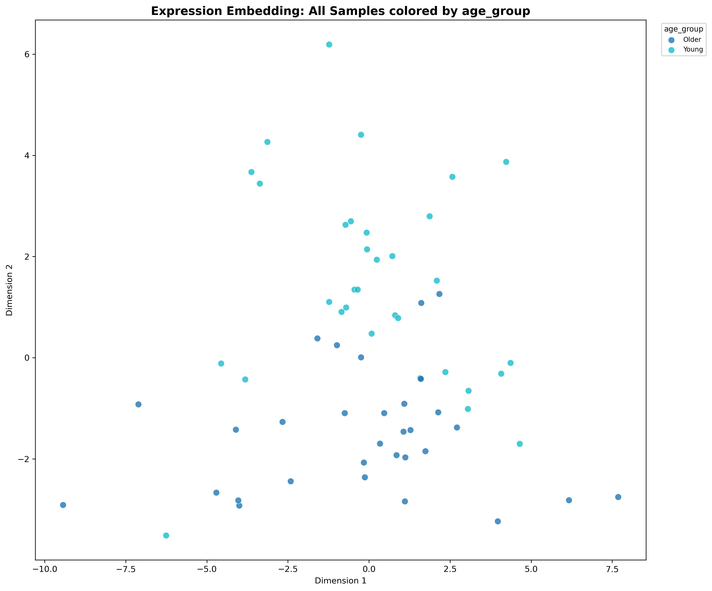

# RNA + flow cytometry (MaxFuse)

SampleDisco only needs a joint cell embedding across modalities, whatever method produced it. For **RNA + protein** measured on *different* cells, such as flow or spectral cytometry, [MaxFuse](https://github.com/shuxiaoc/maxfuse) (Chen et al., *Nat. Biotechnol.* 2024, [doi:10.1038/s41587-023-01935-0](https://doi.org/10.1038/s41587-023-01935-0)) links the cells through the proteins that have a coding gene. This page builds that embedding for a subset of the Sound Life cohort, then one sample embedding over both modalities, in which age group and CMV status stand out. MaxFuse 0.0.2 comes with the all-in-one environment and with `pip install "sampledisco[maxfuse]"` (see [Installation](../installation.md)). It is distributed under its authors' Academic Software License.

## The data

Unpaired scRNA-seq and spectral flow cytometry (panel PS1) of PBMCs from 32 Sound Life donors: one baseline visit each, 16 young and 16 older adults, four per sex × CMV group, with 1,000 cells per sample in each modality. The two modalities share **samples**, not cells. Both files carry the sample columns `sample`, `subject`, `age_group`, `age_at_draw`, `sex`, `cmv` and the processing `batch`.

- `soundlife_RNA.h5ad`: raw UMI counts, 32,000 cells × 18,456 genes, with AIFI L2 cell types in `obs['cell_type']`.
- `soundlife_FLOW.h5ad`: `arcsinh(x / 3000)` of the unmixed values, 32,000 events × 24 markers, with marker-gated lineages in `obs['lineage']`.

```bash
mkdir -p data
curl -fL -o data/soundlife_RNA.h5ad  "https://zenodo.org/records/24451067/files/soundlife_RNA.h5ad?download=1"
curl -fL -o data/soundlife_FLOW.h5ad "https://zenodo.org/records/24451067/files/soundlife_FLOW.h5ad?download=1"
```

```python
import anndata as ad
import numpy as np
import pandas as pd
import scanpy as sc

rna = ad.read_h5ad("data/soundlife_RNA.h5ad")    # raw counts
flow = ad.read_h5ad("data/soundlife_FLOW.h5ad")  # X = arcsinh(unmixed / 3000)
print(rna, flow, sep="\n")
```

The page takes 4 to 20 minutes on 8 CPU cores, depending on the CPU, and peaks at about 3.5 GB of RAM; MaxFuse is most of it. All its code is also one script: [`soundlife_maxfuse_tutorial.py`](../assets/soundlife_maxfuse_tutorial.py).

## 1. Build the linked features

MaxFuse takes two views of each modality. The settings are those of the MaxFuse authors' CITE-seq tutorial, except that the flow side keeps its `arcsinh` transform, because unmixed values are partly negative.

- **Shared features** link the two sides: each flow marker with a coding gene is paired with that gene (CD3 → *CD3E*, *CD3D*, *CD3G*, …), and the linked genes are normalized to the flow scale and log-transformed. Pairs that are constant on either side are dropped, which leaves 25 pairs.
- **Active features** are everything informative within one modality: the RNA highly variable genes and all 24 flow markers.

```python
# Flow marker -> gene(s) encoding it. CD45, CD45RA and CD15 have no usable gene and stay flow-only.
LINKS = {
    "CD3": ["CD3E", "CD3D", "CD3G"], "CD19": ["CD19"], "CD56": ["NCAM1"], "CD14": ["CD14"],
    "HLA-DR": ["HLA-DRA", "HLA-DRB1"], "CD4": ["CD4"], "CD8": ["CD8A", "CD8B"], "CD25": ["IL2RA"],
    "CD127": ["IL7R"], "CCR7": ["CCR7"], "TCRab": ["TRAC"], "IgD": ["IGHD"], "CD27": ["CD27"],
    "CD38": ["CD38"], "CD16": ["FCGR3A"], "CD11b": ["ITGAM"], "CD11c": ["ITGAX"], "CD123": ["IL3RA"],
    "CD304": ["NRP1"], "CD141": ["THBD"], "CD34": ["CD34"],
}
pairs = [(g, p) for p, genes in LINKS.items() for g in genes
         if g in rna.var_names and p in flow.var_names]
rna_link = rna[:, [g for g, _ in pairs]].X.toarray()
flow_link = flow[:, [p for _, p in pairs]].X
keep = (rna_link.std(0) > 1e-5) & (flow_link.std(0) > 1e-5)   # drop constant pairs
pairs = [pr for pr, k in zip(pairs, keep) if k]
print(f"{len(pairs)} linked gene-protein pairs")

def zscore(x):
    return ((x - x.mean(0)) / x.std(0)).astype(np.float32)

# shared features: linked genes normalized to the flow scale, log1p, z-scored
shared = ad.AnnData(rna[:, [g for g, _ in pairs]].X.astype(np.float32))
target = (np.median(np.asarray(shared.X.sum(1))) + np.median(flow_link[:, keep].sum(1))) / 2
sc.pp.normalize_total(shared, target_sum=target)
sc.pp.log1p(shared)
rna_shared = zscore(shared.X.toarray())
flow_z = zscore(flow.X)
flow_shared = flow_z[:, [flow.var_names.get_loc(p) for _, p in pairs]]

# active features: RNA highly variable genes, all flow markers
act = rna.copy()
sc.pp.normalize_total(act)
sc.pp.log1p(act)
sc.pp.highly_variable_genes(act)
rna_active = zscore(act[:, act.var["highly_variable"]].X.toarray())
flow_active = flow_z
print(f"shared {rna_shared.shape[1]} features, active RNA {rna_active.shape[1]} HVGs / flow {flow_active.shape[1]} markers")
```

## 2. Run MaxFuse

MaxFuse matches metacells across the modalities on the shared features, refines the matches with CCA on the active features, and drops the weakest 30% of them. It then embeds every cell of both modalities with the final CCA: 20 dimensions, `X_maxfuse`.

```python
import maxfuse as mf

n_shared = rna_shared.shape[1] - 1
fusor = mf.model.Fusor(shared_arr1=rna_shared, shared_arr2=flow_shared,
                       active_arr1=rna_active, active_arr2=flow_active)
fusor.split_into_batches(max_outward_size=5000, matching_ratio=3, metacell_size=2, seed=42)
fusor.construct_graphs(n_neighbors1=15, n_neighbors2=15, svd_components1=30, svd_components2=None,
                       resolution1=2, resolution2=2, resolution_tol=0.1, leiden_seed=42)
fusor.find_initial_pivots(wt1=0.7, wt2=0.7, svd_components1=min(25, n_shared),
                          svd_components2=min(20, n_shared))
fusor.refine_pivots(wt1=0.7, wt2=0.7, svd_components1=30, svd_components2=None, cca_components=20,
                    n_iters=3, randomized_svd=False, svd_runs=1)
fusor.filter_bad_matches(target="pivot", filter_prop=0.3)
rna_cca, flow_cca = fusor.get_embedding(active_arr1=fusor.active_arr1, active_arr2=fusor.active_arr2)
print("joint embedding:", rna_cca.shape, flow_cca.shape)
```

## 3. Transfer the cell types to flow

The composition blocks need one cell-type vocabulary across modalities. Each flow event takes the majority AIFI L2 label of its 15 nearest RNA cells in the joint space. As a check, the transferred lineage should agree with the flow marker gates; here it does for 92% of the events.

```python
from sklearn.neighbors import NearestNeighbors

_, nbr = NearestNeighbors(n_neighbors=15).fit(rna_cca).kneighbors(flow_cca)
codes, names = pd.factorize(rna.obs["cell_type"].astype(str))
flow_ct = names[[np.bincount(row, minlength=len(names)).argmax() for row in codes[nbr]]]

# sanity check: transferred lineage vs the flow marker gates
to_lineage = {"T cell": "T", "B cell": "B", "NK cell": "NK", "Monocyte": "Mono", "DC": "DC"}
l1 = rna.obs.groupby("cell_type", observed=True)["cell_type_l1"].first().astype(str)
flow_lin = pd.Series(flow_ct).map(l1).map(to_lineage).fillna("other").to_numpy()
print(f"lineage agreement with flow gates: {(flow_lin == flow.obs['lineage'].to_numpy()).mean():.3f}")
```

## 4. Build the union with Harmony

Stack both modalities into one `AnnData` and build the two views SampleDisco uses from `X_maxfuse`:

- `Z_rmd`: Harmony on `batch`. The technical batch is removed and the **sample differences are kept**; this view feeds the RMD displacement block.
- `Z_comp`: Harmony on `batch` + `sample`. The **sample effect is removed**; this view feeds the composition blocks.

```python
from scipy import sparse
from sampledisco.utils.harmony_compat import harmonize_embedding
from sampledisco.preparation.multi_omics_batch_correction import harmonize_xglue

meta = ["sample", "batch", "subject", "visit", "age_group", "age_at_draw", "sex", "cmv"]
obs = pd.concat([
    rna.obs[meta].astype({c: str for c in meta if c != "age_at_draw"})
       .assign(modality="RNA", cell_type=rna.obs["cell_type"].astype(str).to_numpy()),
    flow.obs[meta].astype({c: str for c in meta if c != "age_at_draw"})
        .assign(modality="FLOW", cell_type=np.asarray(flow_ct)),
])
for c in obs.columns.drop("age_at_draw"):
    obs[c] = obs[c].astype("category")
union = ad.AnnData(X=sparse.csr_matrix((len(obs), 0), dtype=np.float32), obs=obs)
union.obsm["X_maxfuse"] = np.vstack([rna_cca, flow_cca]).astype(np.float32)

# Z_rmd: technical batch removed, sample differences kept (displacement view)
union.obsm["Z_rmd"] = harmonize_embedding(union.obsm["X_maxfuse"], union.obs, batch_key=["batch"],
                                          max_iter_harmony=50, use_gpu=False, seed=42)
# Z_comp: batch and sample removed (composition / clustering view)
harmonize_xglue(union, sample_col="sample", batch_col="batch", in_key="Z_rmd", out_key="Z_comp",
                use_gpu=False, max_iter=50, random_state=42)
print(union)
```

## 5. Sample embedding

The same call as for RNA + ATAC, with one unit per sample and modality (`<sample>_RNA`, `<sample>_FLOW`). `batch` is corrected at the unit level too, and `rmd_weight=0.60` sets the weight of the RMD block (see [Sample embedding in depth](sample_embedding.md)).

```python
from sampledisco.sample_embedding import compute_sample_embedding

union = compute_sample_embedding(
    union,
    output_dir="sampledisco_soundlife_output/multiomics",
    sample_col="sample",
    celltype_col="cell_type",
    comp_emb_key="Z_comp",
    rmd_emb_key="Z_rmd",
    modality_col="modality",
    batch_col="batch",
    rmd_weight=0.60,
)
print(union.uns["X_DR_sample"].shape)   # 64 units x 10 PCs
```

## 6. Downstream

`build_sample_adata` turns the embedding into one row per unit, which every downstream module accepts. Here it feeds the per-PC association test (variance explained by age, sex and CMV, with permutation p-values) and the embedding plots. Every other analysis on the [Downstream analysis](downstream/index.md) page (distances, trajectories, clustering, proportion tests) runs on this embedding in the same way.

```python
from sampledisco.sample_embedding.sample_embedding import build_sample_adata
from sampledisco.sample_association.association import run_dimension_association_analysis
from sampledisco.visualization.multi_omics_visualization import visualize_multimodal_embedding

sample_adata = build_sample_adata(union, sample_col="sample", modality_col="modality")
assoc = run_dimension_association_analysis(
    pseudo_adata=sample_adata,
    output_dir="sampledisco_soundlife_output/multiomics/sample_association",
    continuous_cols=["age_at_draw"],
    categorical_cols=["age_group", "sex", "cmv"],
    n_permutations=999,
)
visualize_multimodal_embedding(adata=sample_adata, visualization_grouping_column=["age_group", "modality"],
                               output_dir="sampledisco_soundlife_output/multiomics")   # plots go to .../visualization/
```

Two of the ten PCs carry the donor biology. **Age group explains 45% of PC2** (age at draw: Pearson r = −0.66), and **CMV serostatus explains 37% of PC4**, both with permutation p = 0.001 (FDR 0.013) on 32 donors. The percentages move by a few points between environments; the p-values do not.


<div class="figure-caption">PC1 against PC2 of the 64 units (32 donors × RNA / flow). Young and older donors separate along PC2 in both modalities.</div>

**Output**, under `sampledisco_soundlife_output/multiomics/`:

- `sample_embedding/sample_embedding.csv`: 64 units × 10 PCs.
- `sample_association/variance_explained_sample.csv`: R², permutation p-value and FDR for every variable and PC.
- `visualization/all_samples_*_by_{age_group,modality}.png`: the embedding plots.

*Data: Gong Q. et al. Longitudinal multi-omic immune profiling reveals age-related immune cell dynamics in healthy adults. Nature (2025), [doi:10.1038/s41586-025-09686-5](https://doi.org/10.1038/s41586-025-09686-5); Allen Institute for Immunology, Human Immune System Explorer, [doi:10.57785/bn17-3h16](https://doi.org/10.57785/bn17-3h16). Redistributed for noncommercial use under the Allen Institute Terms of Use.*
