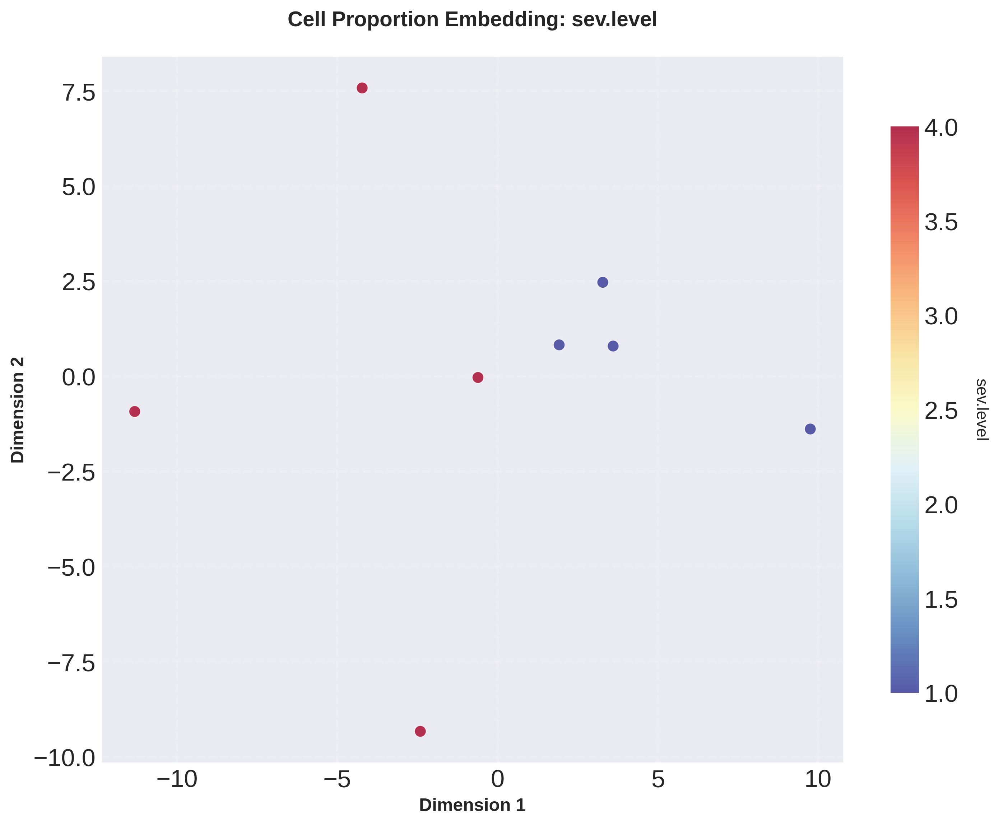

# Quick start

This page runs the whole SampleDisco pipeline on the COVID-19 demo data (8 samples: 4 healthy, 4 severe) from one YAML config. You get a sample embedding and every downstream result in `./sampledisco_demo_output/`.

You need a working [installation](../installation.md). Run every command on this page from the folder created in step 1, because the demo config uses paths relative to it.

## 1. Set up a run folder

```bash
mkdir -p sampledisco_quickstart/data
cd sampledisco_quickstart
curl -fL -o data/test_RNA.h5ad  "https://zenodo.org/records/24451067/files/test_RNA.h5ad?download=1"
curl -fL -o data/test_ATAC.h5ad "https://zenodo.org/records/24451067/files/test_ATAC.h5ad?download=1"
sampledisco --init-config config.yaml
```

- `--init-config` writes the demo config that ships with the package (the same as [`config_demo.yaml`](../assets/config_demo.yaml)), and warns that its values are tuned for the demo data. It never overwrites an existing file.
- This page only needs `test_RNA.h5ad`. `test_ATAC.h5ad` is for the RNA + ATAC option at the end. See [Demo data](demo_data.md) for the other files.

## 2. Run from the command line

The template runs RNA and ATAC. Switch ATAC off, which is the only edit, and run:

```bash
sed -i.bak 's/^run_atac_pipeline: true/run_atac_pipeline: false/' config.yaml
sampledisco -m complex --config config.yaml
```

- `sed -i.bak` works with GNU and macOS `sed`; changing the line in a text editor works just as well.
- The CLI checks the config before it starts: every key must be present and unknown keys are rejected. Change values; don't delete keys.
- On 8 CPU cores the run takes about 2–4 minutes, depending on the machine, and needs about 3 GB of RAM.

The log ends with `RNA pipeline completed successfully!` and the total execution time.

## 3. The same run from Python

The CLI is a thin layer over one function, `wrapper()`, which takes the config keys as keyword arguments. This does the same run as step 2 and writes to the same folder, so you only need one of the two.

```python
import yaml
from sampledisco.wrapper.wrapper import wrapper

with open("config.yaml") as fh:
    cfg = yaml.safe_load(fh)
cfg["run_atac_pipeline"] = False    # the same edit as in step 2

res = wrapper(**cfg)
rna = res["rna_results"]
print("cell level:  ", rna["adata"].shape)
print("sample level:", rna["pseudo_adata"].shape)
```

```text
cell level:   (29988, 12301)
sample level: (8, 7)
```

- `rna["adata"]` is the cell-level AnnData after QC and cell typing, with the sample embedding in `uns['X_DR_sample']`.
- `rna["pseudo_adata"]` has one row per sample. Its `X` is the embedding: 7 PCs, because PCA on 8 samples gives at most 7. Its `obs` holds the sample metadata and `pseudotime_sample`.
- Unlike the CLI, `wrapper()` does not check the key set. A key you leave out takes the function's default, which is often not the demo value, so start from the full config.

## 4. What each stage writes

Each stage has an on/off flag in the config and writes its own folder under `sampledisco_demo_output/rna/`:

| Folder | Stage (flag) | Key files |
| --- | --- | --- |
| `preprocess/` | QC, Harmony and cell typing (`rna_preprocessing`, `rna_cell_type_cluster`) | `adata_preprocessed.h5ad`, `cell_type.csv`, `umap_cell_type.png` |
| `sample_embedding/` | sample embedding (`rna_derive_sample_embedding`) | `sample_embedding.csv` (samples × PCs), `sample_embedding_blocks.npz` |
| `Sample_distance/` | sample distances (`rna_sample_distance_calculation`) | `cosine/` and `correlation/`: distance matrix and heatmap |
| `CCA/` | trajectory (`rna_trajectory_analysis`) | `pseudotime_sample.csv` and CCA plots (`TSCAN/` for an unsupervised trajectory) |
| `trajectoryDEG/` | genes along the pseudotime (`rna_trajectory_dge`) | `gam_*_<timestamp>.tsv`, `visualizations/` |
| `sample_cluster/` | k-means clusters (`rna_sample_cluster`) and proportion test (`rna_proportion_test`) | `kmeans_clusters_sample.csv`, `proportion_test/` |
| `sample_association/` | PCs vs. sample metadata (`rna_dimension_association_analysis`) | `variance_explained_sample.csv`, `figures/` |
| `visualization/` | plots (`rna_visualize_data`) | `cell_type_dendrogram.png`, `*_embedding_sev.level.png` |
| `raisin_results/` | RAISIN DGE (`rna_cluster_dge`) | off in the template, because it needs 16–18 GB of RAM |

`sampledisco_demo_output/sys_log/main_process_status.json` records which stages finished.

## 5. Load the sample embedding back

The tables are plain CSV, so any tool can read them:

```python
import pandas as pd

OUT = "sampledisco_demo_output/rna"
emb = pd.read_csv(f"{OUT}/sample_embedding/sample_embedding.csv", index_col=0)
ptime = pd.read_csv(f"{OUT}/CCA/pseudotime_sample.csv", index_col=0)
clusters = pd.read_csv(f"{OUT}/sample_cluster/kmeans_clusters_sample.csv", index_col=0)
print(emb[["PC1", "PC2"]].join(ptime).join(clusters).round(2))
```

```text
                PC1   PC2  pseudotime  cluster_sample_kmeans
sample                                                      
CoV-3-Wilk    -2.41 -9.33        0.50                      1
CoV-34-Aruna -11.32 -0.92        1.00                      2
CoV-36-Aruna  -0.61 -0.03        0.56                      1
CoV-4-Wilk    -4.22  7.58        0.68                      1
HD-1-Wilk      3.28  2.47        0.09                      0
HD-20-Aruna    1.92  0.83        0.18                      0
HD-21-Aruna    3.60  0.80        0.11                      0
HD-4-Wilk      9.75 -1.38        0.00                      0
```

Leiden clustering and floating-point results vary between machines, so your numbers can differ a little. The pseudotime runs from 0 to 1 and is oriented to increase with `sev.level`. To get the cell-level AnnData back, with the embedding in `uns['X_DR_sample']`, read `preprocess/adata_preprocessed.h5ad`; see [Outputs and resuming runs](outputs.md).

{ width="520" }

<div class="figure-caption"><code>rna/visualization/proportion_embedding_sev.level.png</code>: the 8 samples on the first two embedding PCs, coloured by <code>sev.level</code>.</div>

!!! note "8 samples are enough to run, not to conclude"
    The demo is sized to finish in minutes. With 8 samples the supervised CCA fits almost any label, the k-means clusters are tiny, and the tests compare 4 samples with 4. Treat every statistic it produces as illustrative.

## Next

Keep `run_atac_pipeline: true` to run ATAC as well, or set `run_multiomics_pipeline: true` (with `test_multiomics_integrated.h5ad` in `data/`) for one joint RNA + ATAC embedding, as on the [RNA + ATAC (scGLUE)](multiomics.md) page; the Advanced pages cover the [configuration](configuration.md), [outputs and resuming runs](outputs.md) and [your own data](own_data.md).
