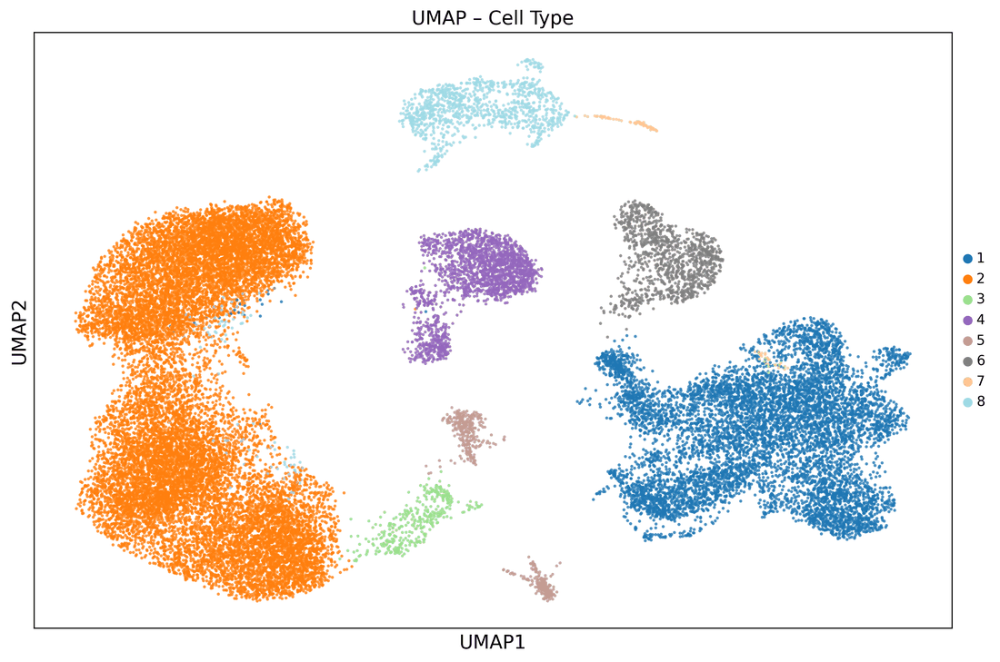

# RNA pipeline, step by step (Python API)

This page runs the scRNA-seq branch of SampleDisco one function at a time, from raw counts to the sample embedding. It reproduces the RNA part of the demo config (`sampledisco --init-config`, the same file as [`config_demo.yaml`](../assets/config_demo.yaml)) with the **same parameter values and the same batch handling**, so you can see what each stage does, what it writes, and how to change it.

There are three calls:

1. **`preprocess`** → QC, HVGs, PCA and two Harmony passes: `obsm['Z_comp']` (sample removed) and `obsm['Z_rmd']` (sample differences kept).
2. **`cell_types`** → Leiden clusters on `Z_comp`, merged to 8 cell types, plus a UMAP.
3. **`compute_sample_embedding`** → one row per sample in `uns['X_DR_sample']`.

Everything after that (distances, trajectories, clustering, association, prediction) is shared with ATAC and multi-omics and lives in [Downstream analysis](downstream/index.md).

!!! tip "Prefer one command?"
    The [quick start](quickstart.md) runs this whole branch, plus the downstream analyses, from the demo config. The table at the end of this page maps every argument below to its config key.

!!! note "Imports"
    Import each function from the module that defines it, as below. Only two subpackages re-export anything from their `__init__`: `sampledisco.sample_embedding` (`compute_sample_embedding`) and `sampledisco.sample_prediction` (`predict_phenotype`, `transfer_labels`). The top-level `sampledisco` package also exposes those three, plus `wrapper`. The preprocessing and cell-typing functions have no shortcut: use `sampledisco.preparation.rna_preprocess_cpu` and `sampledisco.preparation.cell_type_cpu`.

## Inputs

Run everything on this page from one empty folder. Download the demo RNA file into `./data/`:

```bash
mkdir -p data
curl -fL -o data/test_RNA.h5ad "https://zenodo.org/records/24451067/files/test_RNA.h5ad?download=1"
```

`test_RNA.h5ad` holds raw UMI counts for 29,989 cells × 14,881 genes from 8 samples (see [Demo data](demo_data.md)). Its `.obs` already carries everything the pipeline needs, so no metadata CSV is required:

- `sample`: the sample ID (8 samples, 1,599 to 6,950 cells each);
- `batch`: the source study, `Aruna` or `Wilk`, 4 samples each;
- `sev.level`: the phenotype, `1` (healthy) or `4` (severe COVID-19), 4 samples each. Each batch has 2 samples of each level, so correcting `batch` does not remove the phenotype;
- `celltype`: published labels. This page clusters de novo instead, like the demo config.

All output goes to `sampledisco_demo_output/rna/`, the folder the config-driven run uses, so the [downstream pages](downstream/index.md) find it. Running the quick start in the same folder overwrites it.

!!! note "GPU"
    This page runs on CPU. The GPU versions are `preprocess_gpu` (`sampledisco.preparation.rna_preprocess_gpu`), `cell_types_gpu` (`sampledisco.preparation.cell_type_gpu`) and `compute_sample_embedding(..., use_gpu=True)`. Nothing switches to the GPU on its own: **having RAPIDS installed does not turn it on**. You call the `*_gpu` functions yourself and pass `use_gpu=True`, or set `use_gpu: true` in the config (Linux only).

    - The two `*_gpu` preparation modules import `rapids_singlecell` when they load, so they only import on a machine with RAPIDS.
    - `preprocess_gpu` orders its arguments differently and defaults `sample_level_batch_key` to `"batch"`, so pass every argument by keyword.
    - `compute_sample_embedding(use_gpu=True)` falls back to the CPU code, with a message, when `cupy`/`cuml` are missing.

    See [GPU acceleration](gpu.md) for installation and for how far GPU results differ from CPU results.

## 1. Preprocessing

```python
from sampledisco.preparation.rna_preprocess_cpu import preprocess

OUT = "sampledisco_demo_output/rna"

adata = preprocess(
    h5ad_path="data/test_RNA.h5ad",
    sample_meta_path=None,            # sample, batch and sev.level are already in .obs
    output_dir=OUT,
    sample_column="sample",
    cell_level_batch_key=["batch"],   # cell-level Harmony covariates
    sample_level_batch_key="batch",   # only checked to exist here; used again in step 3
    min_cells=100,
    min_genes=200,
    pct_mito_cutoff=20.0,
    exclude_genes=None,
    num_cell_hvgs=2000,
    cell_embedding_num_PCs=20,
    num_harmony_iterations=20,
    verbose=True,
)
print(adata.shape)
print(sorted(adata.obsm.keys()))
```

What happens, in order:

1. **QC.** Genes detected in fewer than `min_cells` cells and cells with fewer than `min_genes` genes are removed, then cells with ≥ `pct_mito_cutoff` % mitochondrial counts, then the `MT-` genes themselves (and any `exclude_genes`). `min_cells` is used a second time to drop samples with fewer than 100 cells. Finally, genes seen in fewer than 0.1 % of cells are dropped.
2. **HVGs and PCA.** 2,000 HVGs are selected from the counts (`seurat_v3`, with `sample` as the batch key). They are flagged in `.var['highly_variable']`, but `.X` keeps all genes. `.X` is then normalized to 10,000 counts per cell and log-transformed; the raw counts stay in `.layers['counts']`. PCA on the HVGs (20 PCs) gives `obsm['X_pca']`.
3. **Harmony pass 1 → `Z_comp`.** Harmony runs on `X_pca` with the `cell_level_batch_key` columns **plus** `sample` (here `batch` and `sample`), so the per-sample variation is removed. Cell typing and the composition blocks use this view. The same matrix is also written under its pre-0.3 name `Z_clust`.
4. **Harmony pass 2 → `Z_rmd`.** A second, sample-naive set of 2,000 HVGs gives a second PCA, `obsm['X_pca_rmd']`. Pass 2 runs Harmony on it with the `cell_level_batch_key` columns **other than** `sample`, so `batch` is removed but the sample differences are kept. The RMD displacement block uses this view. **Pass 2 only runs when there is a non-sample batch column.** With `cell_level_batch_key=None`, `Z_rmd` is the uncorrected `X_pca_rmd`.

`sample_level_batch_key` does nothing in `preprocess` except check that the column exists. The sample-level batch correction happens in step 3, through `batch_col`.

The demo prints (abridged; the Harmony iteration log and a few pandas/scanpy `FutureWarning`s are left out):

```text
Raw shape: 29989 cells × 14881 genes
After initial filtering: 29989 cells × 12314 genes
After mitochondrial filtering: 29988 cells × 12314 genes
After gene exclusion: 29988 cells × 12301 genes
After sample filtering: 29988 cells × 12301 genes
Samples remaining: 8
After HVG1 (sample-aware) selection: 2000 flagged / 12301 total genes
=== [CPU] Harmony pass 1: WITH sample (sample-removed) ===
  batch keys: batch, sample
=== [CPU] Harmony pass 2: NO sample (sample-preserved) ===
  batch keys: batch
  Z_comp    shape: (29988, 20)
  X_pca_rmd shape: (29988, 20)
  Z_rmd     shape: (29988, 20)
Wrote sampledisco_demo_output/rna/preprocess/adata_preprocessed.h5ad
(29988, 12301)
['X_pca', 'X_pca_rmd', 'Z_clust', 'Z_comp', 'Z_rmd']
```

**Writes →**

- `sampledisco_demo_output/rna/preprocess/adata_preprocessed.h5ad` (201 MB): the cell-level AnnData, 29,988 cells × 12,301 genes, with `X_pca`, `Z_comp`, `Z_clust`, `X_pca_rmd` and `Z_rmd`.

## 2. Cell-type clustering

```python
from sampledisco.preparation.cell_type_cpu import cell_types

adata = cell_types(
    anndata_cell=adata,
    cell_type_column="cell_type",
    existing_cell_types=False,        # cluster de novo; the file's 'celltype' labels are not used
    n_target_clusters=8,
    umap=True,
    save=True,
    output_dir=OUT,
    defined_output_path=f"{OUT}/preprocess/adata_preprocessed.h5ad",  # the default, written out
    leiden_cluster_resolution=0.8,
    cell_embedding_column=None,       # None = Z_comp
    cell_embedding_num_PCs=20,
    verbose=True,
)
print(adata.obs["cell_type"].value_counts().sort_index())
```

- **Graph and Leiden.** A 15-neighbor graph is built on `Z_comp` (its first `cell_embedding_num_PCs` = 20 dimensions, i.e. all of them), then Leiden runs at resolution 0.8.
- **Hitting the target.** With `n_target_clusters=8`, if Leiden finds more than 8 clusters, the cluster centroids in `Z_comp` are merged by average-linkage hierarchical clustering down to 8. If it finds fewer, the resolution goes up by 0.5 and Leiden runs again (up to 5.0). On the demo, Leiden found 18 clusters, which were merged into 8. The unmerged Leiden labels stay in `obs['cell_type_original']` and the mapping in `uns['cluster_mapping']`.
- **Where the labels go.** Labels are always written to `obs['cell_type']`, numbered from `"1"`. `cell_type_column` only names the column to read when `existing_cell_types=True`.
- **UMAP.** `umap=True` computes `obsm['X_umap']` and saves the plot below.

The demo prints (abridged):

```text
[cell_types] Target=8, resolution=0.80
[cell_types] Found 18 clusters
[cell_types] Over-shot target; recursing with dendrogram aggregation
  [cell_types] Aggregating 18 → 8 using dendrogram
[cell_types] Saved cell type CSV to sampledisco_demo_output/rna/preprocess/cell_type.csv
[cell_types] Saved sampledisco_demo_output/rna/preprocess/adata_preprocessed.h5ad
cell_type
1     7978
2    16749
3      365
4     1989
5      539
6     1113
7      106
8     1149
Name: count, dtype: int64
```

**Writes →**

- `sampledisco_demo_output/rna/preprocess/cell_type.csv`: one row per cell, columns `cell_id` and `cell_type`;
- `sampledisco_demo_output/rna/preprocess/umap_cell_type.png` (2.1 MB, 300 dpi): the UMAP below;
- `sampledisco_demo_output/rna/preprocess/adata_preprocessed.h5ad`: overwritten, now with `obs['cell_type']`, the neighbor graph and `X_umap`. The file grows to 718 MB here.


<div class="figure-caption">Step 2: UMAP of the 29,988 cells from this run, colored by the 8 merged Leiden cell types.</div>

## 3. Sample embedding

```python
from sampledisco.sample_embedding import compute_sample_embedding

adata = compute_sample_embedding(
    adata,
    OUT,
    use_gpu=False,
    sample_col="sample",
    celltype_col="cell_type",
    comp_emb_key=None,                # None = Z_comp
    rmd_emb_key=None,                 # None = Z_rmd
    batch_col=["batch"],
    medium_K=120,
    fine_K=300,
    rmd_dim_per_cluster=8,
    use_clr=False,
    use_rmd=True,
    block_weights=None,
    rmd_weight="equal",
    pca_components=10,
    batch_method="harmony",
    save=True,
    save_cell_adata=True,
    seed=42,
    verbose=True,
)
emb = adata.uns["X_DR_sample"]
print(emb.shape)
print(emb.round(3))
```

The embedding stacks four blocks, one row per sample. [Sample embedding in depth](sample_embedding.md) explains each block and the options in detail.

| Block | Built from | Demo shape |
| --- | --- | --- |
| A1: coarse composition | fraction of each sample's cells in each of the 8 cell types | 8 × 8 |
| A2: medium composition | soft assignment of the `Z_comp` cells to `medium_K` = 120 k-means centers | 8 × 120 |
| A3: fine composition | the same with `fine_K` centers, capped at cells / 100 = 299 here | 8 × 299 |
| RMD: displacement | for each cell type, the sample's mean `Z_rmd` position minus the mean of the **other samples in the same batch** (leave-one-out), reduced by PCA to at most `rmd_dim_per_cluster` dimensions (7 here: 8 samples allow 7) | 8 × 56 |

The blocks are weighted and stacked. A1, A2 and A3 get inverse-variance weights √(K_fine/K_c), √(K_fine/K_med) and 1, which are 6.11, 1.58 and 1 here. With `rmd_weight="equal"` the RMD weight α makes the RMD block carry as much energy as the three composition blocks together: α = √(6.11² + 1.58² + 1²) = 6.39. PCA keeps `pca_components` = 10 PCs, capped at samples − 1 = **7** on the 8-sample demo. Then Harmony corrects `batch` at the sample level.

**What `batch_col=["batch"]` does.** It is used twice: it defines the reference group for the leave-one-out RMD (each sample is compared with the other samples of its own batch), and it is the covariate of the sample-level Harmony. Sample-level Harmony runs only when there are at least 8 samples and at least 2 batches, which the demo just meets (2 batches). Without `batch_col`, all samples share one RMD reference and no sample-level correction runs. With two or more columns, Harmony corrects each of them, and the first column alone defines the RMD reference groups.

The demo prints (abridged):

```text
[sample_embedding] comp_emb=Z_comp, rmd_emb=Z_rmd
[sample_embedding] 8 units; 29988 cells; comp_emb dim=20
[A1] coarse cell-type composition: shape=(8, 8)
[A2/A3] MiniBatchKMeans K=120 and K=299...
[A2] shape=(8, 120)
[A3] shape=(8, 299)
  [RMD] shape=(8, 56)
[sample_embedding] weights=[6.114, 1.579, 1.0, 6.39] (n_blocks=4)
  [batch correction] 2 groups (group only)
[sample_embedding] done in 3.52s; shape=(8, 7)
(8, 7)
                 PC1    PC2    PC3    PC4    PC5    PC6    PC7
sample
CoV-3-Wilk     4.414 -7.806 -5.206 -0.071  0.934  0.037  0.293
CoV-34-Aruna -12.398 -5.745  3.583  0.200 -0.150 -0.157 -0.009
CoV-36-Aruna  -1.604  2.346 -2.848  1.930 -3.845 -0.779 -0.529
CoV-4-Wilk    -5.884  5.428 -2.641 -5.040  0.992 -0.045  0.268
HD-1-Wilk      0.928  3.478  0.933  3.568  0.297  0.810  1.576
HD-20-Aruna    1.569  1.646  0.512  1.293  1.178  3.012 -1.166
HD-21-Aruna    3.340  2.093  1.427  1.748  2.249 -2.961 -0.611
HD-4-Wilk      9.634 -1.440  4.241 -3.627 -1.656  0.082  0.179
```

"2 groups (group only)" is the sample-level Harmony on the 2 batches. Your numbers will differ slightly; see [Runtime and reproducibility](#runtime-and-reproducibility).

**Writes →**

- `adata.uns['X_DR_sample']`: a `pandas.DataFrame`, samples × PCs (8 × 7 here), plus the settings in `adata.uns['sample_embedding_params']`;
- `sampledisco_demo_output/rna/sample_embedding/sample_embedding.csv`: the same table;
- `sampledisco_demo_output/rna/sample_embedding/sample_embedding_blocks.npz`: the four blocks before weighting (`A1`, `A2`, `A3`, `RMD`) with `unit_ids` and `A1_cell_types`;
- `sampledisco_demo_output/rna/preprocess/adata_preprocessed.h5ad`: updated in place with the two `uns` entries (`save_cell_adata=True`).

## 4. Check the result

The embedding is in memory, in the CSV, and in the re-saved h5ad. `build_sample_adata` turns it into the one-row-per-sample AnnData that the downstream functions take.

```python
import numpy as np
import pandas as pd
from sampledisco.sample_embedding.sample_embedding import build_sample_adata

emb_csv = pd.read_csv(f"{OUT}/sample_embedding/sample_embedding.csv", index_col=0)
blocks = np.load(f"{OUT}/sample_embedding/sample_embedding_blocks.npz")
print(emb_csv.shape, {k: blocks[k].shape for k in ["A1", "A2", "A3", "RMD"]})

sample_adata = build_sample_adata(adata, sample_col="sample")
print(sample_adata.obs[["batch", "sev.level"]])
```

```text
(8, 7) {'A1': (8, 8), 'A2': (8, 120), 'A3': (8, 299), 'RMD': (8, 56)}
              batch  sev.level
sample
CoV-3-Wilk     Wilk          4
CoV-34-Aruna  Aruna          4
CoV-36-Aruna  Aruna          4
CoV-4-Wilk     Wilk          4
HD-1-Wilk      Wilk          1
HD-20-Aruna   Aruna          1
HD-21-Aruna   Aruna          1
HD-4-Wilk      Wilk          1
```

`build_sample_adata` also carries the per-cell `.obs` columns, such as `n_genes` or `total_counts`, to the sample level, with one value per sample. Only the true sample-level columns (`batch`, `sev.level`) mean anything there.

## Runtime and reproducibility

**Runtime.** The outputs on this page come from a plain `pip install` environment, where Harmony runs through `harmonypy`. There, on 8 CPU cores, the whole page took 2 min 20 s and peaked at 3.2 GB of RAM: preprocessing 49 s, cell typing with the UMAP 82 s, the sample embedding 4 s. On an older Intel node it took 3 min 55 s. The config-driven RNA run (demo config with `run_atac_pipeline: false`), which also runs the downstream analyses, took 2 min 50 s and peaked at 3.3 GB. The output folder takes about 720 MB, almost all of it the h5ad.

In the all-in-one CPU conda environment, Harmony runs through `harmony-pytorch`. That package sets PyTorch to one thread per physical core of the **whole machine**, however many cores your job was given. On shared cluster nodes this oversubscribes the job: with 8 cores allocated, the page took 4 min 20 s on a 24-core node but 6 min 44 s and 9 min 23 s on larger nodes. The extra time is in the two Harmony passes: preprocessing took 2.3, 5.5 and 8.4 minutes, against 49 s with `harmonypy`. Peak RAM was 2.3–2.5 GB. On a laptop or a node of your own, this does not matter.

**Does this page reproduce the config run?** Yes, as closely as the config run reproduces itself. In the pip environment, we ran this page twice and the config-driven run twice, each in a fresh folder on 8 cores, and compared every pair. All four gave 8 cell types and an 8 × 7 `X_DR_sample` with the same block shapes. Before merging, Leiden found 18 clusters in all four. A third run of this page found 19, merged into nearly the same 8 types (ARI 0.999 against run 1), and the single-threaded runs below found 17.

| Runs compared | Cell-type agreement (ARI) | Procrustes disparity | Sample-distance correlation |
| --- | --- | --- | --- |
| This page vs the config run, same CPU type | 0.996 | 0.0001 | 1.000 |
| This page, run 1 vs run 2 (two CPU types) | 0.999 | < 0.0001 | 1.000 |
| Config run 1 vs config run 2 (two CPU types) | 0.920 | 0.065 | 0.876 |
| This page vs config run 2 | 0.92 | 0.064 | 0.88 |

ARI compares the 8 cell-type labels of the same cells (1 = identical partition). The Procrustes disparity compares the two 8 × 7 embeddings after the best rotation and scaling (0 = same configuration, 1 = unrelated). The last column is the Pearson correlation of the 28 pairwise distances between the 8 samples.

**Why runs differ.** The code is identical; the numbers are not, for three reasons:

- **`harmonypy` is not bit-reproducible with several threads.** `harmonypy` 0.2 runs on PyTorch. Two Harmony runs on the same input in the same Python session differed by up to 1.3 in some coordinates.
- **`harmony-pytorch` depends on the machine.** On the same node it gave identical results run after run. But because it uses every physical core of the node (see Runtime), its results change with the node. In the all-in-one environment, runs on three node types found 15 or 16 Leiden clusters, agreed at ARI 0.95–0.96, and gave embeddings with Procrustes disparity 0.001–0.07 (sample-distance correlation 0.90–0.997).
- **PCA depends on the CPU type.** On CPUs with AVX-512, `X_pca` differs from the one computed on our other CPUs by up to 0.14, and Harmony amplifies that difference.

The two Harmony packages also give different numbers from each other. On this demo, runs with `harmony-pytorch` and runs with `harmonypy` agreed only at cell-type ARI 0.56, with Procrustes disparity 0.04–0.12.

Leiden followed by the merge to 8 types turns these small shifts into different borders between cell types. Config run 2 ran on an AVX-512 node, which is why it stands apart. Two more runs of this page on another AVX-512 node, with the thread variables set to 1 (below), found 17 Leiden clusters instead of 18. Their cell types agreed with page run 1 and config run 2 at ARI 0.61–0.62, and their embeddings at Procrustes disparity 0.02–0.06. **Expect the Leiden cluster count to move by one or two, the borders between merged types to shift, and the sample embedding to move a little from run to run.** The conclusions you draw from the embedding should not depend on that level of change.

!!! tip "Exactly reproducible runs"
    - **Plain pip install (`harmonypy`).** Export `OMP_NUM_THREADS=1` (plus `MKL_NUM_THREADS`, `OPENBLAS_NUM_THREADS`, `NUMEXPR_NUM_THREADS` and `NUMBA_NUM_THREADS` set to 1) before starting Python. Two runs of this page on the same node were then bit-identical: same cell types, same `X_DR_sample`. Each took about 2 minutes. Single-threaded Harmony is about 2.5× slower.
    - **All-in-one environment (`harmony-pytorch`).** Two runs on the same node were bit-identical with the default settings. The thread variables do not change how many threads `harmony-pytorch` uses.

    With either package, a different machine can still give different numbers. Record the environment and the machine together with your results.

## Equivalent config keys

The config-driven run (`sampledisco --config`) calls the same three functions through `rna_wrapper` (`sampledisco/wrapper/rna_wrapper.py`). This table shows where each argument on this page comes from. The values are those of the demo config.

| Call | Argument on this page | Config key | Demo value |
| --- | --- | --- | --- |
| *(all)* | run the step at all | `rna_preprocessing`, `rna_cell_type_cluster`, `rna_derive_sample_embedding` | `true` |
| *(all)* | `output_dir` / `OUT` | `rna_output_dir` (empty = `{output_dir}/rna`) | empty, so `./sampledisco_demo_output/rna` |
| `preprocess` | `h5ad_path` | `rna_count_data_path` | `./data/test_RNA.h5ad` |
| `preprocess` | `sample_meta_path` | `rna_sample_meta_path` | empty |
| `preprocess` | `cell_meta_path` (not set here) | `rna_cell_meta_path` | empty |
| `preprocess` | `sample_column` | `rna_sample_col` | `sample` |
| `preprocess` | `cell_level_batch_key` | `rna_cell_level_batch_key` | `["batch"]` |
| `preprocess` | `sample_level_batch_key` | `rna_sample_level_batch_col` (passed as a list) | `batch` |
| `preprocess` | `min_cells`, `min_genes`, `pct_mito_cutoff` | `rna_min_cells`, `rna_min_genes`, `rna_pct_mito_cutoff` | 100, 200, 20.0 |
| `preprocess` | `exclude_genes` | `rna_exclude_genes` | empty |
| `preprocess` | `num_cell_hvgs` | `rna_num_cell_hvgs` | 2000 |
| `preprocess`, `cell_types` | `cell_embedding_num_PCs` | `rna_cell_embedding_num_pcs` | 20 |
| `preprocess` | `num_harmony_iterations` | `rna_num_harmony_iterations` | 20 |
| `cell_types` | `cell_type_column` | `rna_celltype_col` | `cell_type` |
| `cell_types` | `existing_cell_types` | `rna_existing_cell_types` | `false` |
| `cell_types` | `n_target_clusters` | `rna_n_target_cell_clusters` | 8 |
| `cell_types` | `umap` | `rna_umap` | `true` |
| `cell_types` | `leiden_cluster_resolution` | `rna_leiden_cluster_resolution` | 0.8 |
| `cell_types` | `cell_embedding_column` | `rna_cell_embedding_column` | empty (= `Z_comp`) |
| `cell_types` | `save=True`, output path | fixed in the wrapper (default path) | – |
| `compute_sample_embedding` | `use_gpu` | `use_gpu` (Linux only) | `false` |
| `compute_sample_embedding` | `sample_col`, `celltype_col` | `rna_sample_col`, `rna_celltype_col` | `sample`, `cell_type` |
| `compute_sample_embedding` | `comp_emb_key`, `rmd_emb_key` | resolved from `rna_cell_embedding_column` | empty (= `Z_comp`, `Z_rmd`) |
| `compute_sample_embedding` | `batch_col` | `rna_sample_level_batch_col` (passed as a list) | `batch` |
| `compute_sample_embedding` | `medium_K`, `fine_K` | `rna_sample_embedding_medium_K`, `rna_sample_embedding_fine_K` | 120, 300 |
| `compute_sample_embedding` | `rmd_dim_per_cluster` | `rna_sample_embedding_rmd_dim` | 8 |
| `compute_sample_embedding` | `use_clr`, `use_rmd` | `rna_sample_embedding_use_clr`, `rna_sample_embedding_use_rmd` | `false`, `true` |
| `compute_sample_embedding` | `block_weights` | `rna_sample_embedding_block_weights` | empty |
| `compute_sample_embedding` | `rmd_weight` | `rna_sample_embedding_rmd_weight` | `"equal"` |
| `compute_sample_embedding` | `pca_components` | `rna_sample_embedding_pca_components` | 10 |
| `compute_sample_embedding` | `batch_method` | `rna_sample_embedding_batch_method` | `harmony` |
| `compute_sample_embedding` | `save_cell_adata` | `rna_save_cell_adata_after_embedding` | `true` |
| `compute_sample_embedding` | `seed` | `random_state` | 42 |
| *(all)* | `verbose` | `verbose` | `true` |

With `rna_autotune_enable: true`, the wrapper calls `run_autotune` instead of `compute_sample_embedding` to choose `rmd_weight` (see [Autotune](downstream/autotune.md)).

---

## Next: downstream analysis

Continue with [Downstream analysis](downstream/index.md). Every module there reads `uns['X_DR_sample']`, from this run or from the config-driven one. On the 8-sample demo, CCA scores, p-values and prediction accuracy are degenerate or noisy. The [Sound Life RNA tutorial](soundlife_rna.md) (32 samples) shows them on a cohort large enough to mean something.

!!! tip "Tune the RMD weight"
    `rmd_weight` (α) balances the RMD block against the composition blocks. [Autotune](downstream/autotune.md) can choose it for you (`run_autotune`, or `rna_autotune_enable: true` in the config).
