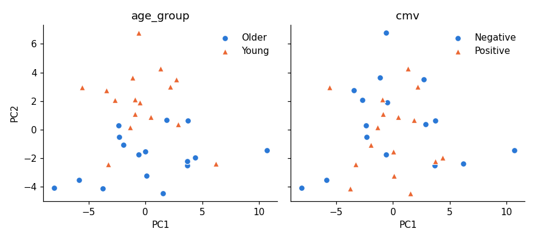
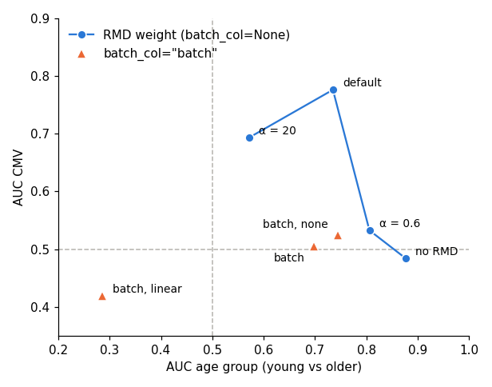

# Sample embedding in depth

`compute_sample_embedding` is the core of SampleDisco. The RNA, ATAC, multi-omics and MaxFuse pipelines all end with it, and every downstream analysis reads what it writes. This page explains what the function computes, taken directly from the source, and then runs it with a few variations on two cohorts:

- the **8-sample COVID-19 demo**, where you can follow every step but can measure very little;
- the **32-donor Sound Life subset**, where the choices you make visibly change what the embedding captures.

In short:

1. Cells are grouped into **units**: one per sample, or one per sample × modality.
2. **Three composition blocks** are built on the sample-removed cell embedding `Z_comp`: cell-type fractions (A1), and soft fractions over (by default) 120 and 300 data-driven anchors (A2, A3).
3. **One displacement block** (RMD) is built on the sample-preserved embedding `Z_rmd`: how each unit's cells of a given type sit relative to the same cell type in comparable units.
4. The blocks are weighted, concatenated and reduced by **PCA**. The result is optionally **batch-corrected** at the sample level.
5. The output is `adata.uns['X_DR_sample']`, a units × PCs table.

```text
cell-level AnnData (obs: sample, cell_type, [batch], [modality])
 ├─ obsm['Z_comp']  sample removed ──┬─ A1  cell-type fractions             K_c columns
 │                                   ├─ A2  soft fractions, K_med anchors   K_med columns
 │                                   └─ A3  soft fractions, K_fine anchors  K_fine columns
 └─ obsm['Z_rmd']   sample preserved ── RMD per-cell-type displacement      ≤ K_c × rmd_dim_per_cluster columns
         │
         ├─ centre each block, scale it to weight w_A1, w_A2, w_A3, α
         ├─ concatenate → PCA (at most n_units − 1 PCs)
         └─ optional sample-level Harmony / linear correction on batch
         → uns['X_DR_sample']  (units × PCs)
```

The method sections below describe sampledisco 0.6.0; the computation is the same in 0.5.0.

!!! note "Where this fits"
    The config-driven pipelines call `compute_sample_embedding` for you (`*_derive_sample_embedding: true`; see the [RNA](rna.md), [ATAC](atac.md), [multi-omics](multiomics.md) and [MaxFuse](multiomics_maxfuse.md) tutorials). Call it yourself, as on this page, to change its options without redoing preprocessing: each run takes seconds. To choose the RMD weight α from the data, see [Autotune](downstream/autotune.md). Everything downstream reads its output; see [Downstream analysis](downstream/index.md).

## 1. Units

A unit is the row of the sample embedding.

- **Single-omics** (no `modality_col`): one unit per value of `sample_col`.
- **Multi-omics** (`modality_col="modality"`): one unit per (sample, modality) pair that has cells, named `<sample>_<modality>`, e.g. `HD-1-Wilk_RNA` and `HD-1-Wilk_ATAC`. A sample ID that already ends in `_<modality>` is not suffixed twice.

Each unit also belongs to a **group**. The group is the pool of units that the RMD block compares it with (section 3):

| Setting | Group of a unit |
| --- | --- |
| Multi-omics | its modality |
| Single-omics, `batch_col` given | the batch most of the sample's cells carry (first column if `batch_col` is a list; ties go to the first label in sorted order) |
| Single-omics, `batch_col=None` (default) | one common group: every sample is compared with all others |

The function needs at least 2 units and 2 cell types.

## 2. Composition blocks A1, A2, A3

All three are computed on `Z_comp`. In this cell embedding Harmony has removed the sample, so a cell's position says *what state it is in*, not which sample it came from.

- **A1: cell-type composition.** The fraction of the unit's cells in each `celltype_col` label. It has `K_c` columns, one per cell type.
- **A2 and A3: anchor composition.** MiniBatchKMeans is fitted on the `Z_comp` of all cells pooled, with `K_med` anchors for A2 and `K_fine` anchors for A3 (5 restarts, seeds `seed` and `seed + 1`).
    - Every cell is soft-assigned to every anchor with a Gaussian kernel `exp(−d² / 2σ²)`, normalized per cell. `σ` is the median cell-to-anchor distance.
    - A unit's row is the mean of its cells' assignments. A2 and A3 are therefore compositions over data-driven states that are finer than the cell-type labels.
- **`use_clr=True`** replaces A1, A2 and A3 by their centred log-ratio (pseudocount 1e-3, then renormalized). The default is off: the blocks stay plain fractions.

### Anchor caps

The number of anchors is capped by the number of cells:

```text
K_med  = min(medium_K, max(2, N // 200))
K_fine = min(fine_K,   max(2, N // 100))
```

`N` is the **total number of cells passed in**, pooled over all samples and all modalities (the rows of `Z_comp`). It is not the number of cells per sample. The cap keeps at least 200 cells per medium anchor and 100 per fine anchor on average. With the defaults `medium_K=120` and `fine_K=300`, the cap only binds when the whole dataset has fewer than **24,000 cells** (for `K_med`) or **30,000 cells** (for `K_fine`):

| Total cells N | K_med | K_fine |
| --- | --- | --- |
| 5,000 | 25 | 50 |
| 10,000 | 50 | 100 |
| 20,000 | 100 | 200 |
| 24,000 | 120 | 240 |
| 29,988 (COVID demo after QC) | 120 | **299** |
| ≥ 30,000 (e.g. Sound Life, 32,000) | 120 | 300 |

A cohort of 500 samples with 100 cells each (N = 50,000) gets the full 120 / 300 anchors. The values actually used are stored as `medium_K` and `fine_K` in `uns['sample_embedding_params']`.

## 3. The RMD block

RMD (reference-relative mean displacement) is computed on `Z_rmd`. This cell embedding keeps the differences between samples, so it can show *how* the cells of one type differ from sample to sample. The block uses the `celltype_col` labels, not the k-means anchors.

For every unit `u` and cell type `k`:

- `mean(u, k)`: the mean `Z_rmd` of u's type-k cells.
- `ref(u, k)`: the mean `Z_rmd` of all type-k cells in the **other units of u's group**. This is a leave-one-out reference, pooled over cells.
- `d(u, k) = mean(u, k) − ref(u, k)`, multiplied by `√n(u,k) / max_u √n(u,k)`. Displacements estimated from few cells are shrunk.

Edge cases:

- If no other unit of the group has type-k cells (for example, a sample that is alone in its batch), the reference comes from the nearest other group (by overall centroid) that has them. If no group has them, `d = 0`.
- A unit without type-k cells gets `d = 0`.

The `n_units × dim(Z_rmd)` displacement matrix of each cell type is then reduced by PCA to `min(rmd_dim_per_cluster, dim(Z_rmd), n_units − 1)` columns. Cell types with no variance are dropped, and the pieces are concatenated. The block has at most `K_c × rmd_dim_per_cluster` columns. With 8 samples, each cell type contributes 7 columns, not 8.

!!! warning "The reference group matters"
    In single-omics data, passing `batch_col` does more than switch on batch correction. Each sample's displacement is then measured against **the other samples of its own batch** only.

    - This helps when batches are large and carry a technical offset.
    - It hurts when batches are small. In the Sound Life subset, 11 of the 19 batches hold a single sample. There, `batch_col="batch"` pushed the CMV prediction AUC from 0.78 down to chance ([section 9](#sound-life)).

## 4. Block weights

Each block is centred (column means removed) and scaled to a Frobenius norm of `√n_units × w`; then the blocks are concatenated. A block's share of the total variance is therefore proportional to `w²`.

With `block_weights=None` (default), the weights are derived from the cluster counts actually used:

| Block | Weight |
| --- | --- |
| A1 | `w_A1 = √(K_fine / K_c)` |
| A2 | `w_A2 = √(K_fine / K_med)` |
| A3 | `w_A3 = 1` |
| RMD | `α`, set by `rmd_weight` |

- **The A weights.** The source calls this the inverse-variance schedule: a composition block's total variance is proportional to `K_fine / K`, inversely proportional to its number of columns. The coarse cell-type fractions therefore weigh most. Changing `medium_K`, `fine_K` or the number of cell types rescales the weights automatically.
- **`rmd_weight="equal"` (default)** sets `α² = w_A1² + w_A2² + w_A3²`, rounded to 2 decimals. The RMD block then carries as much variance as the three composition blocks together. `α` depends only on `K_c`, `K_med` and `K_fine`; in the examples below it is 6.39 for COVID and 4.60 for Sound Life.
- **A number** fixes `α`. Only `"equal"` or a finite positive number is accepted. Values below "equal" favour composition; values above favour cell states. 0.6 is the value used before `"equal"` became the default.
- **`block_weights=[w_A1, w_A2, w_A3, w_RMD]`** overrides everything, including `rmd_weight`. The list needs one weight per block, so 3 entries when `use_rmd=False`. A wrong length raises a `ValueError`. Use [autotune](downstream/autotune.md) to choose `α` from the data.

## 5. PCA and sample-level batch correction

The stacked matrix is reduced by PCA to `min(pca_components, n_units − 1, number of features)` components. The 8-sample demo therefore gets **7 PCs**, not 10.

Then, **only if there are at least 8 units and the batch labels have more than one level**, the PCs are batch-corrected. The labels used are:

| `batch_col` | Single-omics | Multi-omics (`modality_col` set) |
| --- | --- | --- |
| `None` | none, so no correction | modality |
| one column (`"batch"` or `["batch"]`) | the sample's majority batch | `<modality>__<batch>`, or modality alone if that would give every unit its own label |
| two or more columns (`["batch", "site"]`) | multi-covariate Harmony, one covariate per column (per-unit majority; NaN is ignored, `UNK` if a unit has none) | same; modality is **not** added, so list it if you want it |

`batch_method` chooses how the correction is done:

- **`"harmony"`** (default) runs harmonypy's `run_harmony` with `nclust = max(2, min(number of levels, n_units // 2))` (the largest level count across columns for a list), 30 iterations and `random_state=seed`. If Harmony raises an error, the function prints a warning to stderr and falls back to `"linear"`; if that also fails, it keeps the uncorrected PCs. Any value other than `"none"` and `"linear"` also runs Harmony.
- **`"linear"`** regresses the one-hot batch labels out of every PC by least squares. A list of columns is joined into one label.
- **`"none"`** keeps the PCA as it is.

!!! warning "Small cohorts"
    - **Fewer than 8 units:** never corrected, whatever `batch_method` says.
    - **8 to roughly 20 units:** Harmony runs but has little or no effect. On the COVID demo (8 units), 6 of our 7 runs gave the same result as `batch_method="none"` (to two decimals). In a synthetic test with two batches offset by 3 standard deviations, harmonypy left the offset fully in place for 8–16 units and removed part of it only from 20 units on. With so few points, each Harmony cluster tends to hold units of one batch only, so there is no within-cluster batch contrast to remove.
    - **`"linear"` with many batches** removes `n_batches − 1` directions out of `n_units − 1`. On Sound Life (19 batches, 32 samples) it erased the age signal ([section 9](#sound-life)).

## 6. Which cell embeddings it reads

| Argument | `None` (default) resolves to, in order | If nothing is found |
| --- | --- | --- |
| `comp_emb_key` | `Z_comp`, then the legacy `Z_clust`, `X_pca_harmony`, `X_lsi_harmony`, `X_glue_harmony` (with a `FutureWarning`) | `KeyError` |
| `rmd_emb_key` | `Z_rmd`, then the legacy `Z_cmd`, `X_pca_harmony_nosamp`, `X_lsi_harmony_nosamp` (with a `FutureWarning`) | with `use_rmd=True`: falls back to the composition key with a `RuntimeWarning`. The RMD block is then near-degenerate and is **not** the published method. With `use_rmd=False` it is not needed. |

- The RNA and ATAC `preprocess` functions write both canonical keys. In the multi-omics pipeline, `harmonize_xglue` writes `Z_comp` and copies the scGLUE embedding `X_glue` to `Z_rmd`.
- Pass an explicit key only when it is in `.obsm`. For objects written by older releases, leave the argument `None` (the legacy names above are then found automatically) or run `migrate_obsm_keys(adata)` first (see [Legacy embedding key names](../legacy_keys.md)).
- `cluster_emb_key` is the deprecated 0.2.0 name of `comp_emb_key` and is removed in 1.0.
- The keys that were actually used are printed on the first log line (`comp_emb=Z_comp, rmd_emb=Z_rmd`) and stored in `uns['sample_embedding_params']`.

## 7. Outputs

`compute_sample_embedding` **modifies the cell-level AnnData in place and returns it**. It adds two entries:

- `adata.uns['X_DR_sample']`: a DataFrame of units × PCs. Its index is named `sample` and its columns are `PC1`, `PC2`, …. Every downstream module reads this.
- `adata.uns['sample_embedding_params']`: a dict with the values actually used: the capped `medium_K` / `fine_K`, `K_c`, the resolved `rmd_weight` (α) and `block_weights`, the embedding keys, `batch_col` / `batch_cols_multi`, `batch_method`, `seed` and `backend`. `pca_components` is the requested value, not the capped one.

The cell-level object gets no `obsm['X_DR_sample']`. Use `build_sample_adata` (section 8.5) for a one-row-per-unit AnnData.

With `save=True` (default), it also writes, under `output_dir`:

| File | Content |
| --- | --- |
| `sample_embedding/sample_embedding.csv` | the embedding, the same table as `uns['X_DR_sample']` |
| `sample_embedding/sample_embedding_blocks.npz` | the blocks **before** centring and weighting (after CLR if `use_clr=True`): `unit_ids`, `A1_cell_types`, `A1`, `A2`, `A3`, `RMD`. `RMD` has 0 columns when `use_rmd=False`. |
| `preprocess/adata_preprocessed.h5ad` | updated with the two `uns` entries, **only if this file already exists** and `save_cell_adata=True` |

- **When the h5ad is updated.** Use the same `output_dir` as for `preprocess`, so that the h5ad is found. When the file holds the same object as memory, only the two `uns` entries are replaced ("in-place" in the log); otherwise the whole file is re-written ("rewrite").
- **`save_cell_adata=False`** keeps only the CSV and the npz. It warns if the h5ad still holds an older embedding, because a later config run with `derive_sample_embedding: false` would reuse it.
- **`save=False`** writes nothing; the `uns` entries are still set.
- **`use_gpu=True`** dispatches to the RAPIDS implementation when `cupy` and `cuml` are importable, and otherwise runs on the CPU with a message.

In a config run, the same arguments are set through the `rna_` / `atac_` / `multiomics_` keys:

| Argument | Config key (RNA; ATAC and multi-omics analogous) |
| --- | --- |
| `medium_K`, `fine_K` | `rna_sample_embedding_medium_K`, `rna_sample_embedding_fine_K` |
| `rmd_dim_per_cluster` | `rna_sample_embedding_rmd_dim` |
| `use_clr`, `use_rmd` | `rna_sample_embedding_use_clr`, `rna_sample_embedding_use_rmd` |
| `rmd_weight`, `block_weights` | `rna_sample_embedding_rmd_weight`, `rna_sample_embedding_block_weights` |
| `pca_components`, `batch_method` | `rna_sample_embedding_pca_components`, `rna_sample_embedding_batch_method` |
| `batch_col` | `rna_sample_level_batch_col` (`atac_sample_level_batch_col`, `multiomics_batch_col`) |
| `save_cell_adata` | `rna_save_cell_adata_after_embedding` |

## 8. Worked example: COVID-19 demo (8 samples)

The demo has 8 PBMC samples: 4 healthy (`sev.level = 1`) and 4 severe COVID-19 (`sev.level = 4`). They come from two studies (`batch`: `Wilk`, `Aruna`), with 2 healthy and 2 severe samples in each. The point here is to see every step and output. With 8 samples, no number below is a finding.

### 8.1 Setup

Run everything on this page from one folder:

```bash
mkdir -p sampledisco_embedding/data
cd sampledisco_embedding
curl -fL -o data/test_RNA.h5ad      "https://zenodo.org/records/24451067/files/test_RNA.h5ad?download=1"
curl -fL -o data/soundlife_RNA.h5ad "https://zenodo.org/records/24451067/files/soundlife_RNA.h5ad?download=1"
```

Keep the `-f`: without it, curl saves an HTTP error page under the `.h5ad` name and still reports success. See [Demo data](demo_data.md) for the file contents.

### 8.2 Preprocess and cell types

These are the steps the RNA pipeline runs before the embedding, with the values of the demo config (`config_demo.yaml`). `preprocess` writes both cell embeddings: Harmony on `batch` + `sample` gives `Z_comp`, and Harmony on `batch` alone gives `Z_rmd`. `cell_types` clusters `Z_comp` into 8 cell types.

```python
from sampledisco.preparation.rna_preprocess_cpu import preprocess
from sampledisco.preparation.cell_type_cpu import cell_types

OUT = "embedding_output/covid"

adata = preprocess(
    h5ad_path="data/test_RNA.h5ad",
    sample_meta_path=None,            # sample, batch and sev.level are already in .obs
    output_dir=OUT,
    sample_column="sample",
    cell_level_batch_key=["batch"],
    min_cells=100,
    min_genes=200,
    pct_mito_cutoff=20,
    num_cell_hvgs=2000,
    cell_embedding_num_PCs=20,
    num_harmony_iterations=20,
    verbose=False,
)
adata = cell_types(
    anndata_cell=adata,
    cell_type_column="cell_type",
    n_target_clusters=8,
    leiden_cluster_resolution=0.8,
    cell_embedding_num_PCs=20,
    umap=False,                       # the embedding does not need a UMAP
    save=True,
    output_dir=OUT,
    defined_output_path=f"{OUT}/preprocess/adata_preprocessed.h5ad",
    verbose=False,
)
print(adata)
```

```text
AnnData object with n_obs × n_vars = 29988 × 12301
    obs: 'celltype', 'sample', 'old', 'large', 'batch', 'sev.level', 'n_genes', 'n_genes_by_counts', 'total_counts', 'total_counts_mt', 'pct_counts_mt', 'cell_type', 'cell_type_original'
    var: 'n_cells', 'mt', 'n_cells_by_counts', 'mean_counts', 'pct_dropout_by_counts', 'total_counts', 'highly_variable', 'highly_variable_rank', 'means', 'variances', 'variances_norm', 'highly_variable_nbatches', 'highly_variable_clust', 'highly_variable_rmd'
    uns: 'X_name', 'hvg', 'log1p', 'pca', 'neighbors', 'cell_type', 'cluster_mapping'
    obsm: 'X_pca', 'Z_comp', 'Z_clust', 'X_pca_rmd', 'Z_rmd'
    varm: 'PCs'
    layers: 'counts'
    obsp: 'distances', 'connectivities'
```

`Z_clust` is a copy of `Z_comp` under its 0.2.0 name, kept until 1.0 so older releases can read the file.

**Writes** → `embedding_output/covid/preprocess/adata_preprocessed.h5ad` and `preprocess/cell_type.csv`.

### 8.3 The default embedding

The demo config passes `batch_col="batch"`; everything else is the default.

```python
from sampledisco.sample_embedding import compute_sample_embedding

adata = compute_sample_embedding(
    adata,
    output_dir=OUT,
    sample_col="sample",
    celltype_col="cell_type",
    batch_col="batch",
)
```

```text
[sample_embedding] comp_emb=Z_comp, rmd_emb=Z_rmd
[sample_embedding] 8 units; 29988 cells; comp_emb dim=20
[A1] coarse cell-type composition: shape=(8, 8)
[A2/A3] MiniBatchKMeans K=120 and K=299...
[A2] shape=(8, 120)
[A3] shape=(8, 299)
[RMD] LOO displacement on rmd_emb...
  [RMD] shape=(8, 56)
[sample_embedding] weights=[6.114, 1.579, 1.0, 6.39] (n_blocks=4)
  [batch correction] 2 groups (group only)
[sample_embedding] updated embedding_output/covid/preprocess/adata_preprocessed.h5ad (.uns['X_DR_sample'], in-place)
[sample_embedding] wrote embedding_output/covid/sample_embedding/sample_embedding.csv
[sample_embedding] wrote embedding_output/covid/sample_embedding/sample_embedding_blocks.npz
[sample_embedding] done in 2.16s; shape=(8, 7)
```

harmonypy also prints its own `INFO` lines; they are left out here. What the log shows:

- **The anchor cap at work:** 29,988 cells give `K_fine = 299` instead of 300.
- **Small-sample limits:** each of the 8 cell types contributes 7 RMD columns (`n_units − 1`), so the RMD block has 56, and the embedding has 7 PCs, not 10.
- **The weights** are `[√(299/8), √(299/120), 1, α]`, with α = √(37.4 + 2.5 + 1) = 6.39.
- **Batch correction** used the two batches as labels. At 8 units Harmony runs, but it has little or no effect (see section 5).
- **The h5ad** written in 8.2 holds the same object as memory, so only the two `uns` entries were replaced (`in-place`).

```python
print(adata.uns["X_DR_sample"].round(2))
print(adata.uns["sample_embedding_params"])
```

```text
                PC1   PC2   PC3   PC4   PC5   PC6   PC7
sample                                                 
CoV-3-Wilk     3.87 -6.61 -5.89  0.29  1.10 -0.02  0.27
CoV-34-Aruna -12.85 -5.86  3.03  0.04 -0.16 -0.14  0.00
CoV-36-Aruna  -1.52  2.73 -2.56  2.01 -3.91 -0.78 -0.56
CoV-4-Wilk    -5.57  5.93 -2.34 -4.90  1.01 -0.05  0.29
HD-1-Wilk      1.22  3.15  1.40  3.57  0.25  0.81  1.59
HD-20-Aruna    1.67  1.51  0.80  1.24  1.24  3.12 -1.18
HD-21-Aruna    3.52  1.76  1.93  1.57  2.21 -3.09 -0.62
HD-4-Wilk      9.66 -2.60  3.62 -3.81 -1.73  0.15  0.20
{'medium_K': 120, 'fine_K': 299, 'K_c': 8, 'use_clr': False, 'use_rmd': True, 'rmd_weight': 6.39, 'block_weights': [6.113509630318742, 1.5785013990068766, 1.0, 6.39], 'pca_components': 10, 'batch_method': 'harmony', 'comp_emb_key': 'Z_comp', 'rmd_emb_key': 'Z_rmd', 'cluster_emb_key': 'Z_comp', 'modality_col': '', 'batch_col': 'batch', 'batch_cols_multi': ['batch'], 'seed': 42, 'backend': 'cpu'}
```

The exact PC values change slightly between machines: k-means and Harmony are seeded, but not bit-identical across BLAS builds. The structure (7 PCs, the parameters) does not change.

### 8.4 What was written

```python
import numpy as np

blocks = np.load(f"{OUT}/sample_embedding/sample_embedding_blocks.npz")
for key in blocks.files:
    print(f"{key:14s} {blocks[key].shape}")
print(blocks["A1"].sum(axis=1))      # A1 rows are fractions: each sums to 1
```

```text
unit_ids       (8,)
A1_cell_types  (8,)
A1             (8, 8)
A2             (8, 120)
A3             (8, 299)
RMD            (8, 56)
[0.99999994 1.         1.         1.         1.         0.99999994
 1.         1.        ]
```

**Writes** → `embedding_output/covid/sample_embedding/sample_embedding.csv`, `sample_embedding/sample_embedding_blocks.npz`, and the two `uns` entries into `preprocess/adata_preprocessed.h5ad`.

### 8.5 Reading the results back

In a new session, load the cell-level h5ad and turn the embedding into a one-row-per-unit AnnData with `build_sample_adata`. Every downstream function takes this object.

```python
import anndata as ad
from sampledisco.sample_embedding.sample_embedding import build_sample_adata

cells = ad.read_h5ad(f"{OUT}/preprocess/adata_preprocessed.h5ad")
pseudo = build_sample_adata(cells, sample_col="sample")
print(pseudo)
print(pseudo.obs[["batch", "sev.level"]])
```

```text
AnnData object with n_obs × n_vars = 8 × 7
    obs: 'celltype', 'sample', 'old', 'large', 'batch', 'sev.level', 'n_genes', 'n_genes_by_counts', 'total_counts', 'total_counts_mt', 'pct_counts_mt', 'cell_type', 'cell_type_original'
    uns: 'X_DR_sample', 'sample_embedding_params'
    obsm: 'X_DR_sample'
              batch  sev.level
sample                        
CoV-3-Wilk     Wilk          4
CoV-34-Aruna  Aruna          4
CoV-36-Aruna  Aruna          4
CoV-4-Wilk     Wilk          4
HD-1-Wilk      Wilk          1
HD-20-Aruna   Aruna          1
HD-21-Aruna   Aruna          1
HD-4-Wilk      Wilk          1
```

`build_sample_adata` puts the embedding in `.X`, `.obsm['X_DR_sample']` and `.uns['X_DR_sample']`, and copies `uns['sample_embedding_params']`. Its `.obs` takes, for every cell-level column, the value of the first cell of the unit. That is right for sample-level columns such as `batch` and `sev.level`, but meaningless for cell-level ones such as `total_counts` or `cell_type`. For multi-omics, pass `modality_col="modality"` as well.

### 8.6 What the options change

The loop below recomputes the embedding with one option changed at a time. Two details:

- `compute_sample_embedding` only reads `.obs` and the two `.obsm` embeddings, so the variants run on a slim copy.
- `save=False` leaves the files from 8.3 untouched.

For each variant, the loop reports:

- the leave-one-out 3-nearest-neighbour accuracy of `sev.level` (`transfer_labels`);
- the share of the embedding's variance explained by `batch` and by `sev.level` (one-way ANOVA R² over all PCs).

The two-covariate example needs a second sample-level technical column. The demo has none, so the code derives one: whether the sample's median UMI count per cell is above or below the median of its batch.

```python
import pandas as pd
from sampledisco.sample_prediction.prediction import transfer_labels

depth = cells.obs.groupby("sample", observed=True)["total_counts"].median()
batch = cells.obs.groupby("sample", observed=True)["batch"].first()
tier = (depth > depth.groupby(batch, observed=True).transform("median")).map({True: "high", False: "low"})
cells.obs["depth"] = cells.obs["sample"].map(tier).astype("category")

slim = ad.AnnData(obs=cells.obs[["sample", "batch", "depth", "sev.level", "cell_type"]].copy(),
                  obsm={key: cells.obsm[key] for key in ("Z_comp", "Z_rmd")})

def r2(emb, labels):
    """Share of the embedding's total variance explained by a sample label (one-way ANOVA R²)."""
    X = emb.to_numpy() - emb.to_numpy().mean(axis=0)
    M = pd.DataFrame(X).groupby(labels.to_numpy()).transform("mean").to_numpy()
    return (M ** 2).sum() / (X ** 2).sum()

variants = {
    "default": {},
    "use_rmd=False": {"use_rmd": False},
    "rmd_weight=0.6": {"rmd_weight": 0.6},
    "use_clr=True": {"use_clr": True},
    'batch_method="none"': {"batch_method": "none"},
    'batch_col=["batch", "depth"]': {"batch_col": ["batch", "depth"]},
}
rows = []
for name, change in variants.items():
    compute_sample_embedding(slim, output_dir=OUT, sample_col="sample", celltype_col="cell_type",
                             save=False, verbose=False, **{"batch_col": "batch", **change})
    params = slim.uns["sample_embedding_params"]
    sa = build_sample_adata(slim, sample_col="sample")
    _, knn = transfer_labels(sa, "sev.level", n_neighbors=3)
    emb = sa.uns["X_DR_sample"]
    rows.append({"variant": name,
                 "alpha": params["rmd_weight"] if params["use_rmd"] else None,
                 "kNN acc sev.level": knn["loo_accuracy"],
                 "R2 batch": r2(emb, sa.obs["batch"]),
                 "R2 sev.level": r2(emb, sa.obs["sev.level"])})
print(pd.DataFrame(rows).round(2).to_string(index=False))
```

```text
                     variant  alpha  kNN acc sev.level  R2 batch  R2 sev.level
                     default   6.39               0.62      0.10          0.26
               use_rmd=False    NaN               0.62      0.16          0.22
              rmd_weight=0.6   0.60               0.62      0.16          0.22
                use_clr=True   6.39               0.62      0.17          0.27
         batch_method="none"   6.39               0.62      0.10          0.26
batch_col=["batch", "depth"]   6.39               0.62      0.10          0.26
```

Read this table as a demonstration of the calls, not as a result:

- **kNN accuracy is 5 of 8 in every variant.** Chance is 0.5, and one sample more or less moves the score by 0.125.
- **R² needs a yardstick.** When 8 samples are split 4 + 4 at random, the split explains on average 1/7 = 0.14 of the variance. `sev.level` explains 0.22–0.27 in every variant. That is above 0.14, but not significant with 8 samples.
- **Batch explains less with the RMD block.** In the default, batch explains 0.10, below the random 0.14: each sample's displacement is measured against its own batch, which takes the batch offset out of that block. Without RMD, or with α = 0.6 where the composition blocks dominate, the batch share rises to 0.16.
- **The last two rows equal the default.** At 8 units, sample-level Harmony has little or no effect (section 5), so switching it off or adding a covariate changes nothing here.

Across seven runs on different nodes and environments, these R² values moved by up to 0.12, and `use_clr=True` once reached a kNN accuracy of 0.75. Only the direction of the batch effect (lower with the RMD block) held in every run. For differences that can be measured, see the next section.

## 9. Batch handling and the RMD weight on Sound Life { #sound-life }

The Sound Life subset has 32 donors with one baseline PBMC draw each, 1,000 cells per sample:

- 16 young (26–35 years) and 16 older (55–65), balanced for sex and CMV serostatus.
- The cells carry the Allen Institute's AIFI L2 labels (17 cell types), so no clustering is needed.
- It has a real batch structure: 19 processing batches. 11 of them hold a single sample, and several hold only young or only older donors.

With 32 samples the options start to matter. This section only needs `data/soundlife_RNA.h5ad` (downloaded in 8.1) and can be run on its own. The [Sound Life RNA tutorial](soundlife_rna.md) runs the full pipeline on the same data.

### 9.1 Preprocess and the default embedding

`preprocess` corrects the processing batch at the cell level (`cell_level_batch_key=["batch"]`), as in 8.2. The existing `cell_type` column passes through unchanged. The embedding call uses the function defaults, including `batch_col=None`.

```python
import anndata as ad
import numpy as np
import pandas as pd
from sampledisco.preparation.rna_preprocess_cpu import preprocess
from sampledisco.sample_embedding import compute_sample_embedding
from sampledisco.sample_embedding.sample_embedding import build_sample_adata

SL = "embedding_output/soundlife"

sl = preprocess(
    h5ad_path="data/soundlife_RNA.h5ad",
    sample_meta_path=None,
    output_dir=SL,
    sample_column="sample",
    cell_level_batch_key=["batch"],
    min_cells=100,
    min_genes=200,
    pct_mito_cutoff=20,
    num_cell_hvgs=2000,
    cell_embedding_num_PCs=20,
    num_harmony_iterations=20,
    verbose=False,
)
sl = compute_sample_embedding(sl, output_dir=SL, sample_col="sample", celltype_col="cell_type")

sl_pseudo = build_sample_adata(sl, sample_col="sample")
emb = sl_pseudo.uns["X_DR_sample"]
print(emb.corrwith(sl_pseudo.obs["age_at_draw"].astype(float)).round(2))
```

```text
[sample_embedding] comp_emb=Z_comp, rmd_emb=Z_rmd
[sample_embedding] 32 units; 32000 cells; comp_emb dim=20
[A1] coarse cell-type composition: shape=(32, 17)
[A2/A3] MiniBatchKMeans K=120 and K=300...
[A2] shape=(32, 120)
[A3] shape=(32, 300)
[RMD] LOO displacement on rmd_emb...
  [RMD] shape=(32, 136)
[sample_embedding] weights=[4.201, 1.581, 1.0, 4.6] (n_blocks=4)
  [batch correction] 1 groups (group only)
[sample_embedding] updated embedding_output/soundlife/preprocess/adata_preprocessed.h5ad (.uns['X_DR_sample'], rewrite)
[sample_embedding] wrote embedding_output/soundlife/sample_embedding/sample_embedding.csv
[sample_embedding] wrote embedding_output/soundlife/sample_embedding/sample_embedding_blocks.npz
[sample_embedding] done in 22.27s; shape=(32, 10)
PC1     0.12
PC2    -0.69
PC3     0.32
PC4     0.01
PC5    -0.02
PC6     0.06
PC7     0.10
PC8     0.09
PC9     0.23
PC10    0.11
dtype: float64
```

What the log and the correlations show:

- **No cap:** with 32,000 cells, both anchor counts are at their defaults (120 and 300).
- **RMD block:** 17 cell types × 8 dimensions = 136 RMD columns.
- **Weights:** `[√(300/17), √(300/120), 1, α]`, with α = 4.60.
- **No sample-level correction** (`1 groups`), because `batch_col=None`. Every donor's RMD reference is the other 31 donors.
- **A full re-write of the h5ad** (`rewrite`). `preprocess` saves a cleaned copy of `.obs`; for example, numeric columns with fewer than 20 distinct values become text categories. The file therefore does not match the object in memory, and it takes most of the 22 s.
- **PC2 carries age** (r = −0.69 with age at draw).

```python
import matplotlib.pyplot as plt

fig, axes = plt.subplots(1, 2, figsize=(8, 3.6), sharex=True, sharey=True)
for ax, col in zip(axes, ["age_group", "cmv"]):
    levels = sorted(sl_pseudo.obs[col].astype(str).unique())
    for level, color, marker in zip(levels, ["#2a78d6", "#eb6834"], ["o", "^"]):
        m = (sl_pseudo.obs[col].astype(str) == level).to_numpy()
        ax.scatter(emb.loc[m, "PC1"], emb.loc[m, "PC2"], s=42, color=color, marker=marker,
                   edgecolors="white", linewidths=0.8, label=level)
    ax.set(title=col, xlabel="PC1")
    ax.spines[["top", "right"]].set_visible(False)
    ax.legend(frameon=False)
axes[0].set_ylabel("PC2")
fig.tight_layout()
fig.savefig(f"{SL}/embedding_age_cmv.png", dpi=110)
```


<div class="figure-caption">Section 9.1: PC1 vs PC2 of the default Sound Life embedding (function defaults, <code>batch_col=None</code>), 32 donors. Young and older donors separate along PC2. CMV serostatus is not visible in these two PCs; the classifier in 9.2 still finds it in the 10 PCs.</div>

### 9.2 What batch handling and α change

The loop compares the default with three ways of handling the processing batch at the sample level, and with three settings of the RMD weight. The score is how well a cross-validated logistic regression on the 10 PCs separates young from older donors, and CMV-positive from CMV-negative donors: the out-of-fold AUC from `predict_phenotype`, averaged over 10 random 5-fold splits. The `sd` columns only show how much the score moves between fold splits. The sampling uncertainty is larger: with 16 donors per class, an AUC near 0.75 has a standard error of about 0.09.

```python
from sampledisco.sample_prediction.prediction import predict_phenotype

slim = ad.AnnData(obs=sl.obs[["sample", "batch", "age_group", "cmv", "cell_type"]].copy(),
                  obsm={key: sl.obsm[key] for key in ("Z_comp", "Z_rmd")})

def cv_auc(sa, label):
    """Out-of-fold AUC of predict_phenotype (5-fold, all PCs) over 10 fold splits: mean, sd."""
    aucs = [predict_phenotype(sa, label, n_splits=5, random_state=r)[1]["auc"] for r in range(10)]
    return np.mean(aucs), np.std(aucs)

variants = {
    "default": {},
    "batch": {"batch_col": "batch"},
    "batch, none": {"batch_col": "batch", "batch_method": "none"},
    "batch, linear": {"batch_col": "batch", "batch_method": "linear"},
    "no RMD": {"use_rmd": False},
    "α = 0.6": {"rmd_weight": 0.6},
    "α = 20": {"rmd_weight": 20},
}
rows = []
for name, change in variants.items():
    compute_sample_embedding(slim, output_dir=SL, sample_col="sample", celltype_col="cell_type",
                             save=False, verbose=False, **change)
    sa = build_sample_adata(slim, sample_col="sample")
    (age, age_sd), (cmv, cmv_sd) = cv_auc(sa, "age_group"), cv_auc(sa, "cmv")
    params = slim.uns["sample_embedding_params"]
    rows.append({"variant": name, "alpha": params["rmd_weight"] if params["use_rmd"] else None,
                 "AUC age_group": age, "sd age": age_sd, "AUC cmv": cmv, "sd cmv": cmv_sd})
table = pd.DataFrame(rows).set_index("variant")
print(table.round(2))
```

```text
               alpha  AUC age_group  sd age  AUC cmv  sd cmv
variant                                                     
default          4.6           0.73    0.06     0.78    0.06
batch            4.6           0.70    0.05     0.51    0.03
batch, none      4.6           0.74    0.06     0.52    0.04
batch, linear    4.6           0.29    0.07     0.42    0.05
no RMD           NaN           0.88    0.03     0.48    0.11
α = 0.6          0.6           0.81    0.08     0.53    0.11
α = 20          20.0           0.57    0.08     0.69    0.06
```

scikit-learn prints `UndefinedMetricWarning` / "non-finite test scores" warnings during this loop. They come from the inner 3-fold split of `predict_phenotype`, which can leave a fold with donors of one class only; the AUC of that fold is undefined.

What the table shows:

- **Age is mostly a composition signal.** The composition blocks alone (`no RMD`) give the best age-group AUC, 0.88. Raising α moves weight to the RMD block, and the age AUC falls: 0.81 at α = 0.6, 0.73 at the default α = 4.6, 0.57 at α = 20.
- **CMV is a cell-state signal.** Composition alone does not predict it (0.48). The RMD block brings it to 0.78 at the default α, and it stays at 0.69 when RMD dominates (α = 20).
- **The default `"equal"` weight is a compromise, not an optimum.** It keeps both signals well above chance, but neither at its best. To choose α for a given phenotype, use [autotune](downstream/autotune.md).
- **Passing the processing batch costs the CMV signal.** With `batch_col="batch"`, the CMV AUC drops to 0.51. It stays at 0.52 without the sample-level Harmony (`batch, none`), so the loss comes from the RMD reference (section 3), not from Harmony. Each donor's cell states are compared only with its batch mates, and 11 donors have none, so their reference is borrowed from another batch.
- **Linear regression on 19 batches removes the biology.** It regresses 18 of the 31 available directions out of 32 donors, and several batches hold only young or only older donors. The age AUC drops to 0.29 and the CMV AUC to 0.42.

Trust the large differences here (CMV with and without `batch_col`, the linear correction, the two ends of the α range), not the second decimal. Across six runs on different nodes and environments, the entries moved by up to 0.05 (the default CMV AUC ranged from 0.73 to 0.78); the conclusions did not change.

!!! tip "Choosing `batch_col`"
    - Technical batch is often best removed at the cell level: `preprocess(cell_level_batch_key=[...])` takes it out of both `Z_comp` and `Z_rmd` before the embedding is built.
    - Pass `batch_col` to `compute_sample_embedding` when there are a few large batches, each holding samples of every condition, like the two studies in the COVID demo.
    - With many small batches, or batches that track the phenotype, leave `batch_col=None` and avoid `batch_method="linear"`.
    - Whatever you choose, check it against a phenotype you already know, as done here.

??? note "Plot code"

    ```python
    alpha_path = ["no RMD", "α = 0.6", "default", "α = 20"]          # increasing RMD weight
    batch_runs = ["batch", "batch, none", "batch, linear"]
    fig, ax = plt.subplots(figsize=(5.6, 4.4))
    ax.axhline(0.5, color="#b5b3ad", lw=1, ls="--")
    ax.axvline(0.5, color="#b5b3ad", lw=1, ls="--")
    a, b = table.loc[alpha_path], table.loc[batch_runs]
    ax.plot(a["AUC age_group"], a["AUC cmv"], "-o", color="#2a78d6", lw=1.5, ms=7, mec="white",
            label="RMD weight (batch_col=None)")
    ax.plot(b["AUC age_group"], b["AUC cmv"], "^", color="#eb6834", ms=8, mec="white",
            label='batch_col="batch"', linestyle="none")
    offsets = {"batch": (-8, -13), "batch, none": (-8, 6)}
    for name, row in table.iterrows():
        dx, dy = offsets.get(name, (8, 3))
        ax.annotate(name, (row["AUC age_group"], row["AUC cmv"]), xytext=(dx, dy),
                    textcoords="offset points", ha="right" if dx < 0 else "left", fontsize=9)
    ax.set(xlabel="AUC age group (young vs older)", ylabel="AUC CMV", xlim=(0.2, 1.0), ylim=(0.35, 0.9))
    ax.spines[["top", "right"]].set_visible(False)
    ax.legend(frameon=False, loc="upper left")
    fig.tight_layout()
    fig.savefig(f"{SL}/variants_auc.png", dpi=110)
    ```


<div class="figure-caption">Section 9.2: out-of-fold AUC for age group (x) and CMV serostatus (y), each averaged over 10 fold splits. Blue line: the RMD weight from none (<code>use_rmd=False</code>) through α = 0.6 and the default α = 4.6 to α = 20, with <code>batch_col=None</code>. Orange triangles: the default α with <code>batch_col="batch"</code> and the three sample-level methods. Dashed lines: chance.</div>

## Measured runtime

We ran every code block on this page verbatim, in order, in a fresh folder, on 8 CPU cores, with sampledisco 0.6.0. The same blocks also ran unchanged on 0.5.0.

| Step | Wall time | Peak RAM |
| --- | --- | --- |
| 8.2 preprocess + cell types (COVID, 29,988 cells) | 1.2–1.8 min | 2.5 GB |
| 8.3 `compute_sample_embedding` (COVID) | 2–4 s | 2.1 GB |
| 8.4–8.5 inspect and read back | < 1 s | 2.7 GB |
| 8.6 six COVID variants | 11–19 s | 2.8 GB |
| 9.1 preprocess + embedding (Sound Life, 32,000 cells) | 0.8–1.6 min | 3.2 GB |
| 9.2 seven Sound Life variants with 140 cross-validations | 0.5–1.3 min | 2.1 GB |
| **Whole page in one Python session** | **3.8–4.5 min** | **6.2 GB** |

- Run as one session, the page peaks at 6.2 GB because the COVID objects stay in memory during section 9.
- Section 8 alone peaks at 2.8 GB, and section 9 alone at 3.4 GB.
- On a slower node, with the all-in-one `all_cpu` environment, the whole page took 6.7 min (peak 5.5 GB); preprocessing was most of the difference.
- The embedding itself takes seconds. The full re-write of the Sound Life h5ad in 9.1 accounts for most of its 14–22 s.
