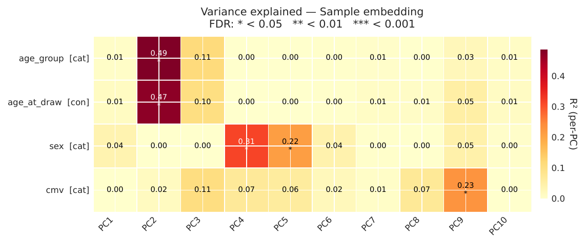
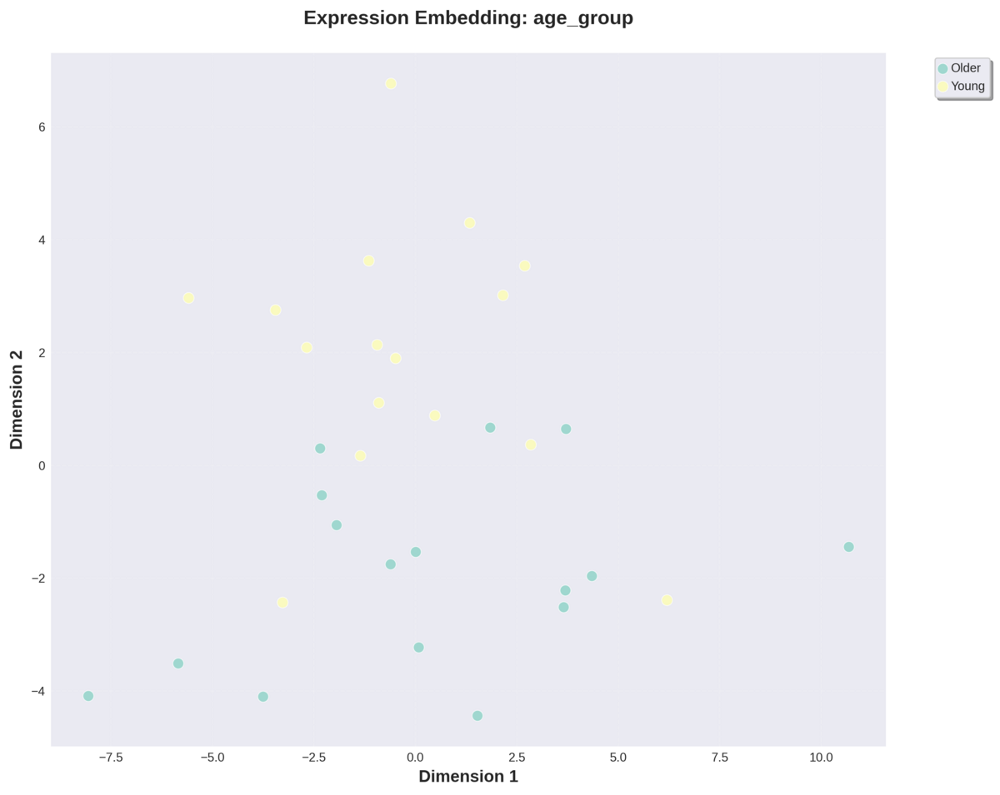
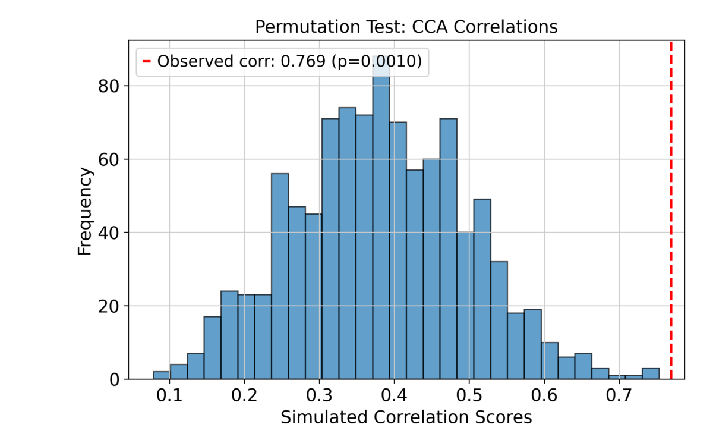
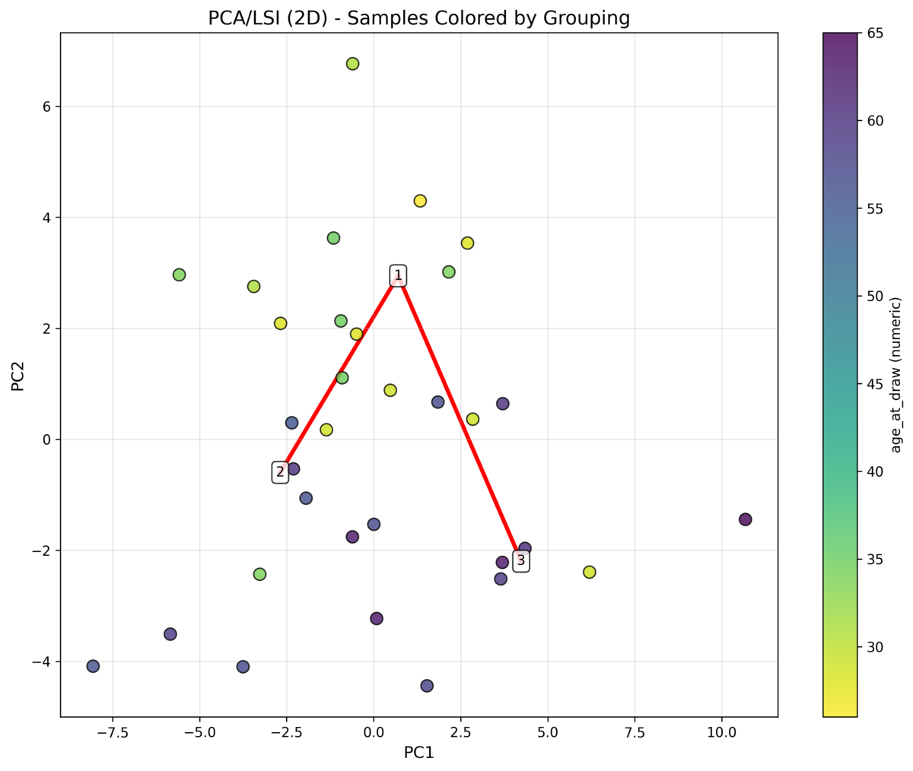

# A 32-donor cohort end to end (Sound Life scRNA-seq)

The 8-sample COVID-19 demo runs every SampleDisco stage, but it is too small for the statistics to mean much: with 8 points CCA fits almost any labelling, permutation p-values sit at their floor, and a classifier sees four samples per class. This page runs the same config-driven RNA pipeline on **32 donors** of the Sound Life cohort (Allen Institute for Immunology; Gong et al., *Nature* 2025) and reads what each stage finds.

In short:

1. Look at the sample metadata, in particular the processing batches.
2. Start from `sampledisco --init-config` and change the keys that name the data, the phenotype columns and the analyses that need more than 8 samples.
3. Run the RNA stages with `sampledisco -m complex --config`.
4. Read the results: association, CCA and its p-value, TSCAN, proportion test, trajectory genes, RAISIN, clustering.
5. Predict phenotypes and transfer labels from Python.
6. Check what the batch correction removed, and what it takes to scale up.

You need a working installation (see [Installation](../installation.md)). On 8 CPU cores the whole page took 10.5 minutes (21 on an overloaded node) and peaked at 4.6 GB of RAM.

!!! warning "Noncommercial data"
    `soundlife_RNA.h5ad` is part of the SampleDisco demo record (CC BY-NC 4.0). It comes from the Allen Institute for Immunology under the [Allen Institute Terms of Use](https://alleninstitute.org/terms-of-use/). Use it for research and other noncommercial work only, and cite the source publication (see the end of this page).

## 1. Set up a run folder

```bash
mkdir -p sampledisco_soundlife/data
cd sampledisco_soundlife
curl -fL -o data/soundlife_RNA.h5ad "https://zenodo.org/records/24451067/files/soundlife_RNA.h5ad?download=1"
sampledisco --init-config config.yaml
```

`soundlife_RNA.h5ad` (137 MB) holds raw UMI counts for 32,000 cells × 18,456 genes: 1,000 cells from each of 32 donors, one baseline blood draw per donor. Run every command and Python snippet on this page from this folder. See [Demo data](demo_data.md) for the MD5 and the other files of the record.

## 2. Look at the donors first

All metadata is in `.obs`. Before choosing the config, check which columns are sample-level and how the processing batches fall across the donors. Opening the file in backed mode reads only `.obs`.

```python
import anndata as ad
import pandas as pd

obs = ad.read_h5ad("data/soundlife_RNA.h5ad", backed="r").obs
donors = obs.groupby("sample", observed=True)[
    ["subject", "age_group", "age_at_draw", "sex", "cmv", "batch"]].first()
print(len(donors), "samples,", donors["subject"].nunique(), "donors,",
      donors["batch"].nunique(), "batches")
print(pd.crosstab(donors["age_group"], [donors["sex"], donors["cmv"]]))
print(donors.groupby("age_group", observed=True)["age_at_draw"].agg(["min", "max"]))

per_batch = pd.crosstab(donors["batch"], donors["age_group"])
print(per_batch.sum(axis=1).value_counts().sort_index().rename("batches with n donors"))
print(per_batch[(per_batch > 0).all(axis=1)])   # batches that hold both age groups
```

```text
32 samples, 32 donors, 19 batches
sex         Female              Male         
cmv       Negative Positive Negative Positive
age_group                                    
Older            4        4        4        4
Young            4        4        4        4
           min  max
age_group          
Older       55   65
Young       26   35
1    11
2     4
3     3
4     1
Name: batches with n donors, dtype: int64
age_group  Older  Young
batch                  
B002           2      2
B047           1      1
```

The design is balanced: 16 young (age 26–35) and 16 older (55–65) donors, four in each sex × CMV cell. `subject` is the donor ID, and each donor has exactly one sample here.

The batches are the catch. The 32 samples span **19 processing batches**: 11 of them hold a single donor (the `1    11` line), the largest holds 4, and only `B002` and `B047` hold both age groups. `batch` is therefore close to a donor label, and it is confounded with age. This decides what to batch-correct (next section and [section 7](#7-what-the-batch-correction-removed)).

## 3. Edit the config

`--init-config` wrote the demo config, tuned for the COVID data. Change these keys and leave the rest:

| Key | Value | Why |
| --- | --- | --- |
| `output_dir` | `./sampledisco_soundlife_output` | keeps this run apart from the COVID demo output |
| `run_atac_pipeline` | `false` | RNA only |
| `rna_count_data_path` | `./data/soundlife_RNA.h5ad` | the input |
| `rna_existing_cell_types`, `rna_celltype_col` | `true`, `cell_type` | use the 17 AIFI L2 labels shipped in the file |
| `rna_n_target_cell_clusters` | `null` | with existing labels, a number (the demo has 8) **merges** the 17 labels into that many groups along a dendrogram |
| `rna_cell_level_batch_key` | `[batch]` | Harmony on `batch` in the cell embeddings |
| `rna_sample_level_batch_col` | `null` | no sample-level batch correction on this subset; see the note below |
| `rna_trajectory_col` | `age_at_draw` | CCA follows age in years |
| `rna_grouping_columns` | `[age_group]` | colors the embedding plots and scores the sample distances by age group |
| `rna_trajectory_visualization_label` | `[age_group]` | replaces the demo's `sev.level`; only TSCAN uses it, and this run uses CCA |
| `rna_cluster_differential_gene_group_col` | `age_group` | the proportion test and RAISIN compare Older with Young |
| `rna_association_continuous_cols`, `rna_association_categorical_cols` | `[age_at_draw]`, `[age_group, sex, cmv]` | the donor traits tested against every embedding PC |
| `rna_association_n_permutations` | `999` | smallest possible p-value 0.001 instead of 0.01 |
| `rna_cca_pvalue` | `true` | the permutation test is informative with 32 samples |
| `rna_spline_order` | `3` | cubic splines for trajectory DGE; see below |
| `rna_cluster_dge` | `true` | RAISIN, Older vs Young |
| `rna_cluster_number` | `2` | two k-means clusters, to compare with the two age groups |

Two keys keep their demo values on purpose:

- **`rna_n_cca_pcs: 5`.** The CCA score and its permutation null both use the first 5 PCs. With 32 samples a random labelling reaches a CCA correlation of about 0.4 on 5 PCs (figure in [section 5.2](#52-cca-against-age-with-its-p-value)), so a real signal can stand out. With 8 samples the same 5 PCs fit any labelling almost perfectly, which is why the demo keeps `rna_cca_pvalue: false`.
- **`rna_num_splines: 5`.** Trajectory DGE fits each gene with a GAM. The spline needs at least `spline_order + num_splines + 2` samples in which the gene is non-zero: 10 here, out of 32. The 8-sample demo cannot meet that with cubic splines and lowers the order to 2.

Make the edit in Python (PyYAML drops the template's comments when it writes the file back), or change the same lines in a text editor:

```python
import yaml

with open("config.yaml") as fh:
    cfg = yaml.safe_load(fh)

cfg.update({
    "output_dir": "./sampledisco_soundlife_output",
    "run_atac_pipeline": False,
    "rna_count_data_path": "./data/soundlife_RNA.h5ad",
    "rna_existing_cell_types": True,
    "rna_celltype_col": "cell_type",
    "rna_n_target_cell_clusters": None,
    "rna_cell_level_batch_key": ["batch"],
    "rna_sample_level_batch_col": None,
    "rna_trajectory_col": "age_at_draw",
    "rna_trajectory_visualization_label": ["age_group"],
    "rna_grouping_columns": ["age_group"],
    "rna_cluster_differential_gene_group_col": "age_group",
    "rna_association_continuous_cols": ["age_at_draw"],
    "rna_association_categorical_cols": ["age_group", "sex", "cmv"],
    "rna_association_n_permutations": 999,
    "rna_cca_pvalue": True,
    "rna_spline_order": 3,
    "rna_cluster_dge": True,
    "rna_cluster_number": 2,
})
with open("config.yaml", "w") as fh:
    yaml.safe_dump(cfg, fh, sort_keys=False)
```

### Batch handling on this subset

The two batch keys are separate decisions.

**`rna_sample_level_batch_col: null`.** The sample-level batch column does three things:

- in the sample embedding, it makes the RMD reference batch-specific: each donor's cell states are measured against its batch mates only, and a donor alone in its batch borrows the reference of the nearest other batch. It also adds Harmony on the sample PCs;
- trajectory DGE regresses the batch out of the per-donor pseudobulk;
- RAISIN runs ComBat on the cells before fitting.

All three need several donors per batch. Here 11 of the 19 batches hold a single donor, and most of the others hold donors of one age group only. We ran this page's config a second time with `rna_sample_level_batch_col: batch` and nothing else changed:

| | `batch` | `null` (this page) |
| --- | --- | --- |
| Age group: strongest PC, R² (p) | PC2, 0.48 (0.001) | PC2, 0.49 (0.001) |
| CMV: strongest PC, R² (p) | PC7, 0.09 (0.09) | PC9, 0.23 (0.005) |
| Age-group AUC, mean of 10 fold splits ([section 6](#6-prediction-and-label-transfer)) | 0.79 | 0.77 |
| CMV AUC, mean of 10 fold splits | 0.50 | 0.73 |
| Trajectory DGE: features at FDR < 0.05 | 0 (smallest FDR 0.22) | 87 |
| RAISIN: genes at FDR < 0.05 | 21 | 13 |
| Peak RAM of the config run | 17.4 GB | 4.6 GB |

- **Age survives, CMV does not.** Age is mostly a composition signal (fewer naive CD8 T cells, [section 5.4](#54-cell-type-proportions-older-vs-young)), which the RMD reference does not touch. CMV is a cell-state signal carried by the RMD block, and comparing each donor only with its batch mates removes it. The [sample embedding page](sample_embedding.md#sound-life) finds the same with the function defaults, and shows that the RMD reference, not Harmony, is what removes it.
- **Trajectory DGE loses 11 donors.** Regressing out a batch that holds one sample sets that sample to the reference-batch mean for every gene.
- **RAISIN gets heavier and stranger.** ComBat corrects a dense cells × genes matrix, and its 21 genes include the Y-chromosome gene *RPS4Y1*, although both age groups have eight men.

The full Sound Life cohort has several samples in each batch. There, set `rna_sample_level_batch_col` to the batch column, after checking, as in [section 2](#2-look-at-the-donors-first), that the batches are not confounded with the phenotype.

**`rna_cell_level_batch_key: [batch]`.** Cell-level Harmony aligns the cells of the 19 batches before the cell embeddings are built, which is the usual first step for processing batches in scRNA-seq. It does not compare donors within a batch, but on near-singleton batches it also removes some donor biology. [Section 7](#7-what-the-batch-correction-removed) measures both sides and explains why this page keeps it.

## 4. Run the pipeline

```bash
sampledisco -m complex --config config.yaml
```

On 8 CPU cores the run took 7 min 18 s and peaked at 4.6 GB of RAM; on an overloaded node it took 16 minutes, with the same peak. RAISIN (2 min 30 s), trajectory DGE (1 min 40 s), cell typing with the UMAP (1 min), preprocessing with the two Harmony passes (1 min) and the association test with 999 permutations (30 s) take most of it; the steps that work on the 32 × 10 sample embedding take seconds.

**Writes** → `sampledisco_soundlife_output/rna/`:

- `preprocess/adata_preprocessed.h5ad` (the cell-level object, 0.96 GB, with the sample embedding in `.uns['X_DR_sample']`), `preprocess/cell_type.csv`, `preprocess/umap_cell_type.png`;
- `sample_embedding/sample_embedding.csv` (32 samples × 10 PCs) and `sample_embedding_blocks.npz`;
- `Sample_distance/{cosine,correlation}/`: distance matrices, heatmaps and `distance_check_results_sample_DR_<method>.txt` (Older vs Young separation score);
- `CCA/pseudotime_sample.csv`, `CCA/pca_5d_cca_sample.pdf`, `CCA/pca_5d_cca_sample_contributions.pdf`;
- `CCA_test/cca_pvalue_result_X_DR_sample.txt` and `cca_pvalue_distribution_X_DR_sample.png`;
- `trajectoryDEG/gam_{all_genes,significant,pseudoDEGs}_<timestamp>.tsv`, `gam_summary_<timestamp>.txt`, `differential_gene_result.txt` and `visualizations/*.png`;
- `sample_cluster/kmeans_clusters_sample.csv`, `kmeans_sample_embedding.png`;
- `sample_cluster/proportion_test/proportion_test_Older_vs_Young.csv`, `proportion_test_significant_summary.txt` and five plots;
- `raisin_results/Older_vs_Young/raisin_results.csv` with two volcano plots, and `raisin_results/summary_plots/`;
- `visualization/expression_embedding_age_group.png`, `proportion_embedding_age_group.png` (the same scatter in another colormap) and `cell_type_dendrogram.png`;
- `sample_association/variance_explained_sample.csv` and `figures/sample_{variance_heatmap,top_associations}.pdf`;
- and, one level up, `sampledisco_soundlife_output/sys_log/main_process_status.json` (which stages finished).

TSCAN is not in the list: with `rna_trajectory_supervised: true` the trajectory stage runs CCA only. [Section 5.3](#53-tscan-without-the-phenotype) runs TSCAN from Python.

## 5. Results

Load the run's cell-level object and build the one-row-per-donor AnnData that every downstream function takes:

```python
import anndata as ad
import pandas as pd
from sampledisco.sample_embedding.sample_embedding import build_sample_adata

OUT = "sampledisco_soundlife_output/rna"
adata = ad.read_h5ad(f"{OUT}/preprocess/adata_preprocessed.h5ad")
pseudo = build_sample_adata(adata, sample_col="sample")
print(adata.shape, pseudo.uns["X_DR_sample"].shape)
```

```text
(32000, 13562) (32, 10)
```

QC kept every cell; the gene filters kept 13,562 genes.

!!! note "Your numbers will differ slightly"
    Harmony and k-means are seeded but not bit-identical across CPUs and BLAS builds. We also ran this page in the all-in-one conda environment (`environment-cpu.yml`). There age group explained 50% of PC2 and CMV 26% of PC9, the CCA correlation was 0.77, the CMV AUC 0.76 ± 0.04, and trajectory DGE found 92 features; the proportion test and RAISIN gave identical tables. TSCAN changed the most: its three clusters came out differently, but again the young cluster sat in the middle of the path and the pseudotime did not follow age (Spearman −0.14). The conclusions below held in every run.

### 5.1 What the embedding captures

`run_dimension_association_analysis` regressed each of the 10 embedding PCs on each donor trait and tested the R² against 999 permutations of the trait; the FDR runs over all 40 (trait, PC) tests.

```python
assoc = pd.read_csv(f"{OUT}/sample_association/variance_explained_sample.csv")
cols = ["variable", "component", "r2", "perm_p", "fdr", "pearson_r"]
print(assoc.sort_values("r2", ascending=False)[cols].head(8).round(3).to_string(index=False))
```

```text
   variable component    r2  perm_p   fdr  pearson_r
  age_group       PC2 0.488   0.001 0.013        NaN
age_at_draw       PC2 0.473   0.001 0.013     -0.688
        sex       PC4 0.315   0.001 0.013        NaN
        cmv       PC9 0.232   0.005 0.040        NaN
        sex       PC5 0.215   0.005 0.040        NaN
  age_group       PC3 0.114   0.058 0.335        NaN
        cmv       PC3 0.106   0.067 0.335        NaN
age_at_draw       PC3 0.104   0.066 0.335      0.322
```

- **Age is the main donor axis.** Age group explains 49% of the variance of PC2 and age in years 47% (Pearson r = −0.69: PC2 falls with age). Both p-values are at the floor of 999 permutations.
- **Sex** explains 31% of PC4 and 22% of PC5, and **CMV** serostatus 23% of PC9 (FDR 0.04). CMV is weaker in RNA alone than in the RNA + flow embedding of the [MaxFuse tutorial](multiomics_maxfuse.md), where it explains 36% of PC4.
- **PC1 carries none of the four traits.** The largest axis of variation between these donors is something else.


<div class="figure-caption">Section 5.1: <code>sample_association/figures/sample_variance_heatmap.pdf</code>. R² of each donor trait on each of the 10 PCs; stars mark FDR &lt; 0.05.</div>


<div class="figure-caption">Section 5.1: <code>visualization/expression_embedding_age_group.png</code>, PC1 against PC2 of the 32 donors. Young donors sit at the top, older donors at the bottom; PC1 does not separate them.</div>

### 5.2 CCA against age, with its p-value

CCA finds the direction in the first 5 PCs that correlates best with `age_at_draw`; the permutation test refits it 1,000 times with shuffled ages.

```python
print(open(f"{OUT}/CCA_test/cca_pvalue_result_X_DR_sample.txt").read())
cca_pt = pd.read_csv(f"{OUT}/CCA/pseudotime_sample.csv", index_col="sample")["pseudotime"]
age = pseudo.obs.loc[cca_pt.index, "age_at_draw"].astype(float)
print("Spearman(CCA pseudotime, age):", round(cca_pt.corr(age, method="spearman"), 2))
```

```text
Observed correlation: 0.7694063482299857
P-value: 0.000999000999000999
P-value definition: (1 + k) / (N + 1) with k = 0 of N = 1000 permuted |r| >= observed
N samples used: 32

Spearman(CCA pseudotime, age): 0.68
```

- **The CCA correlation is 0.77, and no permutation reached it.** The p-value is (1 + k) / (N + 1) with k = 0 of N = 1,000 permutations: 1/1001 ≈ 0.001, the smallest value 1,000 permutations can give. The shuffled ages give correlations around 0.38 and none above about 0.75 (figure below): the null has room below 1, unlike on the 8-sample demo, where almost every labelling fits perfectly.
- **The pseudotime increases with age** (Spearman 0.68). CCA fixes only the axis, not its direction, so the run orients the pseudotime to `rna_trajectory_col`. Here the CCA direction ran the other way, and the log says so: `[CCA] Flipped pseudotime so it increases with 'age_at_draw' (Spearman rho before flip: -0.683)`. Versions before 0.6.0 did not orient it; with those, check the sign before reading the trajectory genes in [section 5.5](#55-genes-along-the-cca-pseudotime).


<div class="figure-caption">Section 5.2: <code>CCA_test/cca_pvalue_distribution_X_DR_sample.png</code>. CCA correlations of 1,000 shuffled age labellings on PCs 1–5, and the observed 0.77 (red; p = 1/1001).</div>

### 5.3 TSCAN without the phenotype

The config ran the supervised trajectory (CCA). TSCAN orders the same samples without looking at age; run it from Python. With `grouping_columns=["age_at_draw"]` the plot is colored by age, and the path starts at the end whose donors are younger on average.

```python
from sampledisco.sample_trajectory.TSCAN import TSCAN

tscan = TSCAN(AnnData_sample=pseudo, column="X_DR_sample", n_clusters=3, output_dir=OUT,
              grouping_columns=["age_at_draw"], verbose=False)
print("cluster path:", tscan["main_path"], "origin:", tscan["origin"])
print(pd.crosstab(pseudo.obs["tscan_cluster"], pseudo.obs["age_group"]))
tscan_pt = pseudo.obs["tscan_pseudotime_main"]
print("Spearman(TSCAN pseudotime, age):",
      round(tscan_pt.corr(pseudo.obs["age_at_draw"].astype(float), method="spearman"), 2))
```

```text
cluster path: [1, 0, 2] origin: 1
age_group      Older  Young
tscan_cluster              
cluster_1          0      9
cluster_2          9      6
cluster_3          7      1
Spearman(TSCAN pseudotime, age): 0.06
```

The Gaussian-mixture clusters partly follow age: `cluster_1` holds 9 young donors and no older one, `cluster_3` 7 older donors and 1 young, and `cluster_2` is mixed (9 older, 6 young). But `cluster_2` and `cluster_3` lie on opposite sides of PC1, so the main path of the tree runs from one to the other **through** the young cluster (`cluster_2 → cluster_1 → cluster_3`), and the TSCAN pseudotime is unrelated to age (Spearman 0.06). An unsupervised ordering follows the main structure of the embedding, which need not be the phenotype you care about; when you have the phenotype, CCA is the direct test.


<div class="figure-caption">Section 5.3: <code>TSCAN/clusters_by_grouping_X_DR_sample.png</code>. Donors on PC1 and PC2, colored by age; the red line joins the three cluster centers along the main path 2 → 1 → 3.</div>

**Writes** → `sampledisco_soundlife_output/rna/TSCAN/`: `clusters_by_cluster_X_DR_sample.png`, `clusters_by_grouping_X_DR_sample.png` and `X_DR_sample_pseudotime.csv`. The call also adds `tscan_cluster` and `tscan_pseudotime_main` to `pseudo.obs`.

### 5.4 Cell-type proportions, Older vs Young

The proportion test compares the CLR-transformed proportions of the 17 cell types between the two `age_group` levels with a moderated t-test. `logFC` is Older minus Young.

```python
prop = pd.read_csv(f"{OUT}/sample_cluster/proportion_test/proportion_test_Older_vs_Young.csv")
print(prop.head(8).round(4).to_string(index=False))
```

```text
             celltype   logFC  p_value    FDR
                CD8aa -1.2355   0.0000 0.0000
                  gdT -0.8921   0.0015 0.0132
Intermediate monocyte  0.9952   0.0027 0.0153
     Naive CD8 T cell -1.3703   0.0039 0.0166
      Progenitor cell  0.3051   0.0077 0.0262
    Memory CD4 T cell  0.4630   0.0105 0.0296
                 ASDC  0.2185   0.0380 0.0924
        CD14 monocyte  0.5340   0.0489 0.1038
```

Six cell types differ at FDR < 0.05. Older donors have fewer naive CD8 T cells, γδ T cells and CD8αα T cells, and more memory CD4 T cells and intermediate monocytes: the known shift of the aging blood from naive to memory T cells. The stage's own summary file (`proportion_test_significant_summary.txt`) uses a stricter FDR < 0.01 and lists only CD8aa, and it draws the box plot only for that cell type.

### 5.5 Genes along the CCA pseudotime

Trajectory DGE builds a pseudobulk per donor and cell type (the 2,000 most variable genes of each cell type), fits a GAM of each feature against the CCA pseudotime, and keeps the 100 strongest features with FDR < 0.05 as pseudoDEGs. A feature is named `<cell type> - <gene>`.

```python
import glob

deg = pd.read_csv(sorted(glob.glob(f"{OUT}/trajectoryDEG/gam_pseudoDEGs_*.tsv"))[-1], sep="\t")
deg["cell_type"] = deg["gene"].str.split(" - ").str[0]
cells_per_donor = adata.obs["cell_type"].value_counts() / pseudo.n_obs
deg["cells_per_donor"] = deg["cell_type"].map(cells_per_donor).round(1)
print(len(deg), "pseudoDEGs")
print(deg.groupby("cell_type")["cells_per_donor"].agg(["size", "first"]).sort_values("size", ascending=False))
print(deg[deg["cells_per_donor"] >= 25].sort_values("fdr")
      [["gene", "fdr", "effect_size", "regulation"]].round(4).to_string(index=False))
```

```text
87 pseudoDEGs
                      size  first
cell_type                        
CD56bright NK cell      49   12.6
CD14 monocyte           10  256.2
gdT                      8   30.9
Memory CD4 T cell        6  449.4
CD8aa                    4    3.8
Memory CD8 T cell        4   30.6
CD56dim NK cell          3   14.0
Naive CD8 T cell         2  134.0
Proliferating T cell     1    4.4
                          gene    fdr  effect_size regulation
        CD14 monocyte - ZBTB16 0.0114       2.1067       DOWN
         CD14 monocyte - FKBP5 0.0137       2.7886       DOWN
     Memory CD4 T cell - RASA4 0.0137       3.6670       DOWN
                   gdT - DHRS1 0.0153       2.5237         UP
      Naive CD8 T cell - REEP6 0.0153       3.1535         UP
     Memory CD8 T cell - ASCL2 0.0190       2.2094       DOWN
               gdT - LINC02256 0.0198       2.4029         UP
      Memory CD8 T cell - AAMP 0.0213       2.8010         UP
          CD14 monocyte - TCF4 0.0222       1.1833         UP
      Memory CD4 T cell - PPID 0.0261       1.2945         UP
                    gdT - HSF2 0.0268       2.4418         UP
         CD14 monocyte - TLDC1 0.0270       1.4047         UP
                    gdT - RAE1 0.0270       2.2687         UP
          CD14 monocyte - MSR1 0.0270       1.0651         UP
         CD14 monocyte - PTPRO 0.0272       1.1904         UP
         CD14 monocyte - CKS1B 0.0321       1.6113         UP
     Memory CD4 T cell - FBXO9 0.0336       3.9304       DOWN
         CD14 monocyte - HMGN5 0.0336       1.1266         UP
     Naive CD8 T cell - ACVR2B 0.0430       1.9053         UP
    Memory CD8 T cell - PARP10 0.0430       1.8322         UP
                  gdT - PCED1B 0.0438       2.0068         UP
     Memory CD8 T cell - HERC5 0.0447       1.9315         UP
         CD14 monocyte - HOXB2 0.0447       1.9855       DOWN
Memory CD4 T cell - AL118516.1 0.0447       2.5892         UP
   Memory CD4 T cell - C5orf24 0.0447       3.0307       DOWN
                   gdT - RBM10 0.0453       2.3448         UP
      Memory CD4 T cell - SNF8 0.0453       2.2039         UP
              gdT - AC012615.1 0.0454       2.1502         UP
       CD14 monocyte - C1orf54 0.0470       0.8828         UP
                  gdT - MRPL39 0.0477       2.8765         UP
```

Read this table with three cautions:

- **Direction.** `regulation` is relative to the CCA pseudotime, which increases with age ([section 5.2](#52-cca-against-age-with-its-p-value)). `UP` means higher in the **older** donors, `DOWN` higher in the younger ones; *ZBTB16* and *FKBP5* in CD14 monocytes, for example, are higher in the younger donors.
- **Thin pseudobulks.** 49 of the 87 features come from CD56bright NK cells, which have about 13 cells per donor; 4 come from CD8αα T cells, with about 4. A per-donor mean over a dozen cells is noisy, and the GAM fits each feature only on the donors where it is non-zero. The second table keeps the cell types with at least 25 cells per donor.
- **Not every hit is age.** *FKBP5* and *ZBTB16* respond to glucocorticoids, and in blood they often follow the time of day of the draw. A pseudotime gene is a candidate, not an age effect.

**The count is not stable.** Seven runs of this config, in two environments, gave between 64 and 109 features at FDR < 0.05 (87 here). The pseudotime differed between the runs only in the fourth decimal, but the GAM p-values of some sparse features moved several-fold (for one CD56bright NK feature, from 1.9 × 10⁻⁷ in one run to 1.5 × 10⁻⁶ in another), and with many features near the cut-off the Benjamini–Hochberg threshold moves with them. The features from the abundant cell types, such as *FKBP5* and *ZBTB16* in CD14 monocytes, were found in every run. For a group comparison, RAISIN (next) is the more robust test.

### 5.6 RAISIN, Older vs Young

RAISIN models each gene's per-donor mean from the single cells, with the cell-to-cell variance inside a donor and the donor-to-donor variance inside each age group, and tests Older against Young. `Foldchange` is Older minus Young on the log-normalized scale.

```python
raisin = pd.read_csv(f"{OUT}/raisin_results/Older_vs_Young/raisin_results.csv", index_col=0)
sig = raisin[raisin["FDR"] < 0.05].sort_values("FDR")
print(len(sig), "genes at FDR < 0.05")
print(sig.round(4).to_string())
```

```text
13 genes at FDR < 0.05
           Foldchange    stat  pvalue     FDR
CD7           -0.2254 -5.1621     0.0  0.0012
STK17A        -0.2307 -5.3054     0.0  0.0012
CD8A          -0.2208 -5.1506     0.0  0.0012
VIM            0.2159  4.9514     0.0  0.0025
LINC02446     -0.2048 -4.7800     0.0  0.0048
ANXA1          0.3784  4.6462     0.0  0.0051
CD8B          -0.3464 -4.6689     0.0  0.0051
ATM           -0.2036 -4.6955     0.0  0.0051
LBH           -0.2231 -4.6789     0.0  0.0051
S100A4         0.4925  4.4774     0.0  0.0102
NUCB2         -0.1885 -4.3814     0.0  0.0145
AHNAK          0.1970  4.2931     0.0  0.0199
LEF1          -0.1843 -4.1373     0.0  0.0367
```

The 13 genes tell the same story as the proportions. Naive and CD8 T-cell genes (*CD8A*, *CD8B*, *LEF1*, *CD7*, *LBH*, *LINC02446*) are lower in older donors, and memory/effector genes (*ANXA1*, *S100A4*, *VIM*, *AHNAK*) are higher. RAISIN runs on all cells together, so these differences mix a change in cell-type composition with changes inside cell types.

### 5.7 Unsupervised groups: k-means and sample distances

```python
km = pd.read_csv(f"{OUT}/sample_cluster/kmeans_clusters_sample.csv", index_col="sample")
print(pd.crosstab(km["cluster_sample_kmeans"], pseudo.obs.loc[km.index, "age_group"]))
print(open(f"{OUT}/Sample_distance/cosine/distance_check_results_sample_DR_cosine.txt").read())
```

```text
age_group              Older  Young
cluster_sample_kmeans              
0                          6      7
1                         10      9
Distance Check Results for sample_DR using cosine
==================================================
Number of samples: 32
Number of groups: 2
Group distribution: {'Young': np.int64(16), 'Older': np.int64(16)}
Number of in-group pairs: 240
Number of between-group pairs: 256
Average in-group distance: 0.460987
Average between-group distance: 0.585793
Score (between/in-group): 1.270735

Interpretation:
- Higher scores indicate better separation between groups
- Score > 1: Groups are more distant from each other than within groups
- Score < 1: Groups are closer to each other than within groups
```

The two k-means clusters do not follow age (6 older / 7 young and 10 / 9). k-means uses Euclidean distance on all 10 PCs, which is dominated by the largest PC, PC1, and PC1 carries none of the tested traits. The sample distances do see age: donors of the same age group are on average closer (cosine distance 0.46) than donors of different groups (0.59), a ratio of 1.27.

## 6. Prediction and label transfer

`predict_phenotype` and `transfer_labels` are not part of the config run; they take the `pseudo` AnnData built in section 5. See [Prediction and label transfer](downstream/prediction.md) for their full description.

### Predicting age group, CMV and sex

Each call runs a 5-fold cross-validation, stratified by the label, of an L2 logistic regression on the 10 standardized PCs; an inner 3-fold cross-validation picks the penalty `C`. `group_col="subject"` keeps all samples of a donor in the same fold. With 32 donors the score depends on which donors share a fold, so the loop also repeats the cross-validation over 10 fold splits (`random_state=0` to `9`):

```python
import numpy as np
from sampledisco.sample_prediction import predict_phenotype, transfer_labels

for label in ["age_group", "cmv", "sex"]:
    pred, m = predict_phenotype(pseudo, label, group_col="subject")
    aucs = [predict_phenotype(pseudo, label, group_col="subject", random_state=r)[1]["auc"]
            for r in range(10)]
    print(f"{label:9s} AUC={m['auc']:.2f}  balanced accuracy={m['balanced_accuracy']:.2f}  "
          f"AUC over 10 fold splits={np.mean(aucs):.2f} ± {np.std(aucs):.2f}")
```

```text
age_group AUC=0.79  balanced accuracy=0.75  AUC over 10 fold splits=0.77 ± 0.04
cmv       AUC=0.82  balanced accuracy=0.75  AUC over 10 fold splits=0.73 ± 0.07
sex       AUC=0.39  balanced accuracy=0.28  AUC over 10 fold splits=0.71 ± 0.14
```

- **Age group and CMV are predictable** from the embedding of donors the model never saw: AUC 0.79 and 0.82 with the default split, 0.77 and 0.73 on average over 10 splits. The [sample embedding page](sample_embedding.md#sound-life) gets 0.73 and 0.78 for the same data with the function defaults, which is the same result within the noise.
- **Sex shows how noisy one split is.** The default split gives AUC 0.39, below chance; the 10-split average is 0.71, with a standard deviation of 0.14. With 16 donors per class, which donors share a fold moves the score a lot. Average over several splits before you compare embeddings or parameters.
- With 16 donors per class, one donor changes the balanced accuracy by about 0.03. Read these as "clearly above chance" or not, rather than as precise values.

### `score_by="group"`

By default every sample is one point in the AUC. With `score_by="group"`, the out-of-fold class probabilities are first averaged over the samples of each `group_col` group, and each group gets its majority label, so a donor with five draws counts once rather than five times. In the full Sound Life cohort, where donors were sampled repeatedly, this gives donor-level AUCs. Here every donor has one sample, so both scores agree:

```python
pred, m_group = predict_phenotype(pseudo, "cmv", group_col="subject", score_by="group")
print(m_group["n_samples"], "samples,", m_group["n_groups"], "groups, AUC =", round(m_group["auc"], 2))
```

```text
32 samples, 32 groups, AUC = 0.82
```

### Transferring labels to held-out donors

`transfer_labels` labels query samples by a vote of their 5 nearest labelled samples in the embedding. Hide the labels of a random quarter of the donors and transfer them back:

```python
rng = np.random.default_rng(0)
query = pseudo.obs_names.isin(rng.choice(pseudo.obs_names, size=8, replace=False))
for label in ["age_group", "cmv"]:
    table, m = transfer_labels(pseudo, label, query=query, n_neighbors=5, group_col="subject")
    q = table[table["query"]]
    print(f"{label}: {(q['predicted'] == q['label']).sum()}/{len(q)} held-out donors correct; "
          f"leave-one-out accuracy on the 24 references {m['loo_accuracy']:.2f}")
print(q)
```

```text
age_group: 6/8 held-out donors correct; leave-one-out accuracy on the 24 references 0.79
cmv: 5/8 held-out donors correct; leave-one-out accuracy on the 24 references 0.46
            label  query predicted  confidence
sample                                        
KT00012  Positive   True  Positive         0.6
KT00015  Negative   True  Negative         0.6
KT00016  Positive   True  Positive         0.6
KT00357  Positive   True  Negative         0.8
KT00362  Negative   True  Negative         0.6
KT00391  Positive   True  Negative         0.6
KT00501  Negative   True  Positive         0.6
KT00523  Positive   True  Positive         0.6
```

Age group transfers well: 6 of the 8 hidden donors, and 79% of the references labelled from the other references. CMV does not: 5 of 8 is what a coin would often give, and the references' leave-one-out accuracy is 0.46. The two tools use the embedding differently. `predict_phenotype` standardizes the PCs and learns weights, so it can rely on PC9, the PC with the most CMV variance (23%). `transfer_labels` uses plain Euclidean distance on the unscaled PCs, which is dominated by the first PCs, and those do not carry CMV. A vote with `confidence` 0.6 (3 of 5 neighbors) is weak; check that column before trusting a transferred label.

## 7. What the batch correction removed

[Section 2](#2-look-at-the-donors-first) showed that `batch` is nearly a donor label here. Harmony on `batch` aligns the batches, and for a single-donor batch that means aligning the donor itself, together with whatever makes the donor different. To see what it costs, run the embedding again without any batch correction and compare. Only the preprocessing, the embedding and the association are needed:

```python
import yaml

with open("config.yaml") as fh:
    cfg = yaml.safe_load(fh)
cfg.update({
    "output_dir": "./sampledisco_soundlife_nobatch",
    "rna_cell_level_batch_key": None,
    "rna_umap": False,
    "rna_sample_distance_calculation": False,
    "rna_trajectory_analysis": False,
    "rna_sample_cluster": False,
    "rna_proportion_test": False,
    "rna_cluster_dge": False,
    "rna_visualize_data": False,
})
with open("config_nobatch.yaml", "w") as fh:
    yaml.safe_dump(cfg, fh, sort_keys=False)
```

```bash
sampledisco -m complex --config config_nobatch.yaml
```

This run took 2 min 21 s and peaked at 3.5 GB. Compare the strongest PC of each trait, and the prediction AUC averaged over 10 fold splits as in section 6, with and without the correction:

```python
def best_pc(path):
    t = pd.read_csv(path)
    return t.loc[t.groupby("variable")["r2"].idxmax(), ["variable", "component", "r2", "perm_p"]].set_index("variable")

print(pd.concat({
    "Harmony on batch": best_pc(f"{OUT}/sample_association/variance_explained_sample.csv"),
    "no batch correction": best_pc("sampledisco_soundlife_nobatch/rna/sample_association/variance_explained_sample.csv"),
}, axis=1).round(3).to_string())

nb = ad.read_h5ad("sampledisco_soundlife_nobatch/rna/preprocess/adata_preprocessed.h5ad")
pseudo_nb = build_sample_adata(nb, sample_col="sample")

def mean_auc(sa, label):
    return np.mean([predict_phenotype(sa, label, group_col="subject", random_state=r)[1]["auc"]
                    for r in range(10)])

print(pd.DataFrame({label: [mean_auc(pseudo, label), mean_auc(pseudo_nb, label)]
                    for label in ["age_group", "cmv", "sex"]},
                   index=["Harmony on batch", "no batch correction"]).round(2))
```

```text
            Harmony on batch               no batch correction              
                   component     r2 perm_p           component     r2 perm_p
variable                                                                    
age_at_draw              PC2  0.473  0.001                 PC2  0.543  0.001
age_group                PC2  0.488  0.001                 PC2  0.576  0.001
cmv                      PC9  0.232  0.005                 PC6  0.142  0.026
sex                      PC4  0.315  0.001                 PC3  0.794  0.001
                     age_group   cmv   sex
Harmony on batch          0.77  0.73  0.71
no batch correction       0.81  0.57  1.00
```

Neither choice is free:

- **Without the correction, sex becomes the strongest donor signal**: it explains 79% of PC3, and the classifier separates men from women perfectly (AUC 1.00). Sex differences (*XIST*, the Y-chromosome genes) are present in every cell of a donor. When a batch holds one donor, aligning the batch also aligns such donor-wide differences away, which fits the corrected embedding keeping only 31% of a PC for sex.
- **Age is about as strong either way** (49% vs 58% of PC2; AUC 0.77 vs 0.81, about one standard deviation of the fold splits apart). It rests mostly on cell-type composition ([section 5.4](#54-cell-type-proportions-older-vs-young)), and the 17 cell-type labels do not depend on the correction.
- **CMV is clearer with the correction** (23% of PC9 and AUC 0.73, against 14% and 0.57). CMV is a cell-state signal; a plausible reading is that the processing batches add cell-state differences of their own, which mask CMV until they are removed.

This page keeps the cell-level correction: processing batches are a known technical factor in scRNA-seq, the two phenotypes studied here (age and CMV) are as strong or stronger with it, and its cost falls on sex, which is not studied. If donor-level traits such as sex matter for your question, run both settings and compare, as done here. With several donors per batch, as in the full cohort, Harmony can tell batch from donor, and this trade-off should shrink.

## 8. Runtime, memory and scaling up

Measured on 8 CPU cores, running every block of this page in order:

| Step | Wall time | Peak RAM |
| --- | --- | --- |
| Section 2: read `.obs` in backed mode | 3 s | 0.6 GB |
| Section 4: `sampledisco -m complex --config config.yaml` | 7 min 18 s | 4.6 GB |
| Sections 5–6: one Python session, with the 0.96 GB cell-level h5ad | 16 s | 1.7 GB |
| Section 7: the run without batch correction | 2 min 21 s | 3.5 GB |
| Section 7: comparison, loads a second cell-level h5ad | 17 s | 2.6 GB |
| Whole page | 10 min 33 s | 4.6 GB |

The node was moderately loaded. On an overloaded node the config run took 16 minutes and the whole page 21; the peak RAM did not change.

With `rna_sample_level_batch_col: batch` the config run peaked at 17.4 GB instead (see [Batch handling on this subset](#batch-handling-on-this-subset)).

The full Sound Life cohort is far larger: 868 samples and 4.3 million RNA cells (see the [MaxFuse tutorial](multiomics_maxfuse.md)), about 135 times the cells of this subset. The stages scale differently:

- **Cell-level stages grow with the number of cells**: preprocessing, the two Harmony passes, the UMAP and the cell-level h5ad (0.96 GB here). Set `use_gpu: true` with the RAPIDS stack (see [Installation](../installation.md)), set `rna_umap: false`, or subsample a fixed number of cells per sample, as this subset does (1,000 per sample: 868 samples would make 0.87 million cells, 27 times this run).
- **RAISIN** builds a dense cells × genes matrix (32,000 × 13,562 here), and ComBat with a sample-level batch column copies it several times. At full scale run it on a cell subsample or switch `rna_cluster_dge` off.
- **Sample-level stages grow with the number of samples**, not cells: the embedding PCA, CCA and its 1,000 permutations, the association test (40 tests × 999 permutations took about 25 s here) and prediction. Trajectory DGE grows with samples and with the number of features (cell types × up to 2,000 genes).
- **Sample-level batch correction becomes possible.** The full cohort has several samples per batch, so `rna_sample_level_batch_col: batch` no longer compares a donor with nobody; the problems of [section 3](#batch-handling-on-this-subset) come from single-donor batches. Check the batch × phenotype table first, as in section 2.
- **Repeated draws.** The full cohort has several draws per donor. Keep `group_col="subject"` in `predict_phenotype` and `transfer_labels`, and use `score_by="group"` for donor-level scores.

*Data: Gong Q. et al. Longitudinal multi-omic immune profiling reveals age-related immune cell dynamics in healthy adults. Nature (2025), [doi:10.1038/s41586-025-09686-5](https://doi.org/10.1038/s41586-025-09686-5); Allen Institute for Immunology, Human Immune System Explorer, [doi:10.57785/bn17-3h16](https://doi.org/10.57785/bn17-3h16). Redistributed for noncommercial use under the Allen Institute Terms of Use. Cite the demo record as shown on [Demo data](demo_data.md#citation).*
